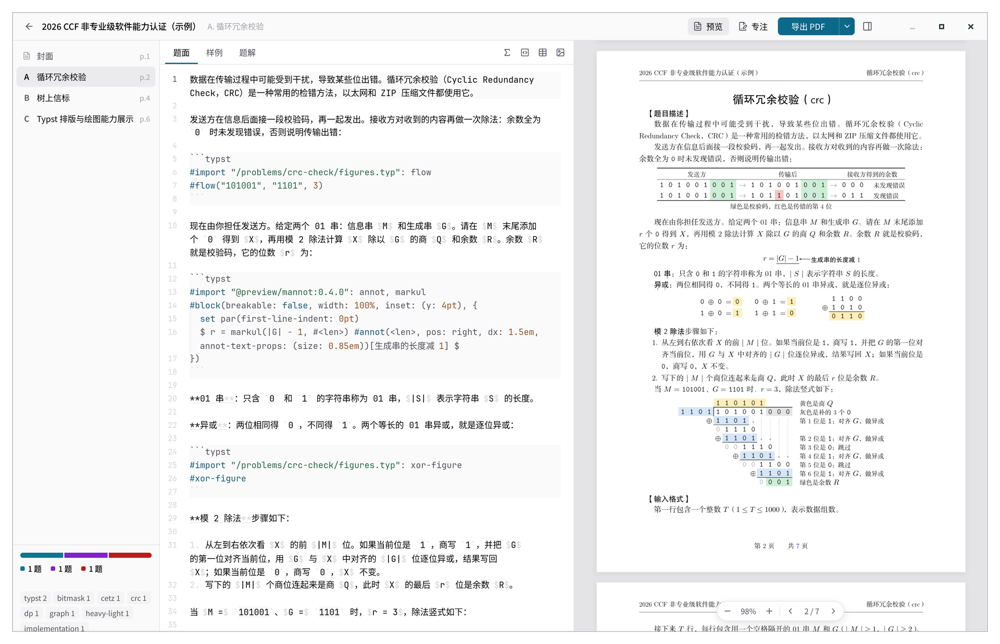
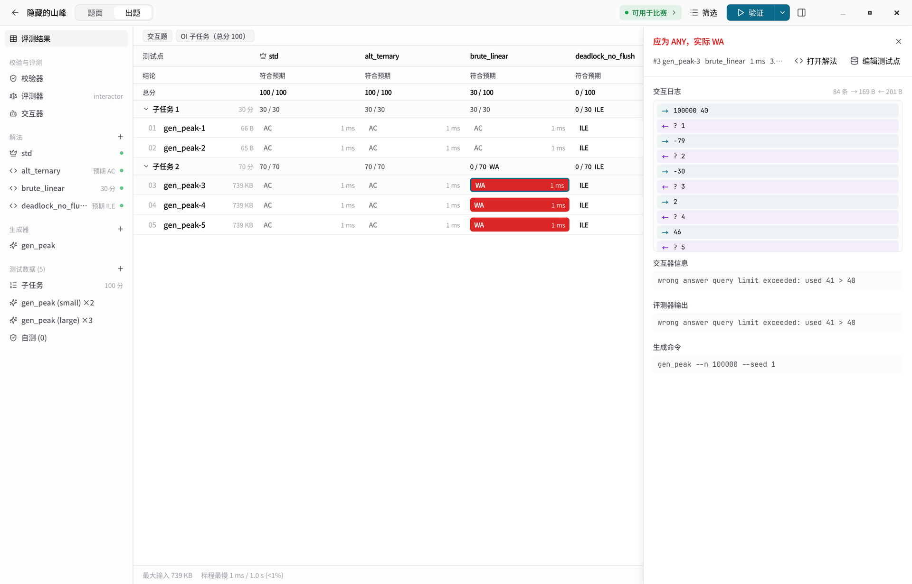
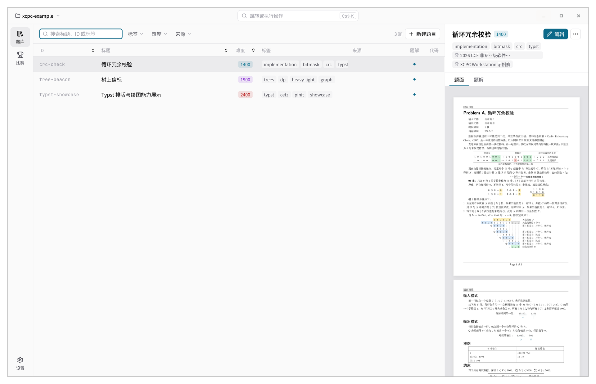
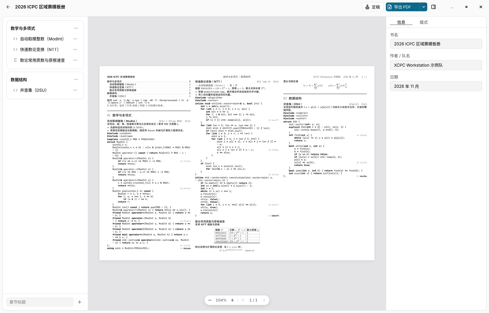
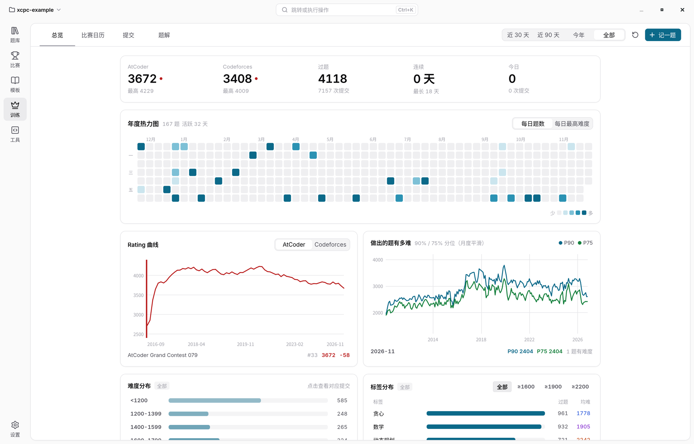
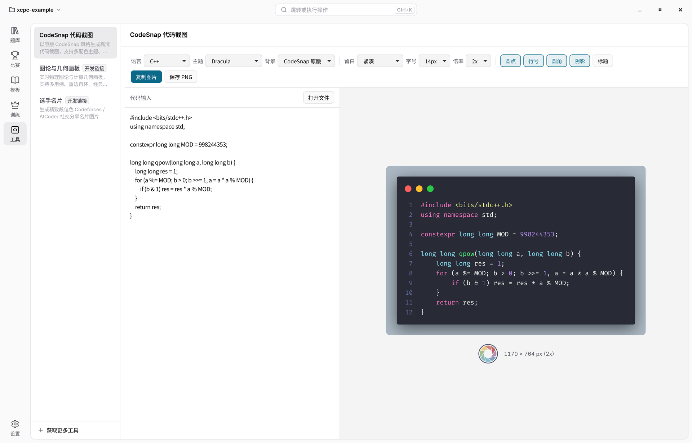

<p align="center">
  
</p>

<h1 align="center">XCPC Workstation</h1>

<p align="center">
  本地优先的 XCPC 工作站 —— 集开放目录题库、本地 Polygon 出题与严格验收、Polygon / DOMjudge / Hydro 数据包流转、活引用组卷与 Typst PDF 出版、活体板子书（Living TRD）与可验证算法库、高密度训练看板与混合沙箱插件生态于一体，原生支持 AI Agent / MCP。
</p>

<p align="center">
  <strong>简体中文</strong> · <a href="./README_EN.md">English</a>
</p>

<p align="center">
  <a href="https://lihaoze123.github.io/xcpc-workstation/"></a>
  <a href="https://github.com/lihaoze123/xcpc-workstation/releases"></a>
  <a href="./LICENSE"></a>
  
  
</p>

<p align="center">
  
</p>

---

## 核心特性

- **零 TeX 环境，毫秒级实时预览**：基于原生 [Typst](https://typst.app/) 引擎与分块增量光栅化，无需安装数 GB 的 TeX Live。内置对齐 `olymp.sty` 中文版的 `olymp-classic`、高度还原 CCF CSP/NOI 官方版式的 `cnoi-classic` 与 `minimal` 三套声明式模板，支持单题、带封面与试题列表的整本试题册、可选奇偶留白页、跨页样例表与 A4 题解册；并内置 `cetz`、`pinit`、`mannot` 等离线回退包与 `templates/preamble.typ` 自定义宏。
- **本地 Polygon（传统题 / 交互题 / 多轮通信 / OI 子任务）**：基于本机原生 `g++` / `clang++` 与内置最新版 `testlib.h`，提供编译/生成/运行三级内容哈希缓存与轻量进程监控。完整支持：
  - **传统题**：内置标准 Checker 家族（`wcmp`/`ncmp`/`fcmp`/`lcmp`/`rcmp4`/`rcmp6`/`rcmp9`/`yesno`/`nyesno`）与自定义 `checker.cpp`、`validator.cpp` 及自测、声明式 `[[test]]` 生成器与对拍（`stress`）；
  - **stdio 交互题与多轮通信题（`runs = N`）**：双管道代理录制截断双向交互日志（`→` / `←`），精准区分 CPU `TLE` 与未 flush 死锁 `ILE`，支持交互器直判或 `checker` 二段复判以及多轮累计 CPU 计时；
  - **OI 子任务与部分分（`[[subtask]]`）**：支持 `min`（捆绑）/ `sum`（按点均分）、DAG 前置依赖、`testlib.h` `quitp` 部分分比例、`validator --group <id>` 自动分组校验与部分分解得分断言；
  - **双档门禁与「动静分离」**：开发态支持局部子集调试，`--strict` 严格验收强制通过自测、全量过检与标程时限余量检查；`xcpc check`、定稿与导出仅核对验收哈希，不暗中编译跑数。
- **Polygon / DOMjudge / Hydro 生态数据包流转**：一键导入 Polygon 单题或整场比赛 ZIP（LaTeX 题面自动转 Markdown，完整导入 `interactor`、`run-count` 与 `groups` 子任务）；一键导出 DOMjudge 与 Hydro 最小集合 ZIP（自动剔除内部解法/生成器，内嵌 Typst 题面 PDF，支持交互题与 Hydro OI 子任务 `config.yaml`）。
- **大规模题库组织、活引用组卷与多人 Git 协同**：全部项目数据以纯文本 Markdown + TOML 存储在开放目录中，个人配置与 `.xcpc/` 本地缓存彻底隔离；题库中心提供持久化分组侧栏、动态视图分组、多选与批量操作（加赛 / 归组 / 批量严格验收 / 批量导出）以及 `Ctrl+K` 分组配额与 `>` 动作检索；比赛以活引用组卷，定稿后将源文件、生效模板与两本 PDF 写入 `snapshot/` 永久只读复现。
- **活体板子书（Living TRD）与可验证算法模板库**：开放目录 `snippets/` 与 `trds/` 同源管理代码、数学说明与验板脚本；自动解析 `#include` 依赖 DAG，提供一键单文件 C++ 展开器（`xcpc bundle`）、KACTL++ 逐行累计校验短哈希、三源自动验板（自测 / 题库 / Library Checker 按需缓存），以及 `trd-compact`（横向 A4 三栏紧凑风）与 `trd-book` 印刷级模板，支持可逆定稿归档。
- **高密度训练看板与多平台 OJ 同步**：内置 Codeforces / AtCoder 增量同步，运行时自动合并外部提交与本地 `training/logs.jsonl` 记录（训练状态不污染题库文件）。提供全局时间窗、双模式年度热力图、Rating 走势曲线、难度突破趋势（P75 / P90）、难度与标签下钻分布、近期比赛日历、提交检索与题解聚合。
- **混合沙箱插件生态与纯插件化「工具」Tab**：Core 层 QuickJS 沙箱运行 OJ 同步与无头计算，纯 Web `<WebView>` 沙箱承载独立 `ui.html` 交互画板（官方提供图论与几何画板、数论与位运算工作台、字符串算法调试器、复杂度与内存估算 4 款零权限工具），所有敏感权限均由 Rust Core 强制 `pending_trust` 信任门控与白名单拦截。
- **AI Agent / MCP 一等公民与官方 Skill**：桌面端、`xcpc` CLI 与 `xcpc mcp`（stdio）共用同一套 Rust Core，完整开放题库检索、题面读写、组卷、题目包检查/构建/严格验收/对拍、模板验板/板子书构建与导入导出工具（支持 `--read-only` 守卫与外部修改零闪白同步）；内置 [`xcpc-problem-creator`](./skills/xcpc-problem-creator/SKILL.md)、[`xcpc-trd-curator`](./skills/xcpc-trd-curator/SKILL.md) 与 [`xcpc-plugin-creator`](./skills/xcpc-plugin-creator/SKILL.md) 官方 Skill，可通过 `xcpc init --with-skills` 一键装入工作区。
- **为出题人打磨的写作、定制、诊断与双语界面**：内置简体中文 / English 实时热切换与双语模板参数；提供 `/` 斜杠命令菜单、编辑器内悬浮迷你公式预览、左右分栏拖拽样例管理、轻量素材库、专注写作模式、实用子集 Vim 模式、自定义 `templates/*.typ` 与全局 `theme.toml`；基于 NSH 0.7.1 与 `nsh-o11y` 提供独立开发者诊断窗口（`Ctrl+Shift+D` / `Ctrl+K`），支持实时帧率/排版/IPC 指标、跨线程 Span 瀑布图与基线对比、结构化日志与 Perfetto JSON 导出，主窗口保持零技术噪音。

<p align="center">
  
</p>

<p align="center">
  
</p>

<p align="center">
  
</p>

<p align="center">
  
</p>

<p align="center">
  
</p>

---

## 下载与安装

前往 [GitHub Releases](https://github.com/lihaoze123/xcpc-workstation/releases) 下载最新版本安装包（所有桌面包均附带 `xcpc` 命令行工具）：

| 平台 | 推荐安装包 | 说明 |
|---|---|---|
| **Windows (x86_64)** | `xcpc-workstation-*-windows-x86_64-setup.exe` | Inno Setup 每用户安装器（免管理员权限，可选将 `xcpc` 加入 PATH，支持应用内自动更新） |
| **Windows (x86_64)** | `xcpc-workstation-*-windows-x86_64.zip` | 绿色便携包（含桌面端与 `xcpc.exe`） |
| **Debian / Ubuntu** | `xcpc-workstation_*_amd64.deb` | `sudo apt install ./xcpc-workstation_*_amd64.deb` |
| **Arch Linux** | `xcpc-workstation-*-x86_64.pkg.tar.zst` | `sudo pacman -U xcpc-workstation-*-x86_64.pkg.tar.zst` |
| **Linux 通用** | `xcpc-workstation-*-linux-x86_64.AppImage` / `.tar.gz` | AppImage 赋权即可运行；`.tar.gz` 支持应用内自动更新 |
| **纯 CLI / MCP** | `xcpc-cli-*-{linux,windows}-x86_64.{tar.gz,zip}` | 仅包含无头 `xcpc` 二进制，适合服务器与 Agent 环境 |

> **Linux 运行依赖**：桌面端基于原生 GTK4 + WebKitGTK 6.0，`.deb` 与 `.pkg.tar.zst` 会自动声明依赖；使用 AppImage 或 `.tar.gz` 时请确保系统已安装 `gtk4` 与 `webkitgtk-6.0`。

---

## 快速开始

### 桌面端

1. 启动 **XCPC Workstation**。
2. 首次打开可直接点击 **「打开示例」**，一键释放内置示例工作区（含 4 个分组、12 道示例题、3 道 Typst 排版精品、4 套完整可严格验收的本地 Polygon 题目包与 2 场比赛），立即体验排版出版、本地出题构建台与整场数据包导出；或点击 **「新建工作区」** 创建自己的题库。
3. 使用 `Ctrl+K` 快速跳转题目/比赛与执行动作（输入 `>` 仅搜动作），使用 `Ctrl+/` 查看全部快捷键。

### 命令行（CLI）

```bash
# 初始化内置示例工作区（可加 --lang en 释放英文示例，或 --with-skills 安装官方出题 Skill）
xcpc init --example ./my-xcpc

# 构建整本试题册与题解册 PDF（输出至 my-xcpc/build/）
xcpc -w ./my-xcpc build contest welcome-round
xcpc -w ./my-xcpc build contest welcome-round --editorial

# 严格验收内置的 4 套本地 Polygon 示例题（传统题 / OI 部分分 / 交互+子任务 / 两轮通信）
for p in interval-sum weighted-walk hidden-peak secret-relay; do
  xcpc -w ./my-xcpc package build "$p" --strict
done

# 导出整场 oi-mock 为 Hydro / DOMjudge ZIP 数据包
xcpc -w ./my-xcpc export hydro contest oi-mock
xcpc -w ./my-xcpc export domjudge contest oi-mock

# 导入外部 Polygon 单题或整场 ZIP
xcpc -w ./my-xcpc import polygon ./contest-package.zip
```

---

## AI Agent / MCP 接入

将以下配置添加到 Claude Desktop、Cursor、Codex 或其他支持 stdio MCP 的客户端（或在桌面端 **「设置 → 工作区」** 一键复制当前工作区的配置）：

```json
{
  "mcpServers": {
    "xcpc-workstation": {
      "command": "xcpc",
      "args": ["-w", "/path/to/your/workspace", "mcp"]
    }
  }
}
```

如需限制 Agent 仅作审题与诊断而不修改工作区，可在 `args` 中追加 `"--read-only"`。配合 `xcpc init --with-skills` 安装官方出题 Skill 后，Agent 可端到端完成出题、数据生成、严格验收与对拍。

---

## 插件生态

在桌面端 **「工具」** 或 **「设置 → 插件」** 中，可一键浏览并安装官方插件仓库 [`xcpc-plugins`](https://github.com/lihaoze123/xcpc-plugins) 中的工具与扩展（亦可通过 CLI 安装或开发联调）：

```bash
# 脚手架生成插件项目、热重载链接并校验清单与打包约束
xcpc plugin init ./my-tool --template ui
xcpc plugin link ./my-tool
xcpc plugin check ./my-tool
```

- **默认安全边界**：纯 Web 交互界面运行在独立 `<WebView>` 沙箱中（无文件系统或 Node 权限），仅通过结构化 `window.xcpc` 桥与宿主通信；后台 OJ 同步与无头工具运行在 Rust Core 内置的 QuickJS 沙箱中，所有网络域名、凭据与只读工作区访问均受白名单约束。
- **核心强制信任门控**：零权限工具开箱即用；任何声明网络域名、凭据或工作区读取权限的第三方插件在首次安装或权限变更时默认处于 `pending_trust` 状态，需用户显式信任后方可执行。
- **插件开发文档**：完整的清单格式、`@xcpc-workstation/plugin-sdk` API、单文件打包流程与社区上架指南见 [`docs/plugin-development.md`](./docs/plugin-development.md)；使用 AI Agent 辅助开发插件可参考 [`skills/xcpc-plugin-creator/SKILL.md`](./skills/xcpc-plugin-creator/SKILL.md)。

---

## 中文字体说明

发行版二进制已内置 **Latin Modern**（正文、数学、等宽）与 **JetBrains Mono**（代码块），安装后即可开箱生成完整 PDF；中文字符默认自动回退到系统字体（如 Windows 宋体/黑体/楷体或 Linux 的 Noto CJK）。

如需获得与 `olymp.sty`（`ctex` `fontset=founder`）基准 **100% 一致** 的中文版式，可将方正书宋 / 黑体 / 楷体 / 仿宋字体文件放入可执行文件同级的 `fonts/` 目录，或通过环境变量 `XCPC_FONT_DIRS` 指定字体目录。

---

## 路线图与当前状态

- **Phase 1–2.5（已完成）**：开放目录题库与多人 Git 协同工作区、活引用组卷 / 定稿 / 归档、`olymp-classic` / `cnoi-classic` / `minimal` 声明式模板引擎、出版工作室、简体中文 / English 国际化、斜杠命令 / 素材库 / 悬浮公式预览 / Vim 模式 / 开放定制、CLI 与 MCP 服务。
- **Phase 3A–3D（已完成）**：本地 Polygon 全链路（原生 `g++`/`clang++` + 内置 `testlib.h`、三级内容哈希缓存、严格验收门禁、对拍、ASan/UBSan 体检、外部验题人零污染试跑与整场审计）、Polygon ZIP 导入与 DOMjudge / Hydro 最小集合 ZIP 导出、题库分组 / 批量操作、交互题 / 多轮通信题 / OI 子任务，以及官方出题 Skill。
- **Phase 4A–4D（已完成）**：混合沙箱插件引擎（Core QuickJS + 强制 `pending_trust` 信任门 + 纯 Web `<WebView>` 沙箱 `ui.html`）、Codeforces / AtCoder 训练同步与高密度训练看板（双模式热力图、Rating 曲线、难度突破趋势、比赛日历、提交检索与题解聚合）、纯净插件化「工具」Tab、`@xcpc-workstation/plugin-sdk` + Vite 单文件工具链与独立官方插件仓库 [`xcpc-plugins`](https://github.com/lihaoze123/xcpc-plugins)。
- **Phase 5A–5C（已完成，v0.5.0）**：活体板子书（Living TRD）与可验证算法模板库（`snippets/` 与 `trds/` 开放目录、依赖 DAG、单文件 C++ 展开器、KACTL++ 累计短哈希、自测/题库/Library Checker 三源验板、`trd-compact` / `trd-book` 模板、可逆定稿归档、桌面端「模板」空间及 CLI / MCP / `xcpc-trd-curator` Skill）。
- **Phase 6A–6G（已完成，v0.6.0-beta.1）**：宿主框架升级至 NSH 0.7.1 与 `nshm` 生态模块（`nsh-icon` / `nsh-o11y`）、Core 解耦（`xcpc-app`）与 `sccache` / `thin` LTO 构建加速、独立多窗口 `nsh-o11y` 开发者诊断面板（实时指标、跨线程瀑布图与基线对比、结构化日志、Perfetto 导出），以及全套设计系统与桌面端 UI 焕新（集中式设计/排版/动效 Token、内嵌 Inter & JetBrains Mono、双层悬浮面板与核心视图打磨、三档空态/加载/错误与焦点环全覆盖、物理弹簧动效与 `prefers-reduced-motion` 支持）。

完整设计规格与阶段细节见 [`docs/`](./docs/README.md)（[产品规格](./docs/product.md)、[系统架构](./docs/architecture.md)、[题面版式](./docs/statement-style.md)、[设计系统](./docs/design-system.md)、[路线图](./docs/roadmap.md)）。

---

<details>
<summary><strong>从源码构建与开发测试（Nix Flake）</strong></summary>

仓库使用 Nix Flake 锁定 Rust 工具链、NSH 0.7.1、`sccache` 与基准字体：

```bash
# 进入开发环境
nix develop

# 启动桌面端（加载示例工作区）
cd apps/desktop && XCPC_WORKSPACE=../../examples/workspace nsh dev

# 运行全量检查与回归测试
cargo fmt --all -- --check
cargo clippy --workspace --exclude xcpc-desktop --all-targets -- -D warnings
cargo test --workspace --exclude xcpc-desktop
scripts/olymp-regress.sh
cd apps/desktop && nsh check && nsh test

# 本地打包（默认关闭 UPX，如需开启可传 --upx）
scripts/package.sh --target linux
```

</details>

---

## 社区与反馈

- **QQ 用户交流群**：`1134941278`（欢迎反馈排版细节、本地出题体验、模板定制与使用建议）
- **问题与建议**：欢迎提交 [GitHub Issue](https://github.com/lihaoze123/xcpc-workstation/issues)，反馈 Bug 时可在桌面端 **「设置 → 关于 → 复制诊断信息」** 一键附带环境信息。

## 致谢与许可证

- 题面默认版式致谢 [`olymp.sty`](https://github.com/GassaFM/olymp.sty/)，预置 CNOI 模板灵感致谢 [`Wallbreaker5th/fuzzy-cnoi-statement`](https://github.com/Wallbreaker5th/fuzzy-cnoi-statement)，评测原语与标准校验器致谢 [`testlib.h`](https://github.com/MikeMirzayanov/testlib)。
- 底层能力基于 [Typst](https://typst.app/)、[NSH](https://github.com/longbridge/nsh) 与 [MiTeX](https://github.com/mitex-rs/mitex)；内置离线回退包包含 [CeTZ](https://github.com/cetz-package/cetz)（LGPL-3.0）、[oxifmt](https://github.com/PgBiel/typst-oxifmt)、[Pinit](https://github.com/OrangeX4/typst-pinit)、[Mannot](https://github.com/y-nakagami/mannot) 与 [Tiptoe](https://github.com/Mc-Zen/tiptoe)。
- 本项目采用 [Apache License 2.0](./LICENSE) 开源许可。
