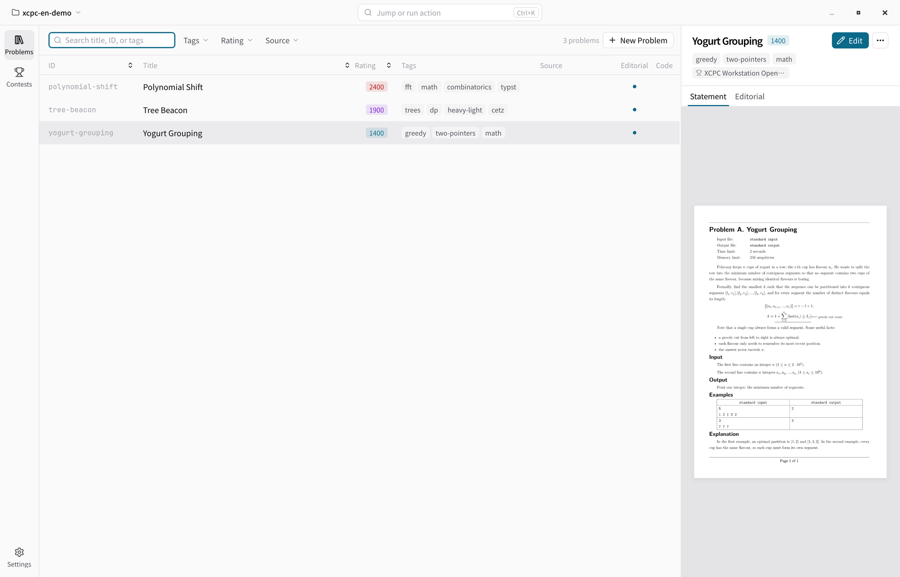

<p align="center">
  
</p>

<h1 align="center">XCPC Workstation</h1>

<p align="center">
  A local-first XCPC workstation — built on an open-directory problem library for personal libraries, multi-author Git contest collaboration, live-reference contest assembly, and PDF publishing, evolving toward local Polygon and training review.
</p>

<p align="center">
  <a href="./README.md">简体中文</a> · <strong>English</strong>
</p>

<p align="center">
  <a href="https://github.com/lihaoze123/xcpc-workstation/releases"></a>
  <a href="./LICENSE"></a>
  
  
</p>

<p align="center">
  
</p>

---

## Key Features

- **Zero TeX Installation, Millisecond Live Preview**: Powered by a native [Typst](https://typst.app/) engine with incremental tile rasterization — no multi-gigabyte TeX Live required. Ships with `olymp-classic` (aligned with `olymp.sty`), `cnoi-classic` (CCF CSP/NOI style), and `minimal` presets, supporting single problems, full contest booklets with covers and problem lists, optional odd-page starts, multi-page sample tables, and A4 editorials.
- **Full Typst Ecosystem & Programmable Typesetting**: Supports `@preview/*` (fetched on demand and sharing the system Typst cache) and `@local/*` packages, with bundled offline fallbacks for `cetz` (vector graphics), `pinit` (formula callouts), and `mannot` (formula annotations). Combine `templates/preamble.typ` macros with inline Typst blocks to draw graphs/geometry diagrams, annotate recurrences, or generate tables programmatically.
- **Open Directory, Live-Reference Contests & Multi-Author Git Workflows**: All project data (including `templates/preamble.typ` and finalized snapshots) lives as plain Markdown + TOML files in an open directory, cleanly separated from personal preferences and local `.xcpc/` cache. Maintain a personal problem library or spin up a dedicated Git repository for a multi-author contest; contests live-reference problems with metadata overrides only, and finalizing writes sources plus both PDFs into a read-only `snapshot/`.
- **AI Agent / MCP First-Class Support**: The desktop app, `xcpc` CLI, and `xcpc mcp` (stdio) share a single Rust Core. Exposes full MCP tools for search, statement editing, contest assembly, diagnostics, page rendering, and PDF export, with a `--read-only` guard and flicker-free live reload on external edits.
- **Crafted Writing, Customization & Bilingual UI**: Instant hot-switching between English and Simplified Chinese (`Settings → Appearance`) plus bilingual declarative template schemas. Includes `/` slash commands (automatically adapting inserted snippets to the publishing language), inline floating math preview, side-by-side drag-and-drop sample management, asset gallery, Focus Mode, a practical Vim subset, customizable `templates/*.typ`, and global `theme.toml` styling.

<p align="center">
  
</p>

---

## Download & Install

Download the latest `v0.2.0-beta.4` packages from [GitHub Releases](https://github.com/lihaoze123/xcpc-workstation/releases) (all desktop packages bundle the `xcpc` CLI):

| Platform | Recommended Package | Notes |
|---|---|---|
| **Windows (x86_64)** | `xcpc-workstation-*-windows-x86_64-setup.exe` | Per-user Inno Setup installer (no admin required, optional `PATH` entry for `xcpc`, in-app auto-update) |
| **Windows (x86_64)** | `xcpc-workstation-*-windows-x86_64.zip` | Portable archive (desktop app + `xcpc.exe`) |
| **Debian / Ubuntu** | `xcpc-workstation_*_amd64.deb` | `sudo apt install ./xcpc-workstation_*_amd64.deb` |
| **Arch Linux** | `xcpc-workstation-*-x86_64.pkg.tar.zst` | `sudo pacman -U xcpc-workstation-*-x86_64.pkg.tar.zst` |
| **Generic Linux** | `xcpc-workstation-*-linux-x86_64.AppImage` / `.tar.gz` | Run AppImage directly; `.tar.gz` supports in-app auto-update |
| **CLI / MCP Only** | `xcpc-cli-*-{linux,windows}-x86_64.{tar.gz,zip}` | Headless `xcpc` binary for servers, CI, and AI agent environments |

> **Linux Runtime Dependencies**: The desktop app uses native GTK4 + WebKitGTK 6.0. `.deb` and `.pkg.tar.zst` declare these automatically; for AppImage or `.tar.gz`, make sure `gtk4` and `webkitgtk-6.0` are installed.

---

## Quick Start

### Desktop App

1. Launch **XCPC Workstation**.
2. On first launch, click **Open Example** to unpack the built-in example workspace and explore Publishing Studio immediately, or click **New Workspace** to start your own library.
3. Press `Ctrl+K` to jump to any problem, contest, or action (supports both English and Chinese/pinyin keywords), and `Ctrl+/` to view all keyboard shortcuts.

### Command Line (CLI)

```bash
# Initialize a workspace with built-in example problems
xcpc init --example ./my-xcpc

# Build contest statement and editorial PDFs (outputs to my-xcpc/build/)
xcpc -w ./my-xcpc build contest welcome-round
xcpc -w ./my-xcpc build contest welcome-round --editorial

# Compile and lint checks (CI / script friendly)
xcpc -w ./my-xcpc check contest welcome-round --json
```

---

## AI Agent / MCP Integration

Add the following configuration to Claude Desktop, Cursor, Codex, or any stdio MCP client (or copy the ready-made snippet from **Settings → Workspace** in the desktop app):

```json
{
  "mcpServers": {
    "xcpc-workstation": {
      "command": "xcpc",
      "args": ["-w", "/path/to/your/workspace", "mcp"]
    }
  }
}
```

Append `"--read-only"` to `args` if you want to restrict the agent to review and diagnostics without modifying workspace files.

---

## Fonts

Release binaries bundle **Latin Modern** (body, math, monospace) and **JetBrains Mono** (code blocks), so English and math PDFs work out of the box. CJK characters automatically fall back to installed system fonts (such as SimSun/SimHei on Windows or Noto CJK on Linux).

To match the `olymp.sty` (`ctex` `fontset=founder`) Chinese typography reference identically, place the FounderType CJK font files in a `fonts/` directory next to the executable or point `XCPC_FONT_DIRS` to them.

---

## Roadmap & Current Status

Currently at **`v0.2.0-beta.4` (Public Beta)**:

- **Phase 1–2.5 (Completed)**: Open-directory problem library & multi-author Git workspaces, live-reference contest assembly / finalization / archiving, declarative `olymp-classic` / `cnoi-classic` / `minimal` template engine, Publishing Studio, English / Simplified Chinese i18n, slash commands, asset gallery, floating math preview, Vim mode, CLI, and MCP server.
- **Phase 3 (Planned)**: Local Polygon — reproducible cross-platform problem package building via Wasmtime + fuel metering, test data generation and stress testing, Polygon import.
- **Phase 4 (Planned)**: Codeforces / AtCoder / QOJ training sync, training dashboard, and upsolving queue.

Full design specifications (in Chinese) live under [`docs/`](./docs/README.md) ([Product](./docs/product.md), [Architecture](./docs/architecture.md), [Statement Style](./docs/statement-style.md), [Design System](./docs/design-system.md), [Roadmap](./docs/roadmap.md)).

---

<details>
<summary><strong>Building from Source & Development (Nix Flake)</strong></summary>

The repository uses a Nix Flake to pin the Rust toolchain, NSH 0.6.0, and reference fonts:

```bash
# Enter the development shell
nix develop

# Launch the desktop app with the example workspace
cd apps/desktop && XCPC_WORKSPACE=../../examples/workspace nsh dev

# Run full checks and regression tests
cargo fmt --all -- --check
cargo clippy --workspace --exclude xcpc-desktop --all-targets -- -D warnings
cargo test --workspace --exclude xcpc-desktop
scripts/olymp-regress.sh
cd apps/desktop && nsh check && nsh test

# Local packaging (UPX disabled by default; pass --upx to enable)
scripts/package.sh --target linux
```

</details>

---

## Community & Feedback

- **QQ User Group**: `1134941278` (feedback on typesetting, custom templates, and feature ideas welcome)
- **Issues & Feature Requests**: Open a [GitHub Issue](https://github.com/lihaoze123/xcpc-workstation/issues). When reporting a bug, use **Settings → About → Copy Diagnostics** in the desktop app to attach environment details.

## Acknowledgements & License

- Default statement layout is inspired by [`olymp.sty`](https://github.com/GassaFM/olymp.sty/), and the CNOI preset draws inspiration from [`Wallbreaker5th/fuzzy-cnoi-statement`](https://github.com/Wallbreaker5th/fuzzy-cnoi-statement).
- Built with [Typst](https://typst.app/), [NSH](https://github.com/longbridge/nsh), and [MiTeX](https://github.com/mitex-rs/mitex); bundled offline fallback packages include [CeTZ](https://github.com/cetz-package/cetz) (LGPL-3.0), [oxifmt](https://github.com/PgBiel/typst-oxifmt), [Pinit](https://github.com/OrangeX4/typst-pinit), [Mannot](https://github.com/y-nakagami/mannot), and [Tiptoe](https://github.com/Mc-Zen/tiptoe).
- Licensed under the [Apache License 2.0](./LICENSE).
