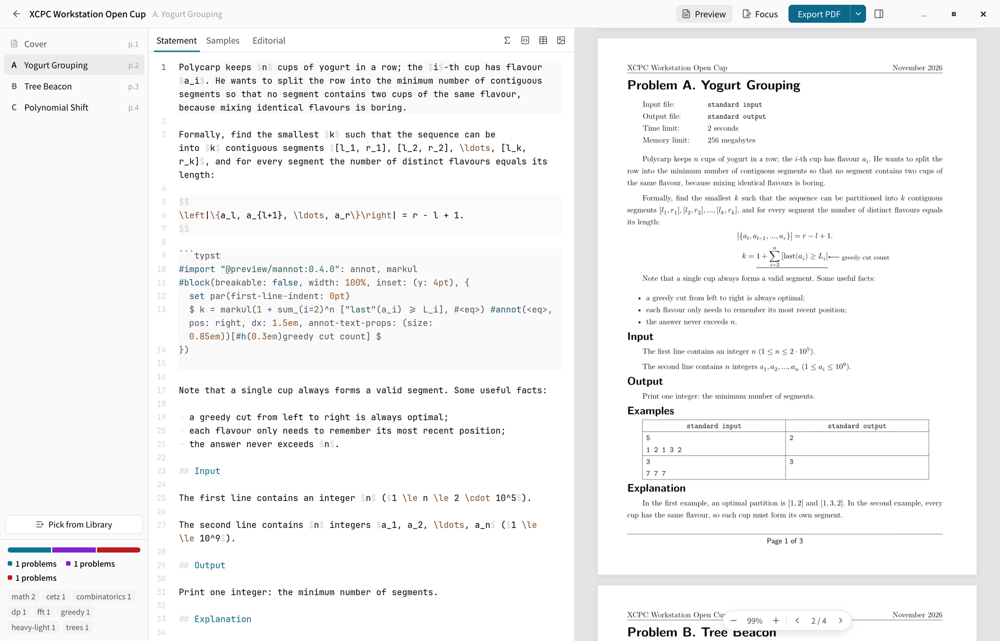
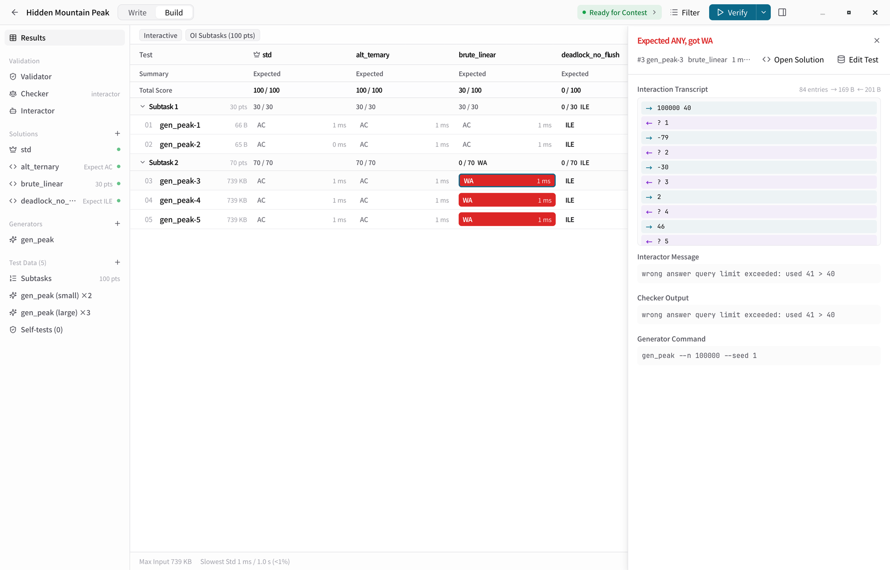
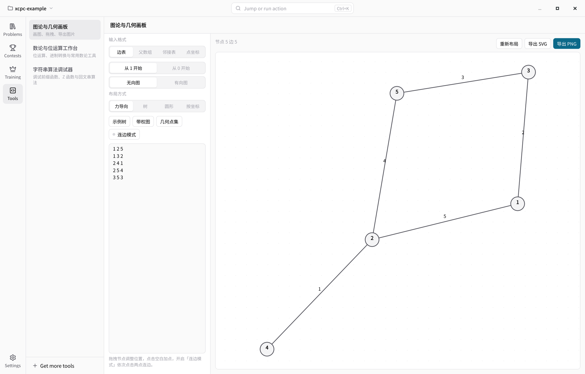

<p align="center">
  
</p>

<h1 align="center">XCPC Workstation</h1>

<p align="center">
  A local-first XCPC workstation — unifying an open-directory problem library, local Polygon package authoring & strict verification, Polygon / DOMjudge / Hydro package exchange, live-reference contest assembly, Typst PDF publishing, a high-density training dashboard, and a hybrid sandboxed plugin ecosystem, with first-class AI Agent / MCP support.
</p>

<p align="center">
  <a href="./README.md">简体中文</a> · <strong>English</strong>
</p>

<p align="center">
  <a href="https://github.com/lihaoze123/xcpc-workstation/releases"></a>
  <a href="./LICENSE"></a>
  
  
</p>

<p align="center">
  
</p>

---

## Key Features

- **Zero TeX Installation, Millisecond Live Preview**: Powered by a native [Typst](https://typst.app/) engine with incremental tile rasterization — no multi-gigabyte TeX Live required. Ships with `olymp-classic` (aligned with `olymp.sty`), `cnoi-classic` (CCF CSP/NOI style), and `minimal` declarative presets, supporting single problems, full contest booklets with covers and problem lists, optional odd-page starts, multi-page sample tables, and A4 editorials, plus bundled offline `cetz`, `pinit`, and `mannot` packages and `templates/preamble.typ` macros.
- **Local Polygon (Traditional / Interactive / Multi-Run Communication / OI Subtasks)**: Uses native `g++` / `clang++` with bundled `testlib.h`, 3-tier content-hash caching (compile / generate / run), and lightweight process monitoring:
  - **Traditional**: Built-in standard checker family (`wcmp`/`ncmp`/`fcmp`/`lcmp`/`rcmp4`/`rcmp6`/`rcmp9`/`yesno`/`nyesno`) & custom `checker.cpp`, `validator.cpp` with self-tests, declarative `[[test]]` generators, and stress testing (`stress`);
  - **stdio Interactive & Multi-Run Communication (`runs = N`)**: Dual-pipe proxy capturing bounded bidirectional transcripts (`→` / `←`), distinguishing CPU `TLE` from flush-deadlock `ILE`, supporting direct interactor verdicts or 2-stage `checker` judging and cumulative multi-run CPU limits;
  - **OI Subtasks & Partial Scoring (`[[subtask]]`)**: `min` (bundled) and `sum` scoring, DAG `depends`, `testlib.h` `quitp` partial ratios, automatic `validator --group <id>` validation, and per-solution `score` / `subtasks` expectations;
  - **Dual-Mode Gate & Static/Dynamic Separation**: Fast subset debugging in dev mode, strict `--strict` verification enforcing self-tests, full validation, and reference time margins; `xcpc check`, finalization, and export verify hashes without silently re-running test data.
- **Polygon / DOMjudge / Hydro Package Exchange**: Import single-problem or full-contest Polygon ZIPs (converting LaTeX statements to Markdown and preserving `interactor`, `run-count`, and `groups` subtasks); export minimal DOMjudge and Hydro ZIP packages (stripping internal solutions/generators, embedding Typst-compiled PDFs, with native interactive and Hydro subtask `config.yaml` support).
- **Scalable Problem Library, Live-Reference Contests & Multi-Author Git**: Plain Markdown + TOML files in an open directory cleanly separated from personal preferences and `.xcpc/` cache. Includes persistent group sidebar, dynamic view grouping, multi-select batch actions (add to contest, regroup, batch strict verify, batch export), and `Ctrl+K` with `>` action search; finalized contests archive sources, active templates, and both PDFs into a read-only `snapshot/`.
- **High-Density Training Dashboard & OJ Sync**: Built-in incremental sync for Codeforces and AtCoder, merging remote submissions with local `training/logs.jsonl` at runtime without polluting problem files. Features a global time window, dual-mode annual heatmap, rating curves, difficulty breakthrough trends (P75 / P90), drill-down rating/tag distributions, upcoming contest calendar, submission search, and editorial aggregation.
- **Hybrid Sandboxed Plugin Ecosystem & Pure Plugin Tools**: Runs OJ sync and headless utilities in a Core QuickJS sandbox while hosting rich interactive `ui.html` panels inside a pure-Web `<WebView>` sandbox (official zero-permission tools include Graph & Geometry Studio, Number Theory & Bitwise Lab, String Algorithm Debugger, and Complexity Estimator), with Core-enforced `pending_trust` gating and permission allowlists.
- **AI Agent / MCP First-Class Support & Official Problem-Creator Skill**: Desktop app, `xcpc` CLI, and `xcpc mcp` (stdio) share a single Rust Core covering search, statement editing, contest assembly, package inspection/verification/stress testing, and OJ import/export (`--read-only` guard + flicker-free reload). Install the bundled [`skills/xcpc-problem-creator/`](./skills/xcpc-problem-creator/SKILL.md) skill into any workspace via `xcpc init --with-skills`.
- **Crafted Writing, Customization & Bilingual UI**: Instant hot-switching between English and Simplified Chinese (`Settings → Appearance`), `/` slash commands, inline floating math preview, drag-and-drop sample editor, asset gallery, Focus Mode, practical Vim subset, customizable `templates/*.typ`, and global `theme.toml`.

<p align="center">
  
</p>

<p align="center">
  
</p>

<p align="center">
  
</p>

<p align="center">
  
</p>

---

## Download & Install

Download the latest release packages from [GitHub Releases](https://github.com/lihaoze123/xcpc-workstation/releases) (all desktop packages bundle the `xcpc` CLI):

| Platform | Recommended Package | Notes |
|---|---|---|
| **Windows (x86_64)** | `xcpc-workstation-*-windows-x86_64-setup.exe` | Per-user Inno Setup installer (no admin required, optional `PATH` entry for `xcpc`, in-app auto-update) |
| **Windows (x86_64)** | `xcpc-workstation-*-windows-x86_64.zip` | Portable archive (desktop app + `xcpc.exe`) |
| **Debian / Ubuntu** | `xcpc-workstation_*_amd64.deb` | `sudo apt install ./xcpc-workstation_*_amd64.deb` |
| **Arch Linux** | `xcpc-workstation-*-x86_64.pkg.tar.zst` | `sudo pacman -U xcpc-workstation-*-x86_64.pkg.tar.zst` |
| **Generic Linux** | `xcpc-workstation-*-linux-x86_64.AppImage` / `.tar.gz` | Run AppImage directly; `.tar.gz` supports in-app auto-update |
| **CLI / MCP Only** | `xcpc-cli-*-{linux,windows}-x86_64.{tar.gz,zip}` | Headless `xcpc` binary for servers, CI, and AI agent environments |

> **Linux Runtime Dependencies**: The desktop app uses native GTK4 + WebKitGTK 6.0. `.deb` and `.pkg.tar.zst` declare these automatically; for AppImage or `.tar.gz`, make sure `gtk4` and `webkitgtk-6.0` are installed.

---

## Quick Start

### Desktop App

1. Launch **XCPC Workstation**.
2. On first launch, click **Open Example** to unpack the built-in example workspace (12 problems across 4 groups, 3 Typst typesetting showcases, 4 complete `--strict`-verifiable Local Polygon packages, and 2 contests), or click **New Workspace** to start your own library.
3. Press `Ctrl+K` to jump to any problem, contest, or action (prefix with `>` to filter actions only), and `Ctrl+/` to view all keyboard shortcuts.

### Command Line (CLI)

```bash
# Initialize the built-in English example workspace (add --with-skills to install problem-creator skills)
xcpc init --example --lang en ./my-xcpc

# Build contest statement and editorial PDFs (outputs to my-xcpc/build/)
xcpc -w ./my-xcpc build contest welcome-round
xcpc -w ./my-xcpc build contest welcome-round --editorial

# Strictly verify all 4 bundled Local Polygon packages (traditional / OI quitp / interactive+subtasks / 2-run)
for p in interval-sum weighted-walk hidden-peak secret-relay; do
  xcpc -w ./my-xcpc package build "$p" --strict
done

# Export the full contest to Hydro / DOMjudge ZIP packages
xcpc -w ./my-xcpc export hydro contest minimal-round
xcpc -w ./my-xcpc export domjudge contest minimal-round

# Import an external Polygon problem or contest ZIP
xcpc -w ./my-xcpc import polygon ./contest-package.zip
```

---

## AI Agent / MCP Integration

Add the following configuration to Claude Desktop, Cursor, Codex, or any stdio MCP client (or copy the ready-made snippet from **Settings → Workspace** in the desktop app):

```json
{
  "mcpServers": {
    "xcpc-workstation": {
      "command": "xcpc",
      "args": ["-w", "/path/to/your/workspace", "mcp"]
    }
  }
}
```

Append `"--read-only"` to `args` if you want to restrict the agent to review and diagnostics without modifying workspace files. Combine with `xcpc init --with-skills` to guide agents through full problem authoring, data generation, strict verification, and stress testing.

---

## Plugins & Extensions

Browse and install official tools and extensions with one click from **Tools** or **Settings → Plugins**, powered by the official [`xcpc-plugins`](https://github.com/lihaoze123/xcpc-plugins) repository (or manage and develop plugins via CLI):

```bash
# Scaffold a plugin project, hot-link it for development, and validate manifest/bundle rules
xcpc plugin init ./my-tool --template ui
xcpc plugin link ./my-tool
xcpc plugin check ./my-tool
```

- **Sandboxed by Default**: Pure-Web UI panels run inside an isolated `<WebView>` sandbox (no filesystem or Node access) and talk to the host strictly via the structured `window.xcpc` bridge. Background OJ sync and headless tools execute inside the Rust Core QuickJS sandbox with explicit allowlists for network domains, credentials, and read-only workspace queries.
- **Core-Enforced Trust Gate**: Zero-permission tools work out of the box. Any third-party plugin declaring network domains, credentials, or `workspace_read` starts in `pending_trust` on install or permission expansion and is blocked by Rust Core until explicitly trusted.
- **Authoring Guide**: See [`docs/plugin-development.md`](./docs/plugin-development.md) for manifest specs, `@xcpc/plugin-sdk` APIs, single-file Vite bundling, and community registry submission; for AI-assisted plugin authoring, see [`skills/xcpc-plugin-creator/SKILL.md`](./skills/xcpc-plugin-creator/SKILL.md).

---

## Fonts

Release binaries bundle **Latin Modern** (body, math, monospace) and **JetBrains Mono** (code blocks), so English and math PDFs work out of the box. CJK characters automatically fall back to installed system fonts (such as SimSun/SimHei on Windows or Noto CJK on Linux).

To match the `olymp.sty` (`ctex` `fontset=founder`) Chinese typography reference identically, place the FounderType CJK font files in a `fonts/` directory next to the executable or point `XCPC_FONT_DIRS` to them.

---

## Roadmap & Current Status

- **Phase 1–2.5 (Completed)**: Open-directory problem library & multi-author Git workspaces, live-reference contest assembly / finalization / archiving, declarative `olymp-classic` / `cnoi-classic` / `minimal` template engine, Publishing Studio, English / Simplified Chinese i18n, slash commands, asset gallery, floating math preview, Vim mode, CLI, and MCP server.
- **Phase 3A–3D (Completed)**: Local Polygon end-to-end (native `g++`/`clang++` + bundled `testlib.h`, 3-tier content-hash cache, strict verification gate, stress testing, ASan/UBSan check mode, zero-pollution external verifier trial runs & contest audits), Polygon ZIP import & DOMjudge / Hydro minimal ZIP export, library groups / batch operations, stdio interactive / multi-run communication / OI subtasks, plus official problem-creator skills.
- **Phase 4A–4D (Completed)**: Hybrid sandboxed plugin engine (Core QuickJS + Core-enforced `pending_trust` + pure-Web `<WebView>` sandbox `ui.html`), Codeforces / AtCoder training sync & high-density training dashboard (dual-mode heatmap, rating curve, breakthrough trend, contest calendar, submission search & editorial aggregation), pure plugin-hosted Tools tab, `@xcpc/plugin-sdk` + Vite single-file toolchain, and official plugin repository [`xcpc-plugins`](https://github.com/lihaoze123/xcpc-plugins).

Full design specifications (in Chinese) live under [`docs/`](./docs/README.md) ([Product](./docs/product.md), [Architecture](./docs/architecture.md), [Statement Style](./docs/statement-style.md), [Design System](./docs/design-system.md), [Roadmap](./docs/roadmap.md)).

---

<details>
<summary><strong>Building from Source & Development (Nix Flake)</strong></summary>

The repository uses a Nix Flake to pin the Rust toolchain, NSH 0.6.0, and reference fonts:

```bash
# Enter the development shell
nix develop

# Launch the desktop app with the example workspace
cd apps/desktop && XCPC_WORKSPACE=../../examples/workspace nsh dev

# Run full checks and regression tests
cargo fmt --all -- --check
cargo clippy --workspace --exclude xcpc-desktop --all-targets -- -D warnings
cargo test --workspace --exclude xcpc-desktop
scripts/olymp-regress.sh
cd apps/desktop && nsh check && nsh test

# Local packaging (UPX disabled by default; pass --upx to enable)
scripts/package.sh --target linux
```

</details>

---

## Community & Feedback

- **QQ User Group**: `1134941278` (feedback on typesetting, local Polygon workflows, custom templates, and feature ideas welcome)
- **Issues & Feature Requests**: Open a [GitHub Issue](https://github.com/lihaoze123/xcpc-workstation/issues). When reporting a bug, use **Settings → About → Copy Diagnostics** in the desktop app to attach environment details.

## Acknowledgements & License

- Default statement layout is inspired by [`olymp.sty`](https://github.com/GassaFM/olymp.sty/), the CNOI preset draws inspiration from [`Wallbreaker5th/fuzzy-cnoi-statement`](https://github.com/Wallbreaker5th/fuzzy-cnoi-statement), and judging primitives & standard checkers are powered by [`testlib.h`](https://github.com/MikeMirzayanov/testlib).
- Built with [Typst](https://typst.app/), [NSH](https://github.com/longbridge/nsh), and [MiTeX](https://github.com/mitex-rs/mitex); bundled offline fallback packages include [CeTZ](https://github.com/cetz-package/cetz) (LGPL-3.0), [oxifmt](https://github.com/PgBiel/typst-oxifmt), [Pinit](https://github.com/OrangeX4/typst-pinit), [Mannot](https://github.com/y-nakagami/mannot), and [Tiptoe](https://github.com/Mc-Zen/tiptoe).
- Licensed under the [Apache License 2.0](./LICENSE).
