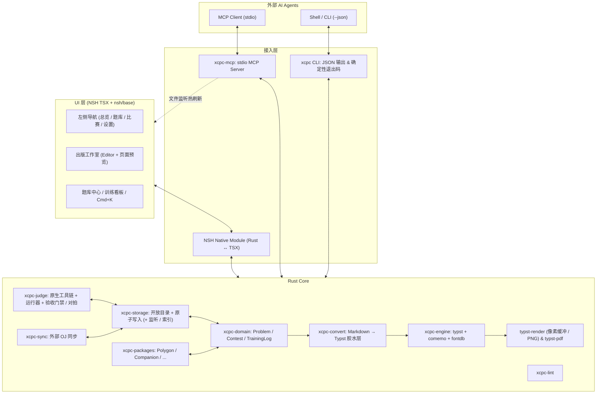
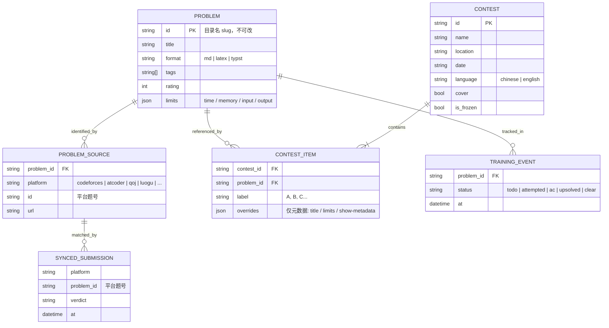
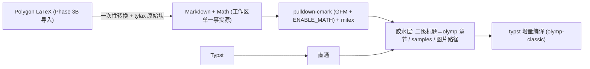

# 系统架构

## 1. 技术栈与平台

| 维度 | 选型 |
| :--- | :--- |
| 平台 | 以 Linux 为主要开发与视觉回归基线，同时提供 **Windows 原生发行版**（支持 Windows 路径规范化去 `\\?\` 前缀、静默 Job Object 评测、WebView2 沙箱与原生 `CF_DIB`+`"PNG"` 剪贴板）。macOS 暂不验收，Web 版远期待定 |
| 应用框架 | **NSH 0.7（[`nsh.dev`](https://nsh.dev/)）**：Rust Core + TSX UI，`nsh init --template mixed` |
| UI 组件 | **以 `nsh/base` 为基础**，需要时可以基于 NSH 自己写组件（如预览页面的 `PageImage`）：`Canvas`、`Editor`、`RichEditor`、`DiffView`、`DataTable`、`Command`、`SplitView`、`plot` 等。[`hero-nsh`](https://c-w-xiaohei.github.io/hero-nsh/) 只作样式参考，不作为依赖。视觉规范见 [design-system.md](./design-system.md) |
| 排版引擎 | 嵌入原生 Rust `typst`：`comemo` 增量编译（有界回收 `evict(2)`）、文档与数学引擎共享 `Arc<FontStore>` 与 `Arc<LazyHash<Library>>`、按需解码内嵌字体、`typst-render` 输出像素缓冲（预览）或 PNG、`typst-pdf` 导出 PDF；桌面端实时预览计划在 Phase 6H 通过 `xcpc-engine` 可选 `vello-preview` feature 演进为 Vello（Sparse Strips）+ `nsh-gpu` 零拷贝渲染（CLI / MCP / PDF 保持 `typst-render` / `typst-pdf` 不变，见 [specs/phase-6h-vello-preview.md](./specs/phase-6h-vello-preview.md)） |
| 题面字体 | Latin Modern（正文、数学、样例与行内等宽）、JetBrains Mono（代码块）和方正（`foundertype-ctex-fonts`），由 `flake.nix` 锁定并通过 `XCPC_FONT_DIRS` 提供；release 构建内嵌 Latin Modern 与 JetBrains Mono，Windows 未设 `XCPC_FONT_DIRS` 时定向加载核心 CJK 字体并在遇自定义字体名时透明扩展扫描系统字体，见 [statement-style.md](./statement-style.md#17-字体) |
| 格式转换 | `pulldown-cmark`（GFM + `ENABLE_MATH`）+ `mitex`；LaTeX 输入用 `tylax`；导出为 Markdown 用 `typlite`/`tylax` |
| 持久化 | 开放的、人类可读的目录（单一事实源，兼容 Git）+ SQLite 派生数据 |
| 凭据 | 系统钥匙串（`keyring`） |
| Agent 接口 | `xcpc mcp`（stdio）+ `xcpc <subcommand> --json` |
| 视觉基准 | `tectonic` 编译参考模板，生成基准 PDF |
| 题目包（Phase 3） | 本机原生 `g++` / `clang++`（自动探测，可覆写）+ 内置最新版 `testlib.h`；轻量进程监控（Linux `rlimit`/`rusage`、Windows `CREATE_NO_WINDOW` + Job Object 真实峰值内存/MLE + `-DFOR_LINUX` + CRLF→LF 归一） |

## 2. 总体结构

**同一个 Rust Core** 同时驱动 NSH 桌面 GUI、无头的 `xcpc mcp` 和 `xcpc` CLI，三者之间不重复实现任何逻辑。



## 3. Workspace 划分

```text
crates/
  xcpc-domain     # Problem、Contest（活引用 + 元数据覆写 + 冻结）、TrainingLog、状态派生规则
  xcpc-storage    # 开放目录读写、原子写入、冻结只读守卫、路径沙箱；后续加入 notify 监听和 SQLite 索引
  xcpc-convert    # Markdown + Math → Typst（pulldown-cmark + mitex）、章节识别、图片路径映射；后续加入 tylax
                  # publish 模块：读工作区 → 转换 → 编译 → 诊断映射回 Markdown，GUI / CLI / MCP 共用
  xcpc-engine     # typst World、olymp-classic 模板（内嵌）、字体加载、render/pdf
  xcpc-lint       # 题面检查与印刷前预检（Phase 2）
  xcpc-judge      # 本地 Polygon（Phase 3A）：本机原生编译器、内置 testlib.h、轻量运行器、双档门禁、build / stress、三级缓存
  xcpc-packages   # 生态数据包（Phase 3B）：Polygon ZIP 导入（单题/整场 + tylax 转换）、DOMjudge / Hydro 最小集合导出
  xcpc-plugin     # 混合沙箱插件引擎（Phase 4A）：内嵌 QuickJS、白名单 HTTP、HTML 选择器、keyring 凭据托管、oj_source / tool 扩展点
  xcpc-sync       # 外部 OJ 同步调度与看板聚合（Phase 4A/4B）：调度 oj_source 插件落盘全局 <dataDir>/oj_sync.db
  xcpc-mcp        # `xcpc` 二进制：CLI 子命令 + `xcpc mcp`
apps/
  desktop         # NSH mixed app：TSX UI + 调用 Core 的 Rust native module
tests/fixtures/
  olymp-ref/      # 参考模板生成的基准 PDF 及其源文件
```

依赖方向：`domain` ← `storage` / `convert` / `lint` / `packages` / `sync`；`convert` → `engine`，`convert` 的 `publish` 模块还依赖 `storage`；`packages` 另依赖 `storage`、`convert`、`engine`（编译 DOMjudge `problem.pdf`）与 `judge`（核对验收报告与内置 `testlib.h`）。`xcpc-mcp` 和 `apps/desktop` 只是外壳，不放业务逻辑。

## 4. 领域模型



- **训练状态是派生值**：`status(problem) = max(TRAINING_EVENT 的结果, 通过 PROBLEM_SOURCE 匹配到的 SYNCED_SUBMISSION 的结果)`。它不写入 `problem.toml`。
- **覆写只限元数据**：渲染时把 `CONTEST_ITEM.overrides` 合并到题目元数据上。题面正文不能覆写。
- **冻结**：渲染改为读取 `contests/<id>/snapshot/`，不再读题库。

## 5. 本地存储

开放目录是**单一事实源**。题库检索用 Core 的内存索引，不落盘；外部 OJ 同步数据存放在用户全局目录 `<dataDir>/oj_sync.db`（多工作区共享，删除后可重新同步）。

```text
xcpc-workspace/
├── .xcpc/                    # 纯本地派生目录，固定写入 .gitignore，绝不进 Git
├── workspace.toml            # 工作区配置：默认 template、`[template-options.<template>]`、标签词典、可选 `training = false`（不含个人 OJ 账号）
├── AGENTS.md                 # 工作区级 Agent 指南（`xcpc init` 时写入的静态文本，之后归用户）
├── templates/                # 工作区 Typst 模板（`<name>.typ`，初始化时按所选预设落盘，进 Git，全部可自由编辑）
│   └── preamble.typ          # 可选：工作区级 Typst 宏与样式注入（保留名，进 Git，不列为可选比赛模板）
├── assets/                   # 工作区级共享静态资源（如通用校徽/Logo）
├── problems/
│   └── cf-1999a/
│       ├── problem.toml      # 元数据、限制、`[[source]]`、单题级 `[template-options.<template>]`；不含训练状态
│       ├── statement.md      # 或 statement.zh.md / statement.en.md
│       ├── editorial.md
│       ├── samples/          # 01.in, 01.ans, ...
│       ├── assets/
│       ├── checker.cpp, validator.cpp, interactor.cpp   # 题目包（Phase 3），均可选
│       ├── generators/
│       ├── solutions/
│       └── tests/            # 手写测试；生成的数据在 build/problems/<slug>/
├── contests/
│   └── icpc-2026-regional/
│       ├── contest.toml      # 元信息、题目引用、元数据/单题版式覆写、`template` 与 `[template-options.<template>]`
│       ├── template.typ      # 可选：单场比赛专属模板（存在即优先于 `contest.toml` 的 `template`）
│       ├── assets/           # 比赛专属配图/封面徽标
│       └── snapshot/         # 仅在冻结后存在：每题源文件副本 + 生效 `template.typ`/preamble/合并参数 + 当时的两本 PDF（进 Git）
└── training/
    └── logs.jsonl            # 追加写入的极简状态事件（进 Git，仅记状态变更）
```

- 工作区的根目录以 `workspace.toml` 为标志（Phase 1 可以是空文件）。`xcpc` 依次用 `--workspace`、`XCPC_WORKSPACE`、当前目录向上查找来确定工作区，桌面端用后两者。
- **个人数据与项目数据解耦**：外观主题（用户全局 `<dataDir>/theme.toml`，不设工作区级 `.xcpc/theme.toml`）、编辑器与界面偏好、OJ 账号、全局同步缓存（`<dataDir>/oj_sync.db`）及系统钥匙串凭据均属于用户个人配置，不写入任何工作区；工作区内的 `.xcpc/` 始终是纯本地派生目录，由 `init_workspace` 固定写入 `.gitignore`，绝不提交到 Git；影响编译结果的公共宏放在 `templates/preamble.typ` 随工作区纳入 Git。
- 导出的 PDF 默认写到工作区的 `build/`（派生物，建议加入 `.gitignore`）：Phase 1–2 默认为 `build/<id>.pdf` / `build/<id>-editorial.pdf`；**Phase 2.5 起**在 Core（`crates/xcpc-convert/src/publish.rs`）统一改为按标题命名（如 `build/春季训练赛-试题册.pdf` / `build/春季训练赛-题解.pdf`，自动替换路径非法字符），GUI、CLI 与 MCP 保持一致；CLI 的 `-o` / `--output` 与 MCP 的 `output` 参数仍可覆盖输出路径。
- **内置示例工作区（Phase 2.5）**：示例工作区静态资源打包进二进制，由 Core 提供「释放到指定目录」接口，供 CLI `xcpc init --example` 与 GUI「打开示例」共用。
- **Phase 1** 直接扫描目录。**Phase 2** 起 Core 维护内存索引（元数据 + 题面/题解的规范化纯文本）：桌面端启动时扫描一遍，之后由 `notify` 增量更新（同时监听 `workspace.toml`、`templates/*.typ`（含 `templates/preamble.typ`）与 `contests/*/template.typ`，外部编辑器保存后立即热刷新预览与模板 schema）；CLI 和 MCP 每次启动现扫。不引入 SQLite / FTS5，也不做 JSON Schema。
- **TOML 写回**：一律用 `toml_edit` 做局部修改，保留注释、顺序和未知字段；读取仍用 `serde`。GUI 和 CLI 通过 Core 的语义操作写入（增删题、移动、设置/删除覆写、比赛元数据、冻结）。
- **并发写入**：Core 记录每个打开文件上次读写时的内容哈希，保存前比对，磁盘已变则返回 `conflict`，不静默覆盖；自己写入引起的 `notify` 事件靠哈希过滤。

## 6. 格式转换管线

**不手写 Markdown / LaTeX / Typst 解析器。**



- 胶水层负责三件事：按二级标题识别章节（规则见 [product.md](./product.md#21-题面结构)）、从 `samples/` 生成样例表、把图片路径映射到题目的 `assets/`。
- **Polygon LaTeX 导入（Phase 3B）**：在 `xcpc-packages` 导入 Polygon ZIP 时，将 `statement-sections/<lang>/*.tex`（回退 `statements/<lang>/problem.tex`）**一次性转换**为 `statement(.zh/.en).md`（保留原生 `$LaTeX$` 数学公式，将复杂 LaTeX 环境经 `tylax` 转为 ```` ```typst ```` 原始块，并将配图拷贝至 `assets/`），保持 `.md` 为工作区唯一题面事实源。
- **模板 Schema 与单入口渲染**：所有生效模板均为磁盘上的 `.typ` 文件（`contests/<id>/template.typ` 优先于 `templates/<name>.typ`；预设 `olymp-classic` / `cnoi-classic` / `minimal` 仅作初始化与添加模板的种子，不做内置回退）。`xcpc-engine` 对模板轻量求值导出 `#let schema`（规范见 [statement-style.md §2.3](./statement-style.md#23-模板声明式-schemalet-schema)）。转换管线按「模板默认 → `workspace.toml` → `contest.toml` → `problem.toml` / `[[problem]]`」合并参数，生成单入口 `#render(doc)` 调用，并为模板未导出的 `section` / `samples` / `subsection` / `runin` 自动回退到 `/xcpc/defaults.typ`。
- 数学定界符：LaTeX 里的普通括号（`(`、`[`、`\lceil` 等）不会缩放，转换成 Typst 时要写成转义或符号形式（`\(`、`\[`、`#sym.ceil.l`），避免 Typst 自动配对放大；只有 `\left…\right` 才转换成 `lr()`。
- **OJ 数据包导出（Phase 3B）**：导出 DOMjudge 与 Hydro 包时均由 `xcpc-engine` 直接编译单题 `problem.pdf`；DOMjudge 置于包根目录，Hydro 置于 `additional_file/problem.pdf` 并在 `problem_zh.md` / `problem_en.md` 中以 `@[pdf](file://problem.pdf?noDisposition=1)` 嵌入展示。后续导出 QOJ 等格式时按需使用 `typlite` / `tylax`。
- **PDF 元数据与书签（Phase 2.5）**：导出 PDF 时由 Core 统一写入文档元数据，并复用 `olymp-classic.typ` 中已有的书签（`bookmarked: true`）：
  - `Title`：`春季训练赛 试题册` / `春季训练赛 题解` / `A. Two Sum`（按比赛试题册、比赛题解或单题标题生成）；
  - `Author`：比赛的作者字段，没有就不写；
  - `Creator`：`XCPC Workstation <版本>`；
  - `Producer`：保留 Typst 默认值。

## 7. Agent / MCP / CLI

### 7.1 运行方式

- `xcpc mcp`：stdio MCP 服务，不需要启动 GUI。
- `xcpc <subcommand> --json`：输出结构化结果，退出码确定。
- 桌面端打开同一工作区时，Agent 的写入通过 `notify` 文件监听让 GUI 刷新（Phase 2），不做本地 IPC。

### 7.2 MCP Tools

| 分组 | Tools | 阶段 |
| :--- | :--- | :--- |
| 出版与视觉自检 | `compile_and_diagnose`（结构化诊断：错误位置、总页数、溢出警告；Phase 2 起并入 lint 结果）、`render_page_png`、`export_pdf`（单题 / 整本 / 题解册）、`list_templates`（列出内置与自定义模板及其 schema） | Phase 1 / 2.5 |
| 题库与组卷 | `search_problems`、`get_problem`、`get_contest`、`write_problem`、`compose_contest`、`set_override`（支持单题级模板参数覆写）、`set_template_options`（更新工作区/比赛/单题的模板选择与参数）、`freeze_contest` | Phase 2 / 2.5 |
| 题目包 | `inspect_package`、`inspect_test_case`（只读，`--read-only` 可用）、`init_package`、`build_package`（`verify`/`debug` 双模式、结构化报告与门禁）、`stress_package`（有界对拍与反例摘要）；后三者在 `--read-only` 下不可用 | Phase 3A |
| 生态数据包 | `import_polygon`（导入 Polygon 单题/整场 ZIP，受 `--read-only` 限制）、`export_oj_package`（导出 DOMjudge / Hydro 最小集合 ZIP，写入工作区 `build/`，受 `--read-only` 限制） | Phase 3B |
| 训练 | `get_training_dashboard`（只读）、`set_training_status`、`ingest_problem`（后两者 `--read-only` 禁用） | Phase 4B |

**MCP 没有解冻工具**，解冻只能由人在 GUI 或 CLI 中完成。

Phase 2 的工具：

- `search_problems`：可选的文本、标签、rating 区间、来源平台；返回元数据列表（ID、标题、rating、标签、来源、有无题解），不含正文。
- `get_problem`：解析后的元数据、`statement*.md` / `editorial.md` 原文及其内容哈希、样例文件列表。
- `get_contest`：不传 `id` 时列出所有比赛；传 `id` 时返回元数据、题目列表（label、ID、覆写、每题起止页）和是否冻结。
- `write_problem`：`id`、`files: {相对路径: 内容}`、可选的 `expected_hash`。题目不存在就创建，存在就逐个原子写入；路径只能是题目目录内的 `problem.toml`、`statement*.md`、`editorial.md`、`samples/*`、`solutions/*`、`generators/*`、`tests/*`、`checker.cpp`、`validator.cpp`、`interactor.cpp`。`problem.toml` 给的是全文，Core 只校验能否解析。
- `compose_contest`：`id`、有序的题目 ID 列表、可选的比赛元数据。比赛不存在就创建；保留下来的题保留覆写，移除的题连同覆写删除，题号由 Core 重排。
- `set_override`：`contest`、`label`、`fields`（`title` / `limits` / `show-metadata` / `options`，`null` 表示删除该覆写）。
- `list_templates`：列出工作区 `templates/*.typ` 的全部模板及其解析后的 `schema`，以及可供安装的预设种子列表（`olymp-classic`、`cnoi-classic`、`minimal`）。
- `set_template_options`：按 `scope`（`workspace` / `contest` / `problem`）切换 `template` 或更新指定模板命名空间下的参数键值（`null` 表示删除覆写、恢复继承；遵循冻结与只读守卫）。
- `freeze_contest`：冻结规则见 [product.md](./product.md#3-比赛contest)。

对应的 CLI：`xcpc search`、`xcpc show`、`xcpc template list|schema|add|fork`、`xcpc contest compose|override|freeze|unfreeze`、`xcpc init [dir]`（Phase 2.5 起支持 `--example` 释放内置示例工作区）；lint 并入 `xcpc check`，不单设命令。

Phase 3B 的两个生态数据包工具：

- `import_polygon`：参数为本地绝对 `.zip` 路径与可选目标 `id`。自动识别单题（`problem.xml`）与整场（`contest.xml`，展开全部子题并生成 `contest.toml`），一次性转换题面为 `.md` 并全量导入题目包；slug 冲突拒绝，遇交互题 / 非 C++ / 子任务保留文件并返回结构化 `warnings`；受 `--read-only` 限制。
- `export_oj_package`：参数 `format`（`domjudge` / `hydro`）、`target`（`problem` / `contest`）、`id` 及可选输出路径（限制在工作区 `build/` 内）。遵循「动静分离」严格门禁，仅打包已验证且内容哈希未过期的 `build/problems/<slug>/` 数据与最小集合文件（不暗中编译跑数）；受 `--read-only` 与路径沙箱限制。

对应 Phase 3B CLI：`xcpc import polygon <zip> [--id <slug>] [--json]`、`xcpc export <domjudge|hydro> <problem|contest> <id> [-o <path>] [--force] [--json]`（`--force` 仅跳过 `verified` 门禁，仍要求已构建测试数据）。

Phase 1 的三个工具参数相同：`target`（`problem` / `contest`）、`id`、可选的 `book`（`statements` / `editorial`）和 `language`（只对单题有效）。`render_page_png` 另有 `page`（从 1 开始）和 `scale`，直接返回图片、不写文件；`export_pdf` 另有 `output`（相对工作区的路径，未指定时走 Core 默认路径，Phase 2.5 起按标题命名，见 §5）。诊断的位置指向工作区里的源文件（`problems/a/statement.md` 的行列），溢出版心的内容是带页码的警告。CLI 对应 `xcpc check|render|build <problem|contest> <id> [--editorial]`，退出码 0 成功、1 文档有错误、2 用法或工作区错误；`--json` 输出同样的结构。

### 7.3 安全边界（在 Core 层强制执行）

- **原子写入**：先写临时文件，再 rename 替换。
- **冻结只读**：`is_frozen = true` 的比赛及其快照禁止一切写入，写操作返回明确的错误码。解冻只开放给 GUI 和 CLI（需二次确认），不开放给 MCP。
- **只读模式**：`xcpc mcp --read-only`。
- **路径沙箱**：所有文件访问限制在工作区内，防止路径穿越；跨平台统一通过 `xcpc-storage` 的 `canonicalize_clean` 剥离 Windows `\\?\` verbatim 前缀，确保相对路径校验与工作区边界判定在 Windows 与 Linux 行为一致。**唯一明确例外**：`import_polygon` 允许只读打开任意本地绝对 `.zip` 路径（强制校验 `.zip` 扩展名并对压缩包内全部条目实施 Zip Slip 路径穿越防护与原子暂存），所有写入操作仍严格限制在工作区目录内。

### 7.4 错误文案集中化（Phase 2.5）

- 人类可读的中文错误文案集中维护在 Core 层，供桌面 GUI 与 CLI 文本输出共用，统一按三段式组织（人话说明现象 → 可点击/可定位的位置 → 仅在有明确下一步时给出操作建议；规则拒绝如冻结只读不当错误处理，详规范见 [design-system.md §7](./design-system.md#7-文案克制规范)）。
- 默认人类可读主文案不暴露底层错误码与英文技术原文（GUI 收入「复制详情」）；CLI `--json` 与 MCP 响应继续保留完整的结构化错误码与细节字段。

### 7.5 可观测性与分层采集（Phase 6B）

- **核心底座**：`crates/xcpc-trace`（Rust 侧零开销 Span + 内存环形缓冲 + Chrome Trace / Perfetto JSON 合并导出）、`crates/xcpc-app`（增量拉取 `o11y_poll_delta` 与 `PixelCache` 命中率统计）与桌面端 `apps/desktop/src/ui/o11y/`（基于 `nsh-o11y` 的独立多窗口诊断面板）。
- **常态轻量层（Always-On Ring）**：始终开启，不启 `rAF` 轮询、不写磁盘。Rust 侧与 JS 侧各自在固定容量内存环（日志 `5,000` 条、慢事件 `1,000` 条）中记录结构化日志与慢操作/错误事件（编译/光栅化/IPC `> 50ms` 或异常），供打开诊断窗口后即时回溯。
- **激活全量层（Live Diagnostics）**：仅在独立诊断窗口打开，或启动设置 `XCPC_TRACE=1` / `XCPC_O11Y=1` 时激活。以 `1000ms` 节拍增量拉取 Rust Span、日志与像素缓存指标，合并 JS 帧间隔（过滤 `> 120ms` 空闲间隙）与交互 INP，驱动 `TimeSeriesChart`（4 面板联动）、`TraceWaterfall` / `TraceComparison` 与 `LogView`；窗口关闭后立即停掉定时器与 `rAF` 退回常态层。

### 7.6 内存预算与空闲回收策略

- **共享与按需加载**：`xcpc-engine` 在主排版引擎与数学公式引擎之间共享单一 `Arc<FontStore>` 与 `Arc<LazyHash<Library>>`，内嵌字体按需延迟解码；每次排版后执行 `comemo::evict(2)` 限制增量缓存代际膨胀。
- **像素缓存与光栅化池**：`xcpc-app` 将 `PixelCache` 预算控制在 `48 MiB`，切换目标文档时立即驱逐旧文档瓦片与 `comemo` 缓存，并复用常驻 `RasterPool` 避免重复建池开销。
- **分层空闲回收（`reclaim_memory`）**：
  - 离开工作室 `4s` 后回收像素缓存、AST 缓存与 `comemo`，并在 Windows 上执行 `HeapCompact` 与空闲工作集修剪（活跃工作室中不触发工作集修剪，避免缺页抖动）；
  - 离开非工作室预览 `6s` 后回收 AST 缓存；关闭诊断窗口 `300ms` 后回收诊断相关瞬态内存；
  - 离开「工具」空间 `15s` 后自动卸载空闲的插件 `<WebView>` 实例（状态通过 `xcpc.storage` 持久化），释放 WebView2 / WebKitGTK 子进程内存。
