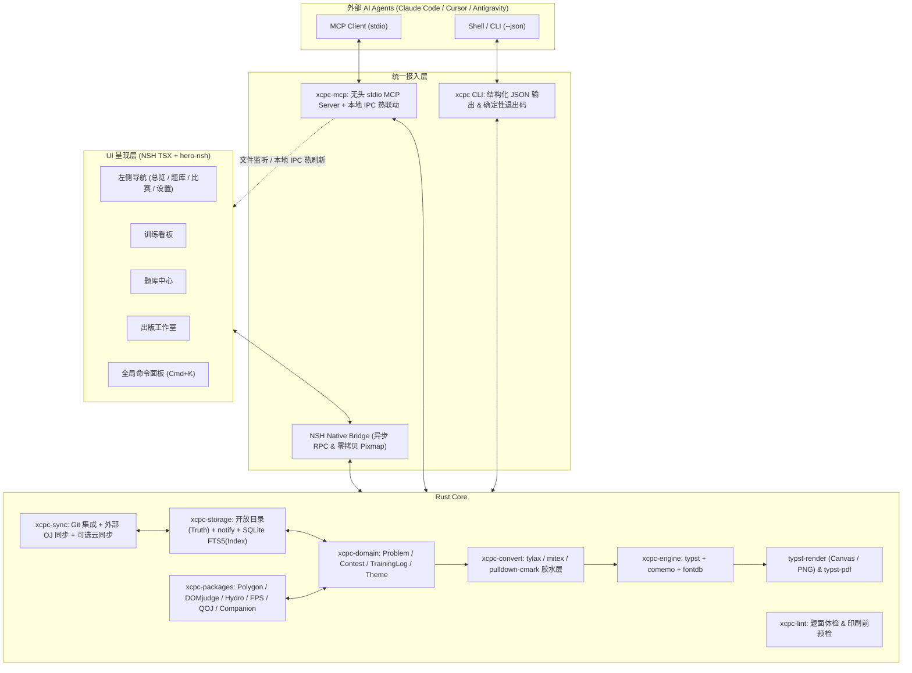
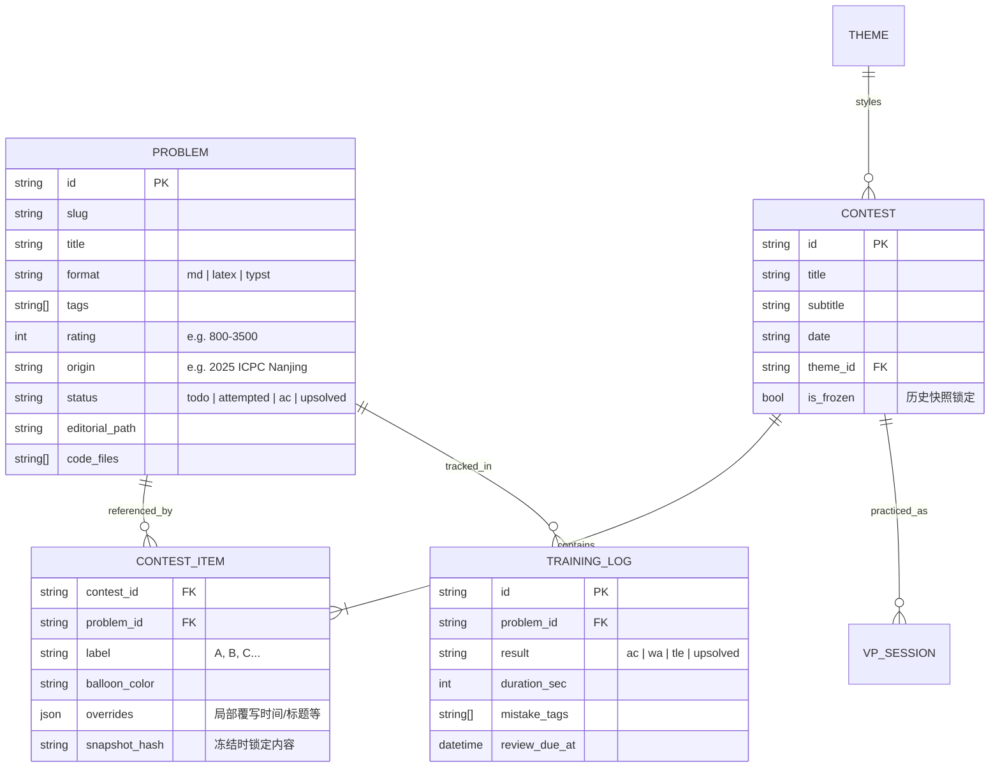
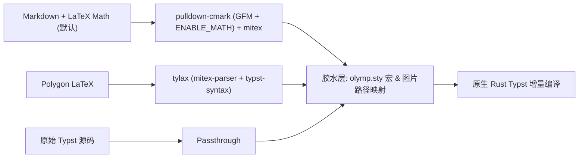

# 系统架构

## 1. 技术栈

| 维度 | 选型 |
| :--- | :--- |
| 应用框架 | **NSH（[`nsh.dev`](https://nsh.dev/)）**：Rust Core + TSX UI；以桌面端（macOS / Windows / Linux）为主，同时兼容 NSH Web 构建 |
| UI 组件与视觉 | `nsh/base` + [`hero-nsh`](https://c-w-xiaohei.github.io/hero-nsh/) 风格的组件层，见 [design-system.md](./design-system.md) |
| 排版引擎 | 嵌入原生 Rust `typst`：`comemo` 增量编译、`fontdb` 读取系统字体、`typst-render` 输出到 NSH Canvas 或 Agent 用的 PNG、`typst-pdf` 导出 PDF |
| 格式转换 | `pulldown-cmark`（GFM + `ENABLE_MATH`）、`mitex`、`tylax`、`typlite`，只写一层很薄的胶水代码 |
| 持久化 | 开放的、人类可读的目录（单一事实源，兼容 Git）+ SQLite FTS5 派生索引 |
| 凭据 | 系统钥匙串（`keyring`） |
| Agent 接口 | `xcpc mcp`（stdio MCP Server）+ `xcpc <subcommand> --json` |
| 远期沙箱 | `wasmtime`（WASI/WASM，Phase 5） |

## 2. 总体结构

计算密集和持久化相关的模块全部放在 Rust 原生层。**同一个 Rust Core** 同时驱动 NSH 桌面 GUI、无头的 `xcpc mcp` 和 `xcpc` CLI，三者之间不重复实现任何逻辑。



## 3. Workspace 划分

```text
crates/
  xcpc-domain     # Problem、Contest（活引用 + overrides + 快照）、TrainingLog、Theme tokens
  xcpc-storage    # 开放目录 FS、notify 监听、SQLite FTS5 索引、原子写入
  xcpc-convert    # pulldown-cmark + mitex + tylax 的胶水层（olymp.sty / Polygon 宏、图片路径映射）
  xcpc-engine     # typst World、comemo 增量编译、fontdb、typst-render、typst-pdf
  xcpc-lint       # 题面静态检查 & 印刷前预检
  xcpc-packages   # Polygon、Competitive Companion(:10043)、DOMjudge、Hydro、FPS、QOJ
  xcpc-sync       # 外部 OJ 同步（6 平台）、Git 集成、可选云同步
  xcpc-mcp        # `xcpc mcp`（stdio）+ `xcpc <subcommand> --json`
apps/
  desktop         # NSH Rust 宿主 + TSX UI（hero-nsh 风格）
```

依赖方向：`domain` ← `storage` / `convert` / `lint` / `packages` / `sync`；`convert` → `engine`；`mcp` 和 `apps/desktop` 只是 Core 的外壳，不放业务逻辑。

## 4. 领域模型



- **活引用**：`CONTEST_ITEM` 只引用 `problem_id`，渲染时再合并 `overrides`。比赛冻结后，内容来自 `snapshot/`，并用 `snapshot_hash` 锁定。
- `problem.toml` 预留了 Phase 5 的声明式字段（`subtasks` / `generators` / `validators` / `checkers` / `solutions`），当前阶段只做解析时的兼容，不实现对应功能。

## 5. 双层本地存储

**开放目录是精选题库和比赛的单一事实源**。SQLite 只承担派生出来的全文索引，以及海量的跨平台同步记录。

```text
xcpc-workspace/
├── .xcpc/
│   ├── index.db              # 精选题库与比赛的 SQLite + FTS5 派生索引（可重建，.gitignore 忽略）
│   └── oj_sync.db            # 多平台同步明细、参赛记录、Rating 历史与赛程缓存（不进 Git）
├── workspace.toml            # 工作区配置、标签词典、默认主题、外部 OJ 账号（凭据存 OS Keychain）
├── AGENTS.md                 # 新建工作区时自动生成，供 Agent 直接读写文件时参考
├── themes/
│   └── custom-icpc.toml      # 用户自定义主题 Token 与可选 Typst 插槽
├── problems/                 # 精选题库
│   └── p-2026-two-sum/
│       ├── problem.toml      # 元数据、标签、难度、来源、限制、训练状态
│       ├── statement.md      # 题面（或 statement.zh.md / statement.en.md；也支持 .tex / .typ）
│       ├── editorial.md      # 题解与笔记
│       ├── samples/          # 01.in, 01.ans, 02.in, 02.ans ...
│       ├── assets/           # 本题配图
│       └── code/             # std.cpp, ac_202605.cpp ...
├── sheets/
│   └── dp-advanced.toml      # 专题题单（引用本地题目或外部 OJ 题号）
├── templates/
│   └── ds/segtree.cpp        # 代码模板库（可出版为 TRD）
├── contests/
│   └── icpc-2026-regional/
│       ├── contest.toml      # 比赛元数据、题目引用列表、覆写、封面/题表开关
│       ├── theme.toml        # 本场覆盖的主题 Token
│       ├── assets/           # 赛事 Logo、赞助商页脚、封面图
│       └── snapshot/         # （仅冻结后生成）不可变历史快照
└── training/
    └── logs.jsonl            # 追加式训练与 VP 记录（方便 Git 合并）
```

- **文件监听**：用户在外部编辑器（VS Code / Neovim）里修改题面、题解或代码，或者执行 `git pull` 之后，后台用 Rust `notify` 增量刷新 `.xcpc/index.db`，前端视图和预览随之同步。
- **Schema**：新建工作区时，会为 `problem.toml`、`contest.toml`、`theme.toml` 生成 JSON Schema，并自动附带 `AGENTS.md`。这样即使 Agent 绕开 MCP 直接读写文件，也能写出合规的内容。
- **Web 端**：NSH Web 目标用 **OPFS + IndexedDB** 映射相同的目录结构，支持以 `.zip` 导入导出整个工作区或单场比赛包。

## 6. 格式转换管线

**不手写 Markdown / LaTeX / Typst 解析器**，直接原生链接成熟的 Rust crate：



- **LaTeX → Typst**：使用 `tylax`（支持文档结构、数学公式、复杂表格、`\newcommand` 宏展开，以及 TikZ → CeTZ）和 `mitex`。
- **Markdown + Math → Typst**：使用 `pulldown-cmark`（或 `md2typ`）和 `mitex`。
- **Typst → Markdown**（导出到 Hydro / QOJ 等 OJ 时）：使用 `typlite` / `tylax`。
- 胶水层**只**处理 `olymp.sty` / Polygon 特有的语义（`\epigraph`、`\illustration`、图片路径映射等）。

## 7. Agent / MCP / CLI

### 7.1 两种运行方式与热联动

- **无头运行**：`xcpc mcp` 是标准的 stdio MCP 服务，不需要启动 GUI 就能被 Claude Code、Cursor、Antigravity 等客户端调用。同样的能力也可以通过 `xcpc <subcommand> --json` 调用，退出码是确定的。
- **桌面端热联动**：桌面端打开同一个工作区时，Agent 通过 MCP 写入的改动会经由 `notify` 文件监听，以及可选的本地 IPC（Unix Socket / Named Pipe）即时通知 GUI，刷新题库列表、Dashboard 统计或当前的预览画布。
- **接入体验**：「设置 → MCP 集成」里可以一键复制或自动安装 MCP 配置，适配常见客户端的配置文件格式。

### 7.2 MCP Tools

| 分组 | Tools | 用途 |
| :--- | :--- | :--- |
| 题库与组卷 | `search_problems`（FTS5 全文检索 + 标签/难度/状态筛选）、`get_problem` / `upsert_problem`、`list_contests` / `get_contest`、`compose_contest` / `update_contest_item` | 按难度曲线组卷、批量校对或翻译题面、补充样例与题解 |
| 视觉自检与出版 | `lint_problem` / `lint_contest`、`compile_and_diagnose`（结构化 JSON 诊断：公式报错行号、总页数、溢出与断页警告）、`render_page_png`（把指定页渲染为 PNG 返回）、`export_pdf`（整本 / 单题 / 题解册） | 多模态 Agent 改完题面后可以跑 lint、编译，再「看图」检查渲染效果，自己修正公式超宽、符号不规范、样例跨页错位、图片清晰度不足等问题 |
| 训练与复盘 | `get_training_dashboard`、`log_training_record`、`generate_upsolve_plan` | 结合本地真实训练数据，制定补题和 VP 复盘计划 |

此外：TRD 出版复用 `compile_and_diagnose` / `render_page_png`；双语一致性校验会比对中英文题面里的变量、数据范围和边界条件。

### 7.3 安全边界（在 Core 层强制执行）

- **原子写入**：所有写操作都先写临时文件，再 atomic rename 替换，杜绝写出半截的损坏文件。重要修改会自动留存一个轻量的本地回滚点，同时也天然纳入工作区的 Git Diff。
- **冻结快照只读**：`is_frozen = true` 的比赛在 Rust Core 层强制只读，任何写入（包括 MCP 的写操作）都返回明确的错误码。
- **只读模式**：`xcpc mcp --read-only`。
- **路径沙箱**：所有文件访问都限制在当前工作区目录内，防止路径穿越。
