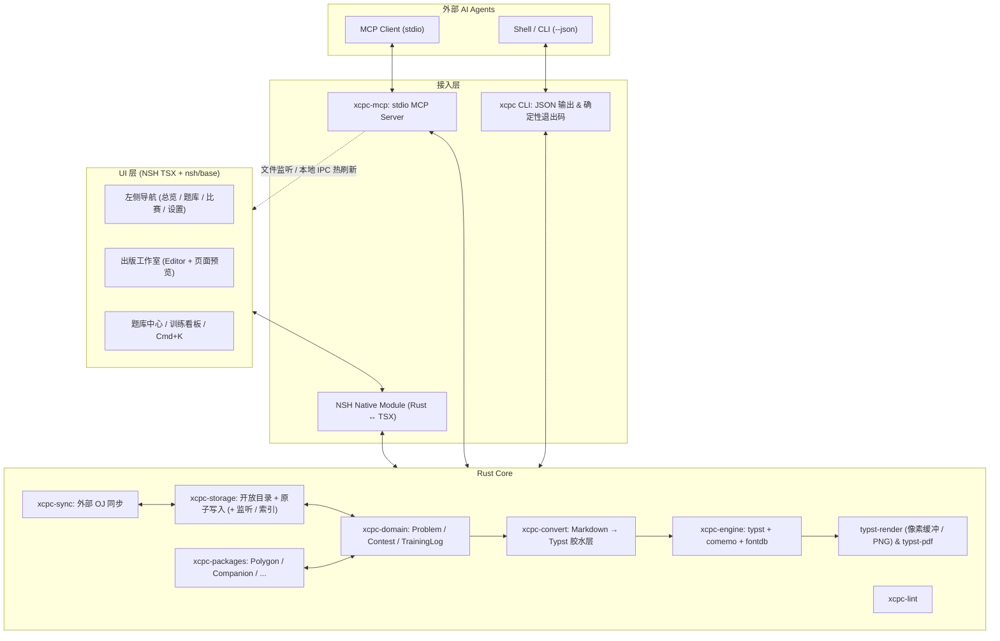
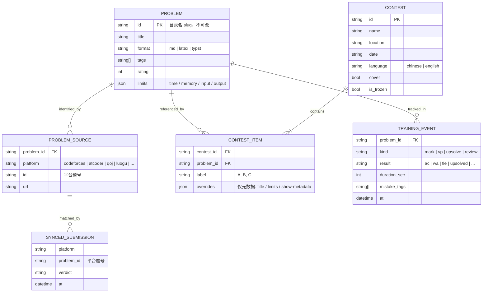
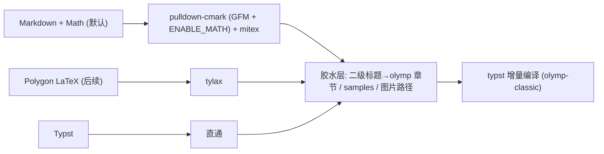

# 系统架构

## 1. 技术栈与平台

| 维度 | 选型 |
| :--- | :--- |
| 平台 | **只在 Linux 上开发和验收**。macOS / Windows 不验收，但能低成本避免的平台特有写法要避免。Web 版远期待定 |
| 应用框架 | **NSH 0.6（[`nsh.dev`](https://nsh.dev/)）**：Rust Core + TSX UI，`nsh init --template mixed` |
| UI 组件 | **以 `nsh/base` 为基础**，需要时可以基于 NSH 自己写组件（如预览页面的 `PageImage`）：`Canvas`、`Editor`、`RichEditor`、`DiffView`、`DataTable`、`Command`、`SplitView`、`plot` 等。[`hero-nsh`](https://c-w-xiaohei.github.io/hero-nsh/) 只作样式参考，不作为依赖。视觉规范见 [design-system.md](./design-system.md) |
| 排版引擎 | 嵌入原生 Rust `typst`：`comemo` 增量编译、`fontdb` 加载字体、`typst-render` 输出像素缓冲（预览）或 PNG、`typst-pdf` 导出 PDF |
| 题面字体 | Latin Modern 和方正（`foundertype-ctex-fonts`），由 `flake.nix` 锁定并通过 `XCPC_FONT_DIRS` 提供，见 [statement-style.md](./statement-style.md#17-字体) |
| 格式转换 | `pulldown-cmark`（GFM + `ENABLE_MATH`）+ `mitex`；LaTeX 输入用 `tylax`；导出为 Markdown 用 `typlite`/`tylax` |
| 持久化 | 开放的、人类可读的目录（单一事实源，兼容 Git）+ SQLite 派生数据 |
| 凭据 | 系统钥匙串（`keyring`） |
| Agent 接口 | `xcpc mcp`（stdio）+ `xcpc <subcommand> --json` |
| 视觉基准 | `tectonic` 编译参考模板，生成基准 PDF |

## 2. 总体结构

**同一个 Rust Core** 同时驱动 NSH 桌面 GUI、无头的 `xcpc mcp` 和 `xcpc` CLI，三者之间不重复实现任何逻辑。



## 3. Workspace 划分

```text
crates/
  xcpc-domain     # Problem、Contest（活引用 + 元数据覆写 + 冻结）、TrainingLog、状态派生规则
  xcpc-storage    # 开放目录读写、原子写入、冻结只读守卫、路径沙箱；后续加入 notify 监听和 SQLite 索引
  xcpc-convert    # Markdown + Math → Typst（pulldown-cmark + mitex）、章节识别、图片路径映射；后续加入 tylax
  xcpc-engine     # typst World、olymp-classic 模板（内嵌）、字体加载、render/pdf
  xcpc-lint       # 题面检查与印刷前预检（Phase 2）
  xcpc-packages   # Polygon、Competitive Companion 等（后续阶段）
  xcpc-sync       # 外部 OJ 同步（后续阶段）
  xcpc-mcp        # `xcpc` 二进制：CLI 子命令 + `xcpc mcp`
apps/
  desktop         # NSH mixed app：TSX UI + 调用 Core 的 Rust native module
tests/fixtures/
  olymp-ref/      # 参考模板生成的基准 PDF 及其源文件
```

依赖方向：`domain` ← `storage` / `convert` / `lint` / `packages` / `sync`；`convert` → `engine`。`xcpc-mcp` 和 `apps/desktop` 只是外壳，不放业务逻辑。

## 4. 领域模型



- **训练状态是派生值**：`status(problem) = max(TRAINING_EVENT 的结果, 通过 PROBLEM_SOURCE 匹配到的 SYNCED_SUBMISSION 的结果)`。它不写入 `problem.toml`。
- **覆写只限元数据**：渲染时把 `CONTEST_ITEM.overrides` 合并到题目元数据上。题面正文不能覆写。
- **冻结**：渲染改为读取 `contests/<id>/snapshot/`，不再读题库。

## 5. 本地存储

开放目录是**单一事实源**。SQLite 只存放派生索引和同步数据，删除后可以重建或重新同步。

```text
xcpc-workspace/
├── .xcpc/                    # 不进 Git
│   ├── index.db              # FTS5 派生索引（Phase 2）
│   └── oj_sync.db            # 外部 OJ 同步明细、Rating、参赛记录、赛程缓存
├── workspace.toml            # 工作区配置、标签词典、OJ 账号（凭据存放在钥匙串）
├── AGENTS.md                 # 工作区级 Agent 指南（Phase 2 起自动生成）
├── problems/
│   └── cf-1999a/
│       ├── problem.toml      # 元数据、限制、[[source]]；不含训练状态
│       ├── statement.md      # 或 statement.zh.md / statement.en.md
│       ├── editorial.md
│       ├── samples/          # 01.in, 01.ans, ...
│       ├── assets/
│       └── code/
├── contests/
│   └── icpc-2026-regional/
│       ├── contest.toml      # 元信息、题目引用、元数据覆写、出版开关
│       ├── assets/
│       └── snapshot/         # 仅在冻结后存在：每题源文件副本 + 当时的 PDF
├── sheets/                   # 题单（后续阶段）
├── templates/                # 代码模板（TRD，后续阶段）
└── training/
    └── logs.jsonl            # 追加写入的训练事件
```

- **Phase 1** 直接扫描目录（几十道题的规模足够）。**Phase 2** 起加入 `notify` 监听、`.xcpc/index.db` 增量索引，以及 `problem.toml` / `contest.toml` 的 JSON Schema 和工作区 `AGENTS.md` 生成。

## 6. 格式转换管线

**不手写 Markdown / LaTeX / Typst 解析器。**



- 胶水层负责三件事：按二级标题识别章节（规则见 [product.md](./product.md#21-题面结构)）、从 `samples/` 生成样例表、把图片路径映射到题目的 `assets/`。处理 Polygon LaTeX 时，还要转换 `\epigraph`、`\illustration` 等宏。
- 数学定界符：LaTeX 里的普通括号（`(`、`[`、`\lceil` 等）不会缩放，转换成 Typst 时要写成转义或符号形式（`\(`、`\[`、`#sym.ceil.l`），避免 Typst 自动配对放大；只有 `\left…\right` 才转换成 `lr()`。
- 导出到 Hydro / QOJ 等 OJ 时，用 `typlite` / `tylax` 把 Typst 转回 Markdown（后续阶段）。

## 7. Agent / MCP / CLI

### 7.1 运行方式

- `xcpc mcp`：stdio MCP 服务，不需要启动 GUI。
- `xcpc <subcommand> --json`：输出结构化结果，退出码确定。
- 桌面端打开同一工作区时，Agent 的写入会通过文件监听或本地 IPC 让 GUI 刷新（Phase 2）。

### 7.2 MCP Tools

| 分组 | Tools | 阶段 |
| :--- | :--- | :--- |
| 出版与视觉自检 | `compile_and_diagnose`（结构化诊断：错误位置、总页数、溢出警告）、`render_page_png`、`export_pdf`（单题 / 整本 / 题解册） | Phase 1 |
| 题库与组卷 | `search_problems`、`get_problem` / `upsert_problem`、`list_contests` / `get_contest`、`compose_contest` / `update_contest_item`、`freeze_contest` | Phase 2 |
| 体检 | `lint_problem` / `lint_contest` | Phase 2 |
| 训练 | `get_training_dashboard`、`log_training_record`、`generate_upsolve_plan` | Phase 3 |

**MCP 没有解冻工具**，解冻只能由人在 GUI 或 CLI 中完成。

### 7.3 安全边界（在 Core 层强制执行）

- **原子写入**：先写临时文件，再 rename 替换。
- **冻结只读**：`is_frozen = true` 的比赛及其快照禁止一切写入，写操作返回明确的错误码。解冻只开放给 GUI 和 CLI（需二次确认），不开放给 MCP。
- **只读模式**：`xcpc mcp --read-only`。
- **路径沙箱**：所有文件访问限制在工作区内，防止路径穿越。
