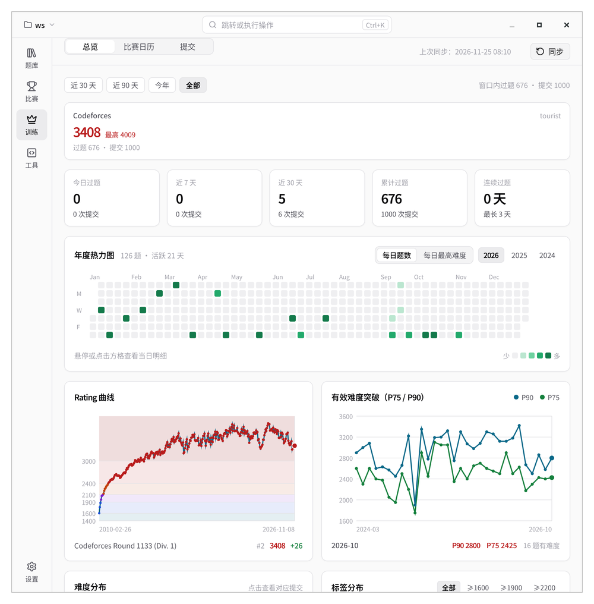
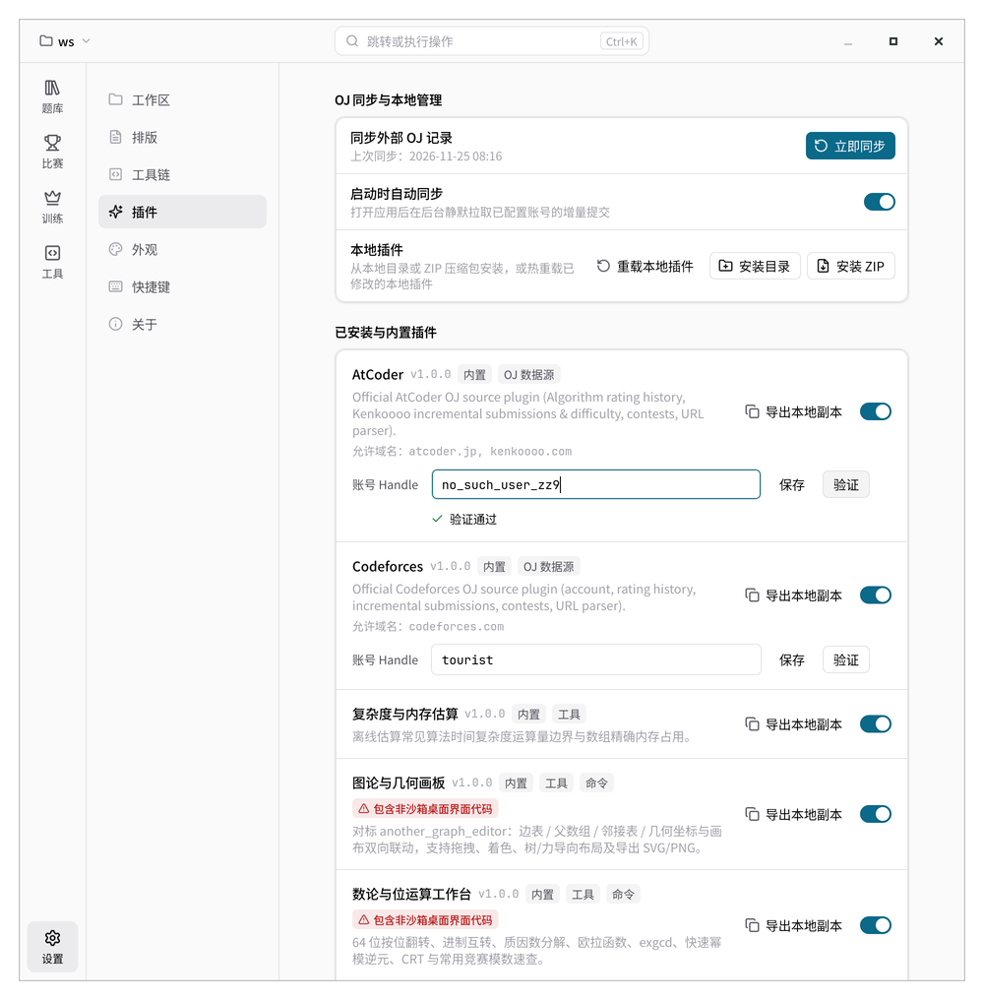
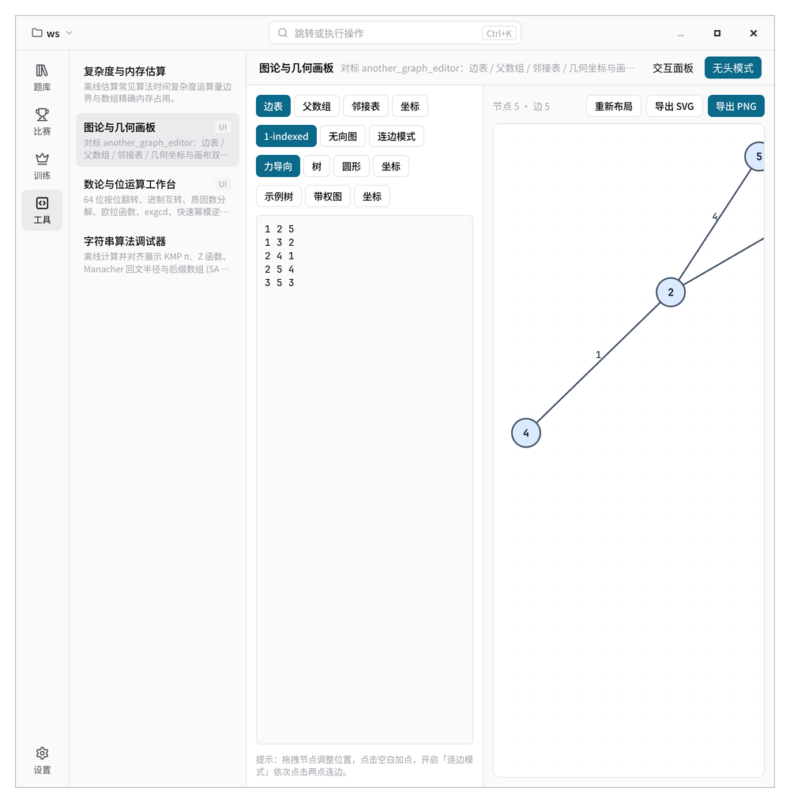
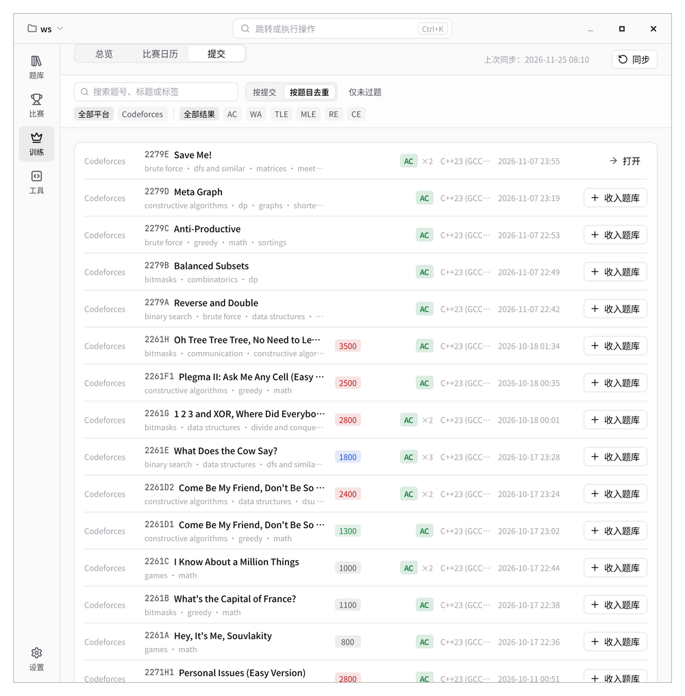
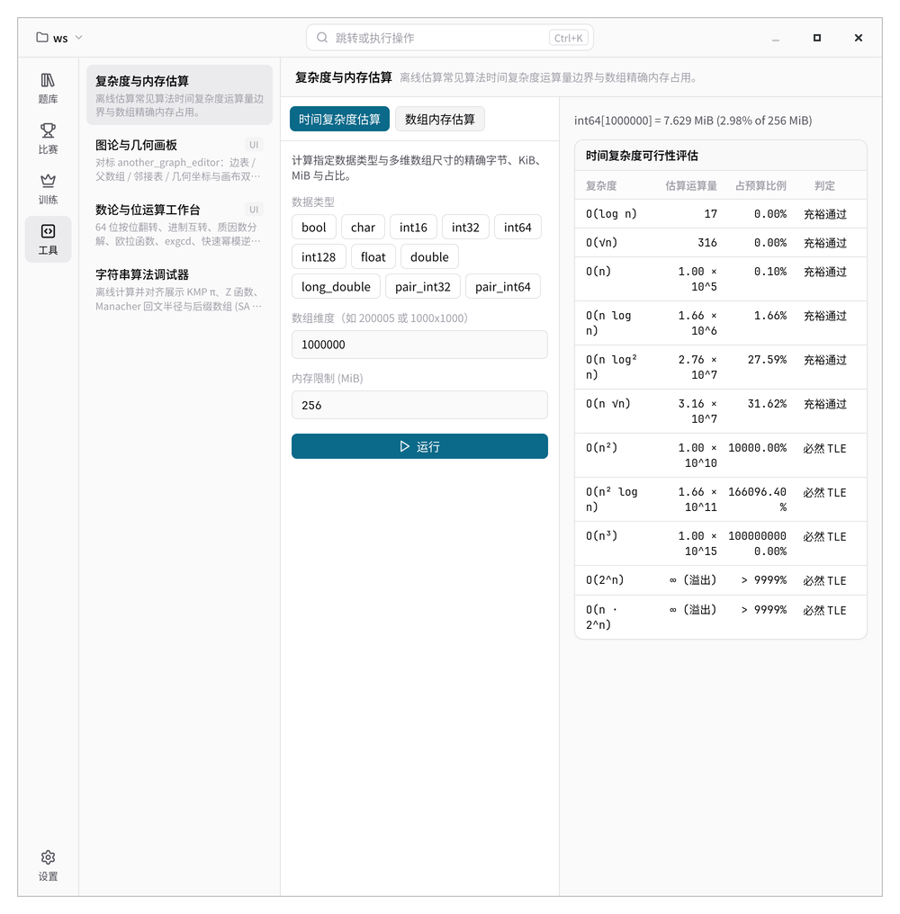
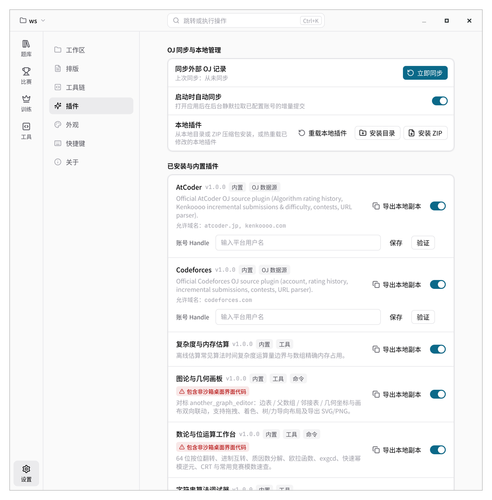
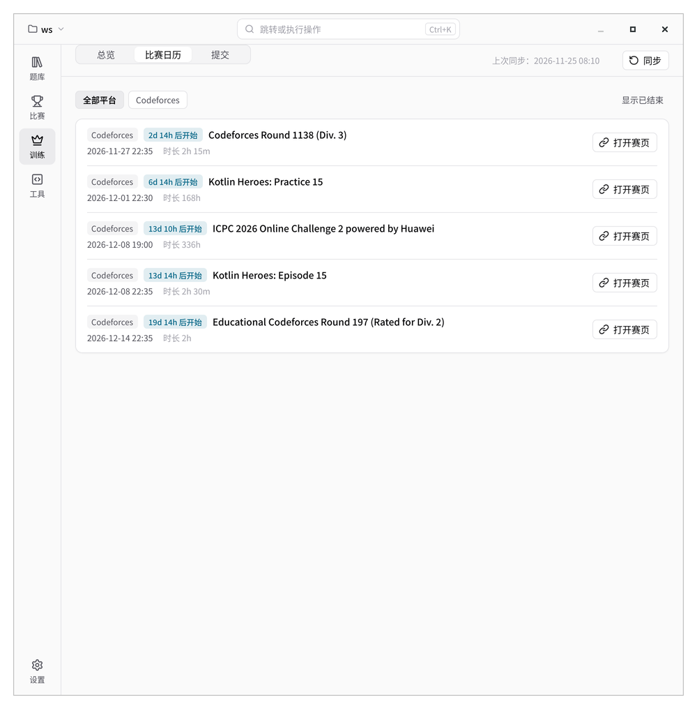
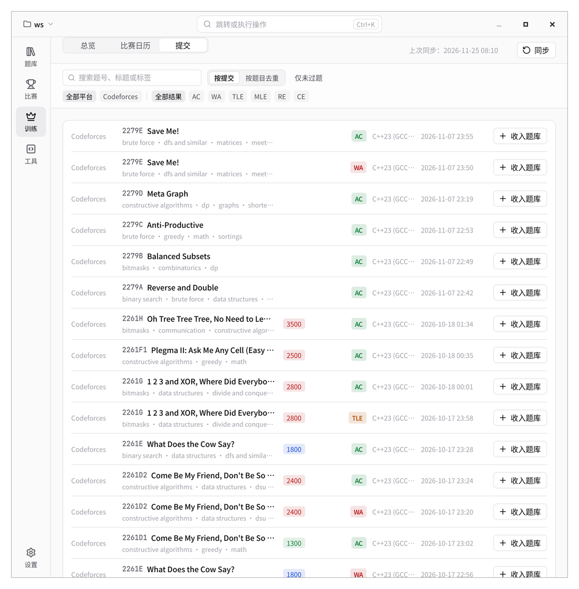
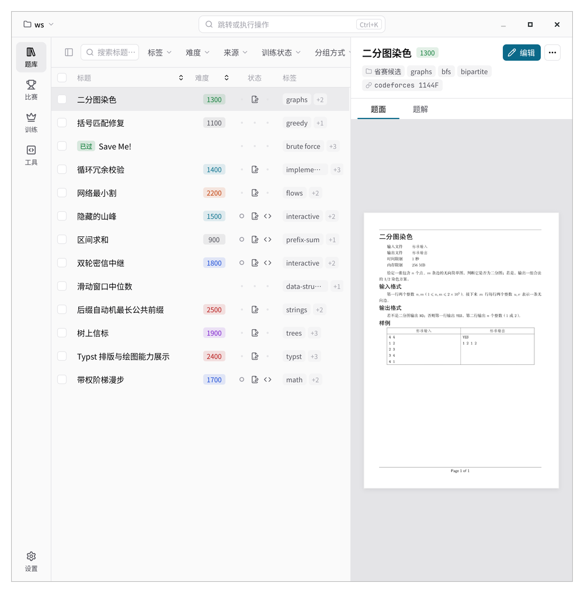

# Phase 4 UX 评审记录（4A / 4B / 4C）

> 评审对象：`133b0edc6`（4A）、`8f3bfb1bd`（4B）、`054386587`（4C）。截图在 `docs/review-phase4-ux/`。
> 环境：`xcpc init --example` 生成的临时工作区；`XCPC_DATA_DIR`、`XDG_*` 全部指向临时目录（全新 `<dataDir>`，不碰真实数据）；`nsh dev`，窗口约 960×980（逻辑像素）；Codeforces handle 用 `tourist`，AtCoder 用一个不存在的 handle 测失败路径。
> 严重度：**阻断**（走不通，或结果错误）/ **别扭**（能走但不顺）/ **打磨**（质感问题）。

## 总评

链路比 Phase 3 刚落地时完整：填 handle → 同步 → 看板 → 收题 → Toast → 打开，主路径能一口气走完，「收入题库」的反馈尤其干净。但 Phase 4 有三类集中问题：

1. **有几处是「看起来能用，其实是坏的」**：训练页整页滚不动（下半部分图表和分页到不了）；首次同步只拿到最近 1000 条提交，累计数据是错的；AtCoder 验证对不存在的账号也显示「验证通过」；图论画板完全没有交互；「仅未过题」开关不可见也点不了；内存估算的结果表一直显示上一个工具的结果。这些比质感问题优先。
2. **实现者视角直接搬上界面**：插件页满是 `v1.0.0`、`OJ 数据源`、`允许域名`、英文插件描述、`对标 another_graph_editor`、`导出本地副本`、`去中心化插件仓库 index.json`、`热重载`、`增量提交`，官方内置插件还挂着红色「包含非沙箱桌面界面代码」警告；工具页有「交互面板 / 无头模式」切换。普通做题人不需要知道这些。
3. **密度有了，呼吸感不够**：看板把六七种信息平铺成一面墙，重复指标多（「近 30 天」既是时间窗口又是一张卡），图表风格不统一，热力图和图表的英文刻度夹在中文界面里；提交列表每行一个描边按钮，一千行就是一千个按钮。

---

## 复审（2026-11-25，基于 `054386587` 之上未提交的工作副本）

> 同一套临时环境、同一窗口尺寸重新实测；`nsh test` 199 项全部通过，`cargo fmt --check` 通过。新截图以 `r2-` 开头。

### 结论

上一轮的阻断项**全部修复或无法再复现**，插件「点不了」的四个根因（A1–A4）都已修好，并补了点击级回归测试。插件页、工具页、提交页都按建议做了减法，整体质感明显提升。剩下的问题集中在两处：**账号失败路径没有闭环**，以及**工具结果表格和几处配色的细节**。

### 已解决

| 项 | 实测结果 |
|---|---|
| A1–A4 插件宿主 | 位运算三个 Tab 都能切换；图论画板的格式、有向图、布局、拖拽、点空白加点、连边模式都能用；内存估算切换后表格立即刷新（`r2-01`、`r2-02`）。`tools.test.tsx` 新增了 A1–A4、0.4、0.6 的点击回归测试 |
| B1 / B2 / B4 / B6 | 选项组统一换成浅灰 `Segmented`，按钮走宿主 `Btn`；去掉了「交互面板 / 无头模式」切换、`UI` 角标和头部描述 |
| 3.1 实时计算 | 复杂度、内存、数论、字符串都是边输入边出结果，没有「运行」按钮，输入框也不会失焦 |
| 0.1 训练页滚动 | 总览可以一直滚到「难度分布 / 标签分布」（`r2-03`），分段控件也不再被裁 |
| 0.2 全量同步 | `xcpc sync --full` 分页拉到 **5519** 条（原来是 1000），耗时约 19 秒 |
| 0.3 AtCoder 验证 | 不存在的账号会显示「未找到该 AtCoder 账号」 |
| 0.5 仅未过题 | 改成和「按提交 / 按题目去重」同一组的第三项，点击后生效，并出现「清除条件」（`r2-04`） |
| 0.7 设置空白 | 在 `workspace.toml` 里写入 `training = false` 再删掉，设置各子页显示正常；切换设置子页也不再闪白 |
| 1.1–1.3 插件页 | 重做为「OJ 账号」和「工具与扩展」两组，版本号、域名、警告等技术细节都不见了；账号在输入框内验证，状态放在输入框里的固定槽位 |
| 2.2 比赛日历 | AtCoder 比赛已经出现 |

### 仍需处理

**别扭（失败路径）**

1. **验证失败的账号照样会被保存和同步**。输入 `no_such_user_zz9x` 后验证失败，但 `sync_config.json` 已经写入这个 handle；之后同步时 AtCoder 一项报告 `ok: true`（0 条提交），「上次同步」时间照常更新。验证失败时应该不保存这个 handle，或者同步时把它标为失败。
2. **错误要点两下才能看到**。验证失败后只显示一行红色的「查看最近一次错误」，展开后才看到「未找到该 AtCoder 账号」；展开时整行高度变化，下面的内容跟着下移。建议把一句话错误直接放在输入框下方的固定槽位，不需要展开。错误文字现在用的是等宽字体，应改用正文字体。
3. **「上次同步」两处不一致**。训练页显示 09:10 时，设置页仍显示 08:16，触发一次验证后才刷新。
4. **应用里的「同步」只做增量**。增量同步只拉到上次的游标为止，之前只拿到 1000 条的数据库永远补不全（临时环境里点「同步」后仍是 1000 条，用 `--full` 后才变成 5519 条）。项目尚未发布，影响有限，但开发者自己的数据库会一直缺数据。可以在游标对应的数据量明显不全时自动补一次全量，或者在设置里提供「重新完整同步」。

**打磨（工具）**

5. **结果表格的列宽**。各列等分宽度：常用模数表的 `2 × 500000003 +⏎1`、`2^26 =⏎67,108,864` 被折行（`r2-05`）；字符串工具的前缀函数表只占卡片约 60% 宽，表头底色也跟着断开；后缀数组表右对齐的 LCP 列和左对齐的「后缀」列贴在一起，表头读成「LCP 后缀」（`r2-06`）。建议按内容决定列宽，数字列统一右对齐并使用 `tabular-nums`。
6. **表格里的中文用了等宽字体**。例如「最常用 NTT 素数模数」「经典竞赛素数模数」等说明文字，混排效果不好。只有代码和数字应该使用等宽字体。
7. **位运算**：右列的 4 个位格组没有贴齐右边，留出约 80px 空白；输入框后面并排了 6 个描边按钮，工具栏偏重，「全 1 / << 1 / >> 1」可以合并到一个溢出菜单里。
8. **图论画板**：「连边：开 / 关」两种状态的样式几乎一样；选中节点面板里的「删除」是实心红色大按钮，在一个辅助面板里太抢眼，用描边的危险样式就够了；节点调色板仍然硬编码 Tailwind 浅色（`ui.js:10-13`），深色模式下没有适配；格式、编号、方向三组分段控件宽度不一，左边缘对齐但右边缘参差不齐。

**打磨（看板）**

9. **比赛日历的倒计时标签用了品牌浅色衬底**（「2 天后 · 周五 22:35」），违反「不用品牌浅色衬底」的规则；平台标签宽度不同，导致比赛标题的起始位置参差不齐。
10. **总览**：难度分布用了 9 种颜色的条形，像彩虹；标签分布右侧带颜色的那列数字没有表头，看不出是平均难度；标签名称仍是英文；「时间窗口作用于…」这行说明可以去掉，改为让受影响的卡片在标题旁显示窗口名称。
11. **提交页**：带「×2」的行里结果徽标会左移，同一列没有对齐；960 宽下难度筛选换到了第二行；「仅未过题」模式下结果筛选仍然提供 `AC`，选了也不可能有结果。
12. **设置页的「立即同步」是实心主色按钮**，训练页的「同步」是描边按钮，同一个动作有两种样式；AtCoder 的描述被截断成「同步你的 AtCoder 提交与 R…」。

---

## 插件专项（重点）

> 结论：**按钮「点不了」不是个别插件的问题，而是插件宿主的响应式写法有系统性错误**；按钮的点击事件其实送到了，但状态要么被丢掉，要么界面不刷新。**界面丑**的主要原因是插件绕开了设计系统：选中态用实心主色、硬编码颜色、内部 ID 和英文直接上界面、一页三栏挤在一起。

### A. 按钮点不了：四个根因

| # | 位置 | 错误写法 | 实测后果 |
|---|---|---|---|
| A1 | `ToolsView.tsx:23` `PluginUiHost` | 在 `computed(() => …)` 里调用 `mountPluginUi → render(sdk)`。`render` 内部同步读到的每个 signal 都会被外层 `computed` 订阅 | 点一下就触发**整个插件重新挂载**，插件内的 `signal` 重新创建并回到初始值；同时 `Each` 的 key（`${id}:${rev}:ok`）没变，界面上仍是旧实例。效果就是**点了没反应**。图论画板全部按钮、拖拽、加点、改边表都失效（`20-graph-editor-unresponsive.png`）；位运算工作台的「数论计算 / 常用模数」两个 Tab 点不进去（`27-bitwise-tab-dead.png`） |
| A2 | 两个 `ui.js`（如 `graph-editor/ui.js:520,580,666`、`math-bitwise/ui.js:444`） | 用 `h()` 构造元素时直接传 `variant: format() === id ? …`、`"节点 " + nodes().length` 这类**求好的值**，而不是函数 | 即使修好 A1，这些选中态、计数、按钮文字也只在第一次渲染时计算，之后永远不会更新。位运算的位按钮之所以能用，是因为它恰好包在 `If(() => …)` 里，每次变化都会把整块重建（代价是输入框会失焦、没有过渡） |
| A3 | `HeadlessToolRunner.tsx:29,51` `FieldInput` | `const on = Boolean(props.value)`、`const current = String(props.value)` 写在组件体里，只求一次 | 布尔开关**只能翻一次**：图论表单点两次「有向图」，结果一直是「有向」，按钮却始终显示「关」（`28-headless-bool-stuck.png`）；单选项（数据类型、输入格式、布局）的选中高亮永远不动 |
| A4 | `OutputRenderer.tsx:466` | `<Each of={blocks} key="index">` 配合 `const b = blk()` 只取一次值 | 新结果到来时，同一下标复用旧的块组件：**内存估算显示的是时间复杂度表**（0.6）；图论表单切成有向图后，「图结构 / 矢量预览」仍是旧图 |

**修复方向**：
1. `PluginUiHost` 用 `untrack` 包住 `render(sdk)`（或者在 `effect` 里挂载一次，只依赖 `pluginId` 和 `rev`），保证插件状态只属于一个实例。
2. Plugin SDK 的 `Button / Text / View` 的 `variant`、`children`、`style` 支持传函数（`() => …`），文档和两个官方 `ui.js` 一律改成函数形式；`SdkIf` 不应该成为唯一的响应式手段。
3. `FieldInput` 改为在 JSX 里读 `props.value`；`OutputRenderer` 的 `Each` 改用「块类型 + 序号 + 结果序号」作为 key。
4. **补交互测试**：现有 `tools.test.tsx` 只测了能挂载。需要逐个点击每个按钮并断言状态变化（Tab 切换、布尔开关翻两次、内存估算的表头、画板点布局后节点坐标变化）。这四个根因都是只看静态截图发现不了的。

### B. 插件界面丑：具体在哪

对照 `docs/design-system.md` 和 AGENTS.md 的 UI 约束逐条列出：

1. **选中态用实心主色，违反 §2 Token 规则**（「品牌色只用于实色主按钮、指示条、聚焦环，选中态用 `--bg-selected` 浅灰」）。画板左栏有格式、索引、布局、预设四排按钮，选中项全是深青实心块，加上「导出 PNG」「无头模式」，一屏有 6–7 个主色块（`19-graph-editor-initial.png`）；复杂度工具的内部 Tab、位运算的 Tab 也一样。主按钮失去了「唯一主操作」的意义，整页像一排信号灯。
   - 改法：选项组统一用宿主的 `Segmented`（浅灰底 + 白色选中块）；每个工具最多一个主按钮，最好一个都没有，改成实时计算。
2. **自己造了一套按钮和颜色，没有用宿主组件**：`SdkButton` 是另写的（hover 用 `bg-sidebar-primary`，危险态用 `bg-chart-5`），尺寸、圆角和 `Btn` 不一致；画板直接硬编码 `#dbeafe / #475569 / #0f172a` 和 `JetBrains Mono`，调色板叫「翠绿 / 琥珀 / 珊瑚」，与产品 Token 无关；深色模式下只做了画布底色的二选一。
   - 改法：SDK 直接透出宿主的 `Btn / Segmented / Input / Chip`，`token()` 覆盖画布用色。
3. **内部 ID 和英文直接上界面**：表单选项是 `edge_list / parent_array / adj_list / coords`、`force / tree / circle / coords`，另有 `1-indexed 编号`、`(0-indexed)`、`(2.98% of 256 MiB)`、`bits 63..56`；画板里「坐标」出现三次，分别表示格式、布局和预设，意思各不相同。
4. **同一个工具有两套界面**：「交互面板 / 无头模式」的切换按钮外观不随状态变化，两套界面的状态也不同步（位运算在交互面板里翻成 …355，无头表单仍是 …353）。用户只需要一个工具，不需要知道它有无头实现。
5. **三栏挤压与折行**：960 宽下「工具列表 + 表单 + 结果」三栏并排，结果表格出现 `1.00 ×⏎10^5`、`Mana⏎cher⏎d1[i⏎]`；图论的「矢量预览」SVG 被放大裁切，只露出半张图；初始布局溢出画布边界。
6. **冗余**：头部重复工具名和完整描述；字符串工具的摘要写了三遍；左侧列表有 `UI` 角标；插件页官方插件挂红色「非沙箱」警告。
7. **可以作为样板的一页**：位运算的 8 位一组位格（`22-tool-bitwise-ui.png`）是 4C 里唯一达标的界面，有等宽数字、清楚的分组和克制的留白。其他工具建议按这个标准重做：一个输入、即时结果、不出现「运行」按钮。

---

## P0：阻断

### 0.1 训练页整页滚不动，下半部分内容到不了 · 阻断

「总览」和「提交」两个 Tab 都不能滚动：总览停在 Rating 曲线，下面的「难度分布 / 标签分布」只露出标题；提交列表看不到底部分页。同一窗口里设置页可以正常滚动，滚轮事件也确实送到了（热力图出现了悬停态），所以问题出在布局上。顶部分段控件贴着标题栏、上沿被裁，也是同一个原因：内容撑破了容器，而不是在容器里滚动。

- 代码上，`OverviewTab` / `SubmissionsTab` 都用了 `<Scroll style={{ flex: 1 }}>`，看起来和设置页一样，根因要在 `TrainingView` 根节点 → `SpaceStage` 这一层的高度约束里查（例如缺 `minHeight: 0`，或者 `<If>` 包装改变了 flex 链）。
- **建议**：修好后补一条测试，在 960×980 窗口下滚到总览底部，断言能看到「标签分布」，同时断言分段控件的上边距。

### 0.2 首次同步只拿到最近 1000 条提交，累计数据是错的 · 阻断

同步 `tourist` 后显示「过题 676 · 提交 1000」，这个数字明显偏少。`crates/xcpc-plugin/plugins/codeforces/index.js:95` 写死了 `&from=1&count=1000`，并且没有分页；同步完成后游标会推进到最大 ID，**更早的提交以后也补不回来**（`--full` 同样只取 1000 条）。累计过题、热力图跨年数据、难度趋势、标签短板都建立在这份残缺数据上。

- **建议**：首次同步和 `--full` 分页拉全量；增量同步拉到上次的游标为止。界面上不要用整数 1000 这种「刚好」的数字掩盖截断问题。

### 0.3 AtCoder「验证」对不存在的账号也通过 · 阻断

AtCoder handle 填 `no_such_user_zz9`，点「验证」后显示 ✓「验证通过」。原因：`atcoder/index.js:49 verify()` 只检查 `history/json` 返回的是不是数组，但不存在的用户返回的是 HTTP 200 加空数组 `[]`。验证本该是这个流程里最能给人信心的一步，现在反而在误导用户。

- **建议**：换一个对不存在用户会返回 404 的端点（比如用户主页），或者空数组时再做一次存在性确认。

### 0.4 图论画板没有任何交互 · 阻断

打开「图论与几何画板」后：初始布局溢出画布（节点 1、3 在画布外，5 被截掉）；「重新布局」「圆形 / 树」不生效；拖动节点没有反应；在边表里输入新边，画布也不更新。同一时刻其他工具（位运算的位翻转）都能正常交互，所以问题在这个插件本身，不在 `ui.js` 机制。这是 4C 的「标杆插件」，验收清单要求「对标 another_graph_editor 双向交互」，目前一项都没做到。

| 初始状态 | 拖拽、改边表、切布局之后 |
|---|---|
|  |  |

### 0.5「仅未过题」开关不可见，也点不了 · 阻断

提交页「仅未过题」前面本该有一个 `Switch`（`SubmissionsTab.tsx:195`），但界面上只能看到文字，开关本身没有渲染出来；点文字和点文字左侧都没有反应。这个功能就是 4B 规格里「便于筛出 WA/TLE 未过题」的核心入口。

- **建议**：整行（开关 + 文字）都可点；或者干脆做成和「按提交 / 按题目去重」同一组的第三个分段项。

### 0.6 内存估算显示的是时间复杂度的结果表 · 阻断

在「复杂度与内存估算」里切到「数组内存估算」并点运行：顶部摘要更新成了 `int64[1000000] = 7.629 MiB`，但下面的表格仍然是上一次「时间复杂度可行性评估」的结果；CLI `xcpc tool run complexity-mem:memory` 输出的是正确的「数组内存精确计算」表。可见是 GUI 的 `OutputRenderer` 复用了旧的 table 块，没有按新输出刷新。另外，切换后顶部 Tab 的高亮仍停在「时间复杂度估算」。

### 0.7 切换 `training` 开关后，整个设置区变成空白 · 阻断

在 `workspace.toml` 里把 `training = false` 写入再删掉（应用会热重载），之后「设置」下所有子页（插件、外观……）的内容区都是一片空白，重启应用才恢复。初步怀疑和 `App.tsx:348` 用 `<If when={trainingEnabled}>` 包住训练 `SpaceStage` 有关：重新挂载打乱了后面 stage 的层级或可见性。

- 另外，首次进入「设置 → 插件」也会先空白一帧（`02-settings-plugins-blank-frame.png`），违反「切换零闪白」。

---

## P1：插件页（设置 → 插件）

### 1.1 技术细节铺满了整页 · 别扭

逐项看：

| 现在 | 问题 | 建议 |
|---|---|---|
| `v1.0.0`、`内置`、`OJ 数据源`、`工具`、`命令` 标签 | 做题人不关心版本号和扩展点 | 全部去掉；需要时放到插件详情里 |
| CF / AtCoder 的英文描述（`Official AtCoder OJ source plugin (Algorithm rating history, Kenkoooo incremental submissions…`） | 中文界面里突然一段英文，还带「Kenkoooo」「incremental」 | 一句白话：「同步你的 AtCoder 提交与 Rating」 |
| `允许域名：atcoder.jp, kenkoooo.com` | 安全实现细节 | 只在安装第三方插件、需要授权时展示 |
| 官方内置插件挂红色「⚠ 包含非沙箱桌面界面代码」 | 用户自己没装任何东西，却被官方插件吓一跳 | 警告只在**安装第三方** `ui.js` 插件时出现 |
| `对标 another_graph_editor：……` | 内部参考项目名 | 改成「画图、拖拽、导出图片」 |
| 每行都有「导出本地副本」 | 这是给插件开发者的功能 | 收进 `⋯` 菜单 |
| 「本地插件：……或热重载已修改的本地插件」「重载本地插件 / 安装目录 / 安装 ZIP」 | 开发者动作摆在第二行 | 合并成一个「安装插件…」，重载放 `⋯` |
| 「去中心化插件仓库」「输入仓库 index.json 地址」 | 纯协议术语 | 「插件来源」「添加来源地址」，或者在没有社区仓库之前直接不做（做减法） |
| 「启动时自动同步：拉取已配置账号的增量提交」 | 「增量」是术语 | 「打开应用时自动更新做题记录」 |

### 1.2 账号设置埋在插件列表里 · 别扭

用户要做的第一件事（填自己的 CF / AtCoder 账号），被放在「插件」列表的某张卡片里。OJ 账号和画板、计算器之类的工具插件混在同一个列表中，没有分组。

- **建议**：把「OJ 账号」作为插件页（或训练页空状态）的第一块：每个平台一行，包括 handle 输入、状态和「上次同步」；工具插件另起一组。
- **训练页没有账号时应该直接引导**：现在没填 handle 时训练页是一整面全 0 的看板（`08-training-before-sync.png`），用户不知道要去哪里填。应当显示空状态：「填写你的 Codeforces / AtCoder 账号，开始记录训练」，并就地给输入框。

### 1.3「保存」和「验证」重复 · 别扭

实测点「验证」就已经把 handle 写进了 `sync_config.json`，「保存」按钮没有存在的必要。另外，验证结果「✓ 验证通过」是在输入框下方新插入的一行，会把下面所有卡片往下推 28px（`07-verify-ok-shift.png`）；验证中的转圈图标出现在按钮右侧，也会让这一行变宽（`06-verify-spinner.png`）。

- **建议**：只保留一个动作。输入框失焦或按回车时自动验证并保存，结果放在输入框内右侧的固定槽位里（✓ / 错误图标 + 悬停提示），不占新的一行。

### 1.4 同步反馈 · 别扭

- 没配置账号时点「立即同步」：Toast 提示「尚未配置任何已启用 OJ 插件的账号」，读起来很绕；而且「上次同步」时间被刷新了，**实际上什么都没同步**（`05-sync-without-handle.png`）。建议没有账号时直接禁用按钮，提示「先填写账号」，也不要更新时间戳。
- 训练页点「同步」：转圈图标插在「上次同步」文字和按钮之间，把文字往左推（`09-sync-spinner-shift.png`）；同步 tourist 用了约 30 秒，期间没有任何进度提示，结束后也没有完成反馈。按设计规范 §6.5，这属于长耗时任务，应该在右下角显示单槽 Toast：「正在同步 Codeforces…」，完成后变为「已同步 · 新增 N 条提交」。
- 设置页点「立即同步」后，原位没有进行中状态，也没有完成反馈。

---

## P2：训练看板（4B）

### 2.1 总览：信息平铺，缺层级 · 打磨

- **指标重复**：时间窗口有「近 30 天」，下面又有一张「近 30 天」卡；右上角「窗口内过题 676 · 提交 1000」和平台卡里的「过题 676 · 提交 1000」、「累计过题 676 / 1000 次提交」卡，三处说的是同一件事。建议平台卡（Rating）+ 3 张卡（周期内过题、连续天数、今日）就够了，「窗口内」那行删掉。
- **时间窗口的作用范围不清楚**：切换「近 30 天 / 全部」时，哪些卡片会跟着变、哪些不会（今日、近 7 天显然不受影响），界面上看不出来。
- **热力图**：月份 `Jan…Dec` 和星期 `M / W / F` 是英文；格子没有铺满卡片宽度，右侧留出约 70px 空白；第一列有错位；年份切换（2026 / 2025 / 2024）是第三种样式的分段控件。
- **Rating 曲线**：每个点都画了实心圆，tourist 的 200 多场比赛连成一串红色珠子，噪点很多；Y 轴刻度挤在 1400–2400（段位分界），3000 以上的大段没有刻度；X 轴只有首尾两个日期；段位色带的饱和度偏粉，压过了曲线。建议默认不画点，只在悬停时显示；刻度按「整齐数值」生成，段位色带只作淡底。
- **有效难度突破**：和 Rating 曲线是两套图表风格（这张有网格线和坐标轴，另一张没有）；图例 P90 用蓝、P75 用绿，底部数值却都标成红色，颜色对不上。
- 看板标题「有效难度突破（P75 / P90）」里的 P75 / P90 是统计术语，建议换成「做出的题有多难」，副标题再写「75% / 90% 分位」。

### 2.2 比赛日历 · 打磨

- **AtCoder 没有出现**：AtCoder 插件处于启用状态（当时还没填 handle），日历里却只有 Codeforces。看比赛日程本不需要账号，规格写的也是「聚合已启用 `oj_source` 插件」。
- 「2d 14h 后开始」「时长 168h / 336h」：英文单位，而且 168h 应该写成「7 天」。建议「2 天后 · 周五 22:35」「时长 2 小时 15 分」。
- 每行都有一个描边的「打开赛页」按钮，五个一模一样；建议整行可点，悬停时出现外链图标。
- 只有一个平台时，「全部平台 / Codeforces」筛选没有意义，应该隐藏。
- 可以按「今天 / 本周 / 以后」分组，让人一眼看清最近的比赛。

### 2.3 提交页 · 别扭 / 打磨

- 每行一个描边的「+ 收入题库」按钮，整页看起来像一面按钮墙。建议悬停时才显示（或者用一个弱化的 `+` 图标），已收入的行显示「已在题库」弱文字。
- 每行都有「Codeforces」平台列，单平台时纯属冗余；语言列 `C++23 (GCC…` 被截断，而且价值不高，可以只在悬停时展示。
- 规格要求「平台 / 结果 / 难度 / 标签 / 搜索」多维筛选，界面上没有难度筛选（只能从总览的分布图钻取进来）。
- 筛选 Chip 的选中态（浅灰底）和未选中态区别太小：选了 WA 之后，「全部结果」看起来也像是选中的（`16-submissions-wa-filter.png`）。
- 结果筛选里有 MLE / RE / CE，但「按题目去重」本来就是为了找没过的题，建议直接把「仅未过题」做成主入口（见 0.5），结果 Chip 收进更多筛选里。

### 2.4 收题链路 · 基本满意，一处别扭

点「+ 收入题库」→ 按钮原位变成「→ 打开」→ 右下角 Toast「已收入题库：Save Me! · 打开」，**这是 Phase 4 里手感最好的一段**（`13-ingest-toast.png`）。只有两点：

- 「打开」落到了出题页的**题面** Tab，题面是空模板（`14-open-ingested-lands-statement.png`）。按规格，收题的目的是「直达工作室写 `editorial.md`」，应该直接落到**题解**。
- `problem.toml` 写入的 `time = "1s"`、`memory = "256MB"` 是默认值，不是 CF 的真实限制，容易被误认为来自原题。要么抓取真实限制，要么不写。

### 2.5 题库联动 · 别扭

- 训练状态「已过」做成了插在**标题前面**的标签，于是这一行标题比其他行往右缩进了，表格对不齐；同时表格已经有一列「状态」（三个出题状态小图标），两种「状态」混在一起。建议训练状态单独占一列（或者并入「状态」列的第一个槽位，用同一套小图标语言）。
- 详情区的 `⋯` 菜单里没有「标记为已过 / 待补」，规格写的是「右键 / 详情一键切换」。右键菜单是原生弹出菜单，代码里已经接好，但锁屏环境下截不到图，**未能实测**。
- 开启训练后，题库工具栏多了一个「训练状态」筛选，960 宽时会把右侧的「打开文件夹 / 新建」两个按钮挤出可视区（对比 `01-library-status-columns.png` 和关闭训练后的 `25-training-disabled.png`）。
- `training = false` 的隐藏效果是对的：训练入口、状态标签和筛选都消失了，且支持热重载。

---

## P3：工具 Tab（4C）

### 3.1 工具容器 · 别扭

- **「交互面板 / 无头模式」**：这是实现层面的概念。同一个工具做了两套界面（位运算的交互面板和无头表单），功能完全重复；而且切换后按钮的高亮不变，用户看不出当前在哪个模式（`23-tool-bitwise-headless-toggle.png`）。建议：有 `ui.js` 就只显示交互面板，没有就显示表单，不暴露切换。
- **重复标题**：左侧列表有名称和描述，右侧头部又写一遍名称加完整描述，字符串工具的结果区还把摘要连写了三遍（顶部一行、「核心摘要」卡、表格标题）。按 AGENTS.md「主工作区不放冗余标题」，头部只保留名称即可，描述可以去掉。
- 左侧列表里的 `UI` 角标是技术标签，应该删掉。
- **三栏太挤**：960 宽下「工具列表 + 表单 + 结果」三栏并排，结果表格被迫折行，例如 `1.00 ×⏎10^5`、`166096.40⏎%`、`Mana⏎cher⏎d1[i⏎]`（`17-tool-complexity.png`、`21-tool-string-lab.png`）。建议工具列表可以收起，或者让表单和结果上下排列。
- **要点「运行」**：规格写的是「纯离线实时响应」，复杂度和内存估算的输入都很轻，应该边输入边出结果，不需要「运行」按钮。
- 选项组（数据类型 `bool/char/int16…`、画板的格式 / 索引 / 布局 / 预设四排按钮）的选中态用实心主色，一屏里同时出现五六个主色块，抢了真正主按钮的视觉权重；画板里「坐标」出现了三次（格式、布局、预设），`1-indexed` 是英文。
- 表格数值：`10^5` 用了脱字符写法，`∞（溢出）`、`> 9999%` 这类写法读起来不像产品界面；建议直接写「1e5」或者用上标，超出范围时写「远超时限」。

### 3.2 各工具 · 打磨

| 工具 | 实测 | 主要问题 |
|---|---|---|
| 复杂度与内存估算 | 时间复杂度能用，内存估算结果错 | 见 0.6、3.1 |
| 图论与几何画板 | 无交互 | 见 0.4 |
| 数论与位运算工作台 | 位翻转交互流畅、排版好看 | 切到无头模式后显示的是旧值（交互面板里已翻成 …355，无头表单仍是 …353），两套界面的状态不同步 |
| 字符串算法调试器 | 结果正确 | 摘要重复三遍；对齐表的行名折行；`(0-indexed)` 是英文 |

数论 / 位运算的交互面板（`22-tool-bitwise-ui.png`）是整个 4C 里质感最好的一页：8 位一组、等宽数字、选中位用实心主色，信息层次清楚。其他工具可以向它看齐。

### 3.3 Ctrl+K · 打磨

插件命令（如「打开图论画板」）已经接入，但排在所有操作的最后，要输入 `>` 后再往下翻才能看到。在「工具」空间里，面板仍然把「复制带样例的 Markdown」「检查比赛」「加入比赛」排在前面，没有按上下文调整优先级。

---

## 未覆盖

以下几项本次没有实测，需要另外补测：断网时的同步、`.zip` 和目录安装第三方插件（含非沙箱提示）、插件仓库订阅、凭据（keyring）、importer/exporter、导出 PNG/SVG、原生右键菜单（锁屏截不到）、总览下半部分的难度和标签分布（因为 0.1 无法到达）。

## 建议的修复顺序

0. **插件宿主的响应式修复（A1–A4）**：一次修复能同时解决图论画板、位运算 Tab、表单开关、结果表四处「点不了」，并补上点击级测试。
1. **数据正确性与可用性**：0.1 滚动、0.2 全量同步、0.3 AtCoder 验证、0.5 仅未过题、0.6 结果表刷新、0.7 设置空白、0.4 图论画板。
2. **插件页做减法**：1.1 的整张表、1.2 账号前置与训练空状态、1.3 合并保存和验证、1.4 同步反馈改为 Toast。
3. **看板与工具的质感**：去掉重复指标，统一图表语言并中文化；提交行按钮改为悬停显示；工具页去掉「无头模式」和冗余标题，改为实时计算。
