# Phase 5 UX 复审记录（工作副本修复）

> 复审对象：`73f8b88df` 之上**未提交**的工作副本（jj `tworkypu`）。相对上一轮评审时的快照改了 25 个文件（+1767/−1121）。对照 `docs/review-phase5-ux.md` 逐条复测，截图在 `docs/review-phase5-ux-r2/`。
> 环境：新生成的 `xcpc init --example` 工作区，`nsh dev`（debug 构建），窗口约 960×980，在 niri 下用 linux-cua 操作。断网和无编译器的构造方式与上一轮相同（`unshare -rn` 隔离网络并配合空的 `XCPC_CACHE_DIR`；从 PATH 中去掉 g++ / clang++）。
> 只记录，不修改代码。
> 测试工具的限制：linux-cua 在 Wayland 下逐个发送中文字符时，新建对话框会被关掉（英文输入正常）。这应该是测试工具的问题，所以涉及中文标题的场景都改用英文标题来测。

## 总评

上一轮 5 个阻断问题**全部修好**，都已实测确认：两条崩溃路径不再报错，模板册「信息 / 版式」的修改能写进文件，两个工作室的预览会实时刷新，单条工作室改为自动保存，删除章节前会弹确认。出错路径也基本闭环：验板失败的原因能直接看到；断网时已通过的板子不会被改判；没有编译器时给出白话提示并附「去设置」入口；缺失的条目会标红，但不会拖垮整本预览。详情页改成以渲染预览为主体之后，「模板」空间终于有了内容重心，质感比上一轮明显提升。

这一轮新发现 **2 个别扭级问题**和若干打磨项。最需要优先处理的有两条：

1. **新建之后，元数据没有地方改**：新建对话框按 S-5 精简了，但工作室里并没有补上元数据编辑。标题、标签、复杂度和验板项在界面上都改不了，新建的模板也永远「暂无验板项」。
2. **定稿对话框不显示阻断错误**：如果有缺失的条目，对话框里只列出验板警告，用户点了「定稿」才弹出 Toast 说无法定稿，而且 Toast 文字被截断了。

| 上轮编号 | 结论 |
|---|---|
| 0.1 空数组导致崩溃 | ✅ 两条路径都不再崩溃；附带一个副作用，见新问题 D |
| 0.2 信息 / 版式修改丢失 | ✅ 作者、字号都能写盘，失败时也有提示。修法是兼容解析，见新问题 E |
| 0.3 预览不刷新 | ✅ 两个工作室都会实时刷新 |
| 0.4 离开时丢失修改 | ✅ 改为自动保存（S-7） |
| 0.5 删除章节不确认 | ✅ 已加确认；但菜单里的删除项不是红色，见新问题 C |
| 1.1 分段控件贴顶 / 两层工具栏 | ⚠️ 分段控件已垂直居中；顶部整宽工具栏加列表搜索行的两层结构还在 |
| 1.2 详情页看不到算法本身 | ✅ 改为以渲染预览为主体，关系信息压成一行 |
| 1.3 失败原因看不到 | ✅ |
| 1.4 断网被改判为失败 | ✅ |
| 1.5 英文报错与文件路径 | ✅ 大部分已白话化；还剩几处细节，见新问题 F |
| 1.6 按钮移位 | ✅ |
| 1.7 ⌘K 搜不到 | ✅ |
| 1.8 缺失条目拖垮整本预览 | ✅ |
| 1.9 题解「沉淀」把整篇当代码 | ⚠️ 入口直接删掉了，但规格 §5.2 仍要求保留，见新问题 G |
| 1.10 说明编辑器 | ⚠️ 加了软换行，仍然没有 Markdown 样式源码 |
| 1.11 单条预览版式 | ⚠️ 模板名会跟随所在的模板册，但仍是竖版单栏，册里的版式选项也没有带上 |
| 1.12 英文下分段控件溢出 | ✅（代码确认，宽度改成 92，本轮没有切换英文实测） |
| 2.1 字号偏小 | ⚠️ 11.5–12.5 的字号从 71 处降到 34 处，13 及以上有 58 处 |
| 2.2 大纲常驻三个按钮 | ⚠️ 已收进 `⋯` 菜单，标题不再被截断；仍然没有拖拽排序 |
| 2.3 验板页内容重复 | ✅ |
| 2.4 展开弹窗细节 | ✅ |
| 2.5 空状态 | ⚠️ 重复的主按钮已去掉；行动按钮仍没有标快捷键，空工作区本轮未复测 |
| 2.6 新建对话框 | ✅ |
| 2.7「沉淀为算法模板」贴着右边缘 | ❌ 未修 |
| 2.8 定稿后仍像可编辑 | ✅（代码确认；本轮定稿被缺失条目挡住了，没有实测） |
| 2.9 标识名与标题不一致 | ✅ 模板册详情已显示标题；算法详情的「依赖」行仍显示标识名 |
| 2.10 对话框 / 抽屉不一致 | ✅ |
| 2.11 预览默认缩放 42% | ⚠️ 加了适配宽度，但默认窗口下属性抽屉占掉 320pt，实际只有 38% |
| 2.12 文档未同步 | ✅ `design-system.md` §2.1、§8.1、§9 都已更新 |
| S-1 至 S-7 | ✅ 都已落实（S-3 的细节见新问题 H；S-5 留下了一个缺口，见新问题 A） |

---

## 逐项复测（只展开有变化或有保留意见的条目）

### 0.1 空数组导致崩溃 ✅

- 在展开弹窗里粘贴 `#include "ntt/code.hpp"`，右侧正常输出，底部显示「已内联 2 个文件」。
- 不填标签直接新建模板 `fenwick`，会直接进入工作室，列表里选中它也不再报错。
- Rust 侧去掉了 Phase 5 类型上全部的 `skip_serializing_if = "Vec::is_empty"`，前端读取这些字段时也补了 `?? []`。

### 0.3 / 0.4 预览刷新与自动保存 ✅

- 单条工作室：在代码里输入一行，右侧预览立即出现这一行；约 0.5 秒后 `code.hpp` 写入磁盘。
- 模板册工作室：把字号切到 6.5pt，第 2 页内容随之缩短；删掉「数据结构」章后，预览从 2 页变成 1/1。

### 1.2 详情页 ✅

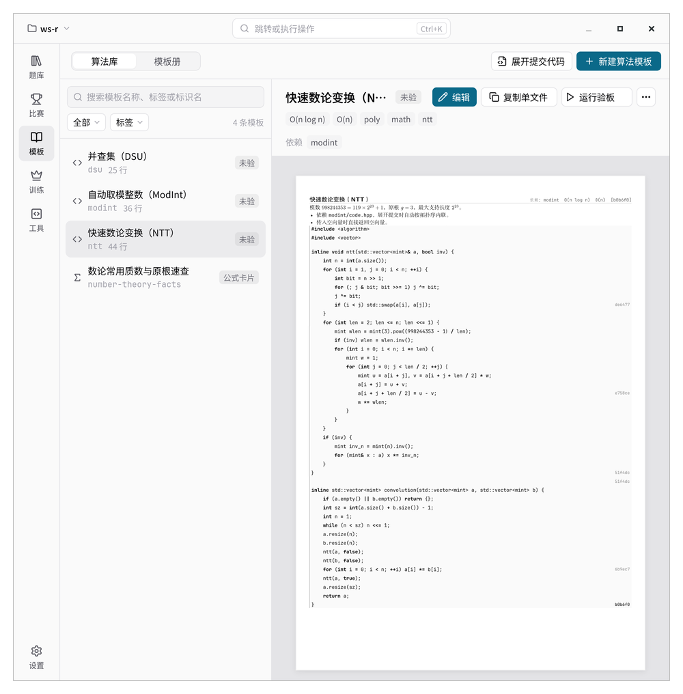

公式卡片的内容也能直接看到了。有两处细节：标题后面跟着状态标签和 3 个按钮，在 960 宽的窗口下「快速数论变换（NTT）」被截成「快速数论变换（N…」；预览里的代码字号很小，需要放大才能读清。

### 1.3 失败原因 ✅

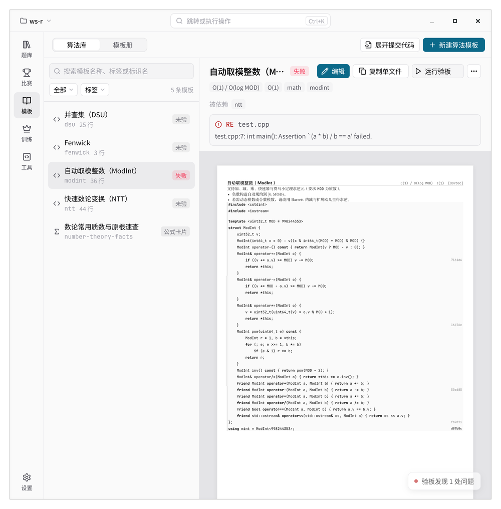

失败原因直接显示在详情头下面：`RE test.cpp` 加上已经去掉路径和哈希的断言消息。Toast 改成了「验板发现 1 处问题」。

### 1.4 断网 ✅

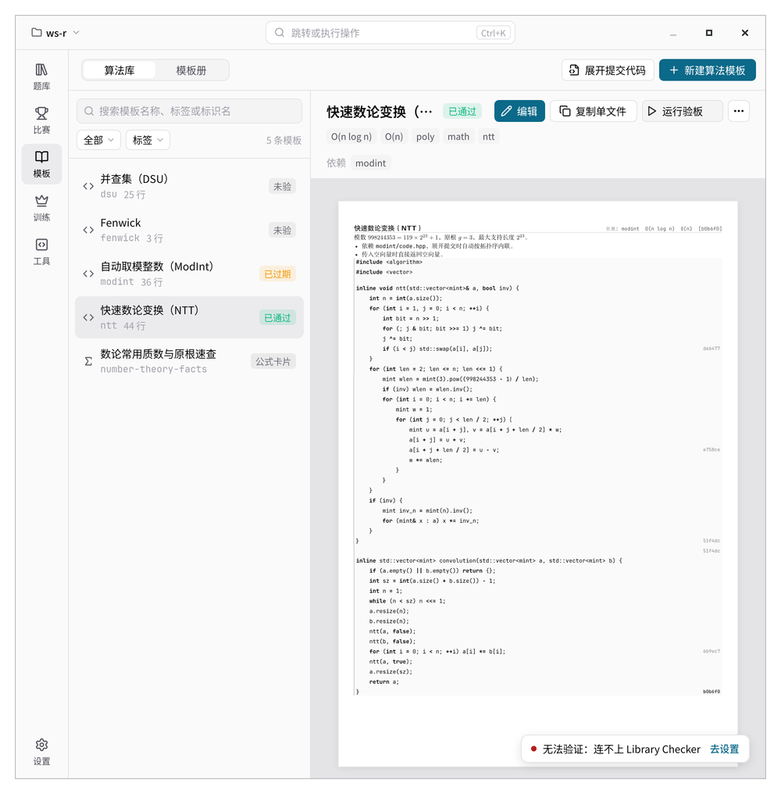

先在联网时让 NTT 验板通过（自测 1/1，convolution_mod 51/51），然后在隔离网络、空缓存的条件下重新验板，状态仍是「已通过」，Toast 显示「无法验证：连不上 Library Checker · 去设置」。

还有一点可以改进：从这里点「去设置」跳到工具链页时，Library Checker 的设置收在默认折叠的「高级」里，用户还得自己展开一次。建议这个入口跳转时直接展开「高级」。

### 1.8 缺失条目 ✅

大纲里缺失的条目显示红色图标和红字，模板册详情里对应的 chip 也是红色；其余内容正常排版，HUD 显示「1 错 1 警」。

---

## 新问题

### A. 新建之后，标题、标签、复杂度和验板项都没有地方改 · 别扭

S-5 的本意是「复杂度和标签放到工作室里再填」，但单条工作室只有「代码 / 说明 / 验板」三个 Tab，没有元数据编辑。前端也没有任何地方调用 `updateSnippetMeta`。结果是：

- 新建模板的标题、标签、复杂度，只能手动去改 `snippet.toml`；
- `[[verify]]` 在界面上一直没有入口，新建的模板在「验板」页永远显示「暂无验板项」，运行验板也没有意义。

建议：在单条工作室加一个和模板册一致的「信息」抽屉（`Cmd+I`），放标题、标签、复杂度，以及验板项的增删（自测文件 / Library Checker 题名 / 工作区题目）。

### B. 定稿对话框不显示阻断错误 · 别扭

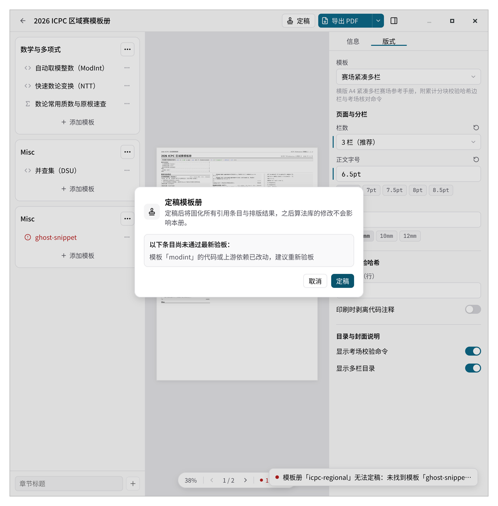

模板册里有缺失条目时，定稿对话框只列出「以下条目尚未通过最新验板」这类警告，「定稿」按钮也照常可以点。点击后才弹出 Toast：「模板册「icpc-regional」无法定稿：未找到模板「ghost-snippe…」」。这条提示有三个问题：用的是 ID 而不是书名，文字被截断，而且对话框也没有关。

建议：预检里的错误在对话框中用红色列出，同时禁用「定稿」按钮；Toast 里改用书名。

### C. 新菜单里的「删除」不是红色 · 打磨

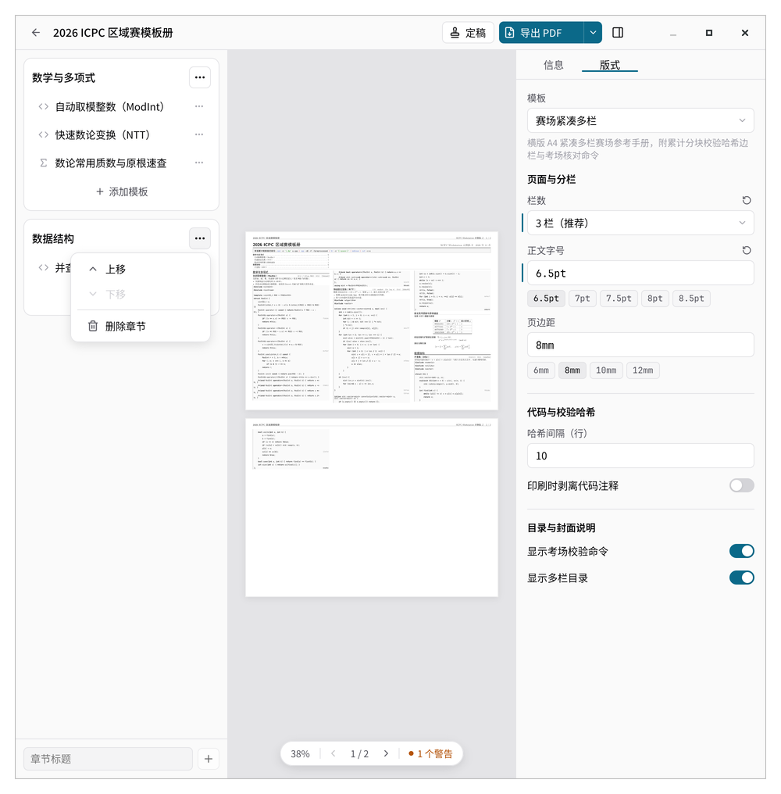

`MenuEntry` 里表示危险操作的字段叫 `destructive`，而 Phase 5 新写的 4 处菜单项用的是 `danger: true`（`TrdStudio.tsx:518`、`:572`，`SnippetsView.tsx:686`、`:992`），所以「删除章节 / 从本册移除 / 删除」都按普通文字显示，不符合 §9.1.4 的「红色文字」。`nsh check` 没有报错，说明这个多余字段没有被类型检查拦下来。

### D. `snippet.toml` 会写出 `tags = []`、`verify = []` · 打磨

0.1 的修法是在 `SnippetMeta` 上去掉空数组的省略，所以新建的 `snippet.toml` 会多出两行空数组，和示例里的手写格式不一致。建议只让 IPC 载荷始终带上数组，落盘时仍然省略空数组（例如给 IPC 单独做一层 DTO，或者把 TOML 序列化和 JSON 序列化分开）。

### E. 0.2 的修法是在桌面壳里兼容解析，而不是对齐编码 · 打磨（代码层）

`apps/desktop/src/snippets.rs` 新增了 `parse_trd_meta_patch` 和 `parse_snippet_meta_patch`，同时接受「扁平值」和 serde 标准的 `Patch<T>` 两种写法。这里有两个问题：

- 注释说「接受标准写法」，但 `Patch::Keep` / `Patch::Clear` 在 serde 里序列化成字符串 `"Keep"` / `"Clear"`。`parse_string_patch` 会把它们当成 `Set("Keep")`，所以实际上并不兼容。
- 这两个函数和上一轮 3 个只修了 Rust 侧的问题（`clean_verify_stderr`、`UNAVAILABLE` 时保留上次结果、`LcFetchError` 分类）都没有对应的测试。上一轮建议补的「往返测试」也没有补。

更简单的修法是 TS 侧直接按 `{"Set": …}` / `"Clear"` 编码，Rust 侧继续用 `serde_json::from_str`，再补一个往返测试。

### F. 文案还剩几处细节 · 打磨

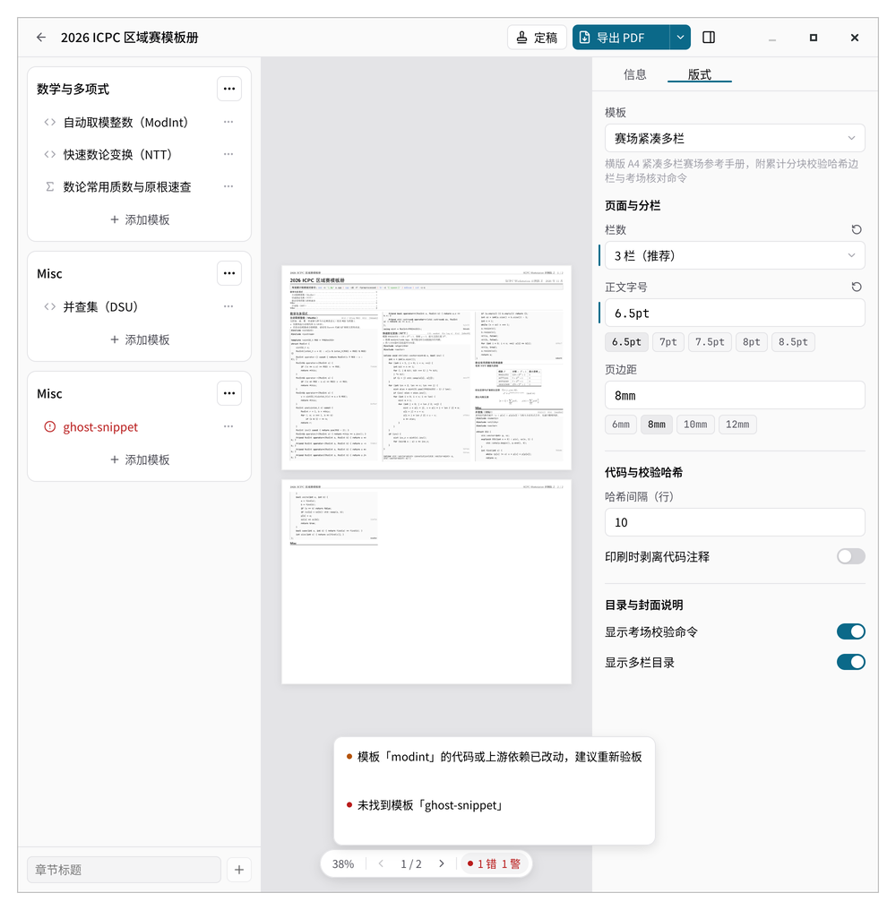

- 预览 HUD 的问题列表里，两条消息之间空着一大块（原来放文件位置的那一行现在是空的，但高度还在）。
- 预检消息用的是标识名，例如「模板「modint」的代码…」，而界面上其他地方都显示标题「自动取模整数（ModInt）」。
- 定稿失败的 Toast 用的是 ID，见 B。

### G. 规格 §5.2 和实现不一致 · 需要你确认

1.9 的修法是把题解编辑器工具栏上的「沉淀」入口整个删掉了，但 `docs/specs/phase-5-living-trd.md` §5.2 仍然写着「出版工作室的 `editorial.md` 代码块右键 / 操作菜单中提供『沉淀为算法模板』」。另外 i18n 里还留着 `snippets.studio.noCodeBlockAtCursor`、`snippets.trd.missingItem`、`snippets.trd.finalizeStrict`、`snippets.studio.verifyDoneFail` 等已经不再使用的 key。

二选一：

- 按「做减法」把规格 §5.2 改成「只在题库代码查看器中提供」；
- 或者把入口放进题解编辑器的右键菜单，只在光标位于代码块内时出现。

### H. 工具链「高级」里的 Library Checker 设置 · 打磨

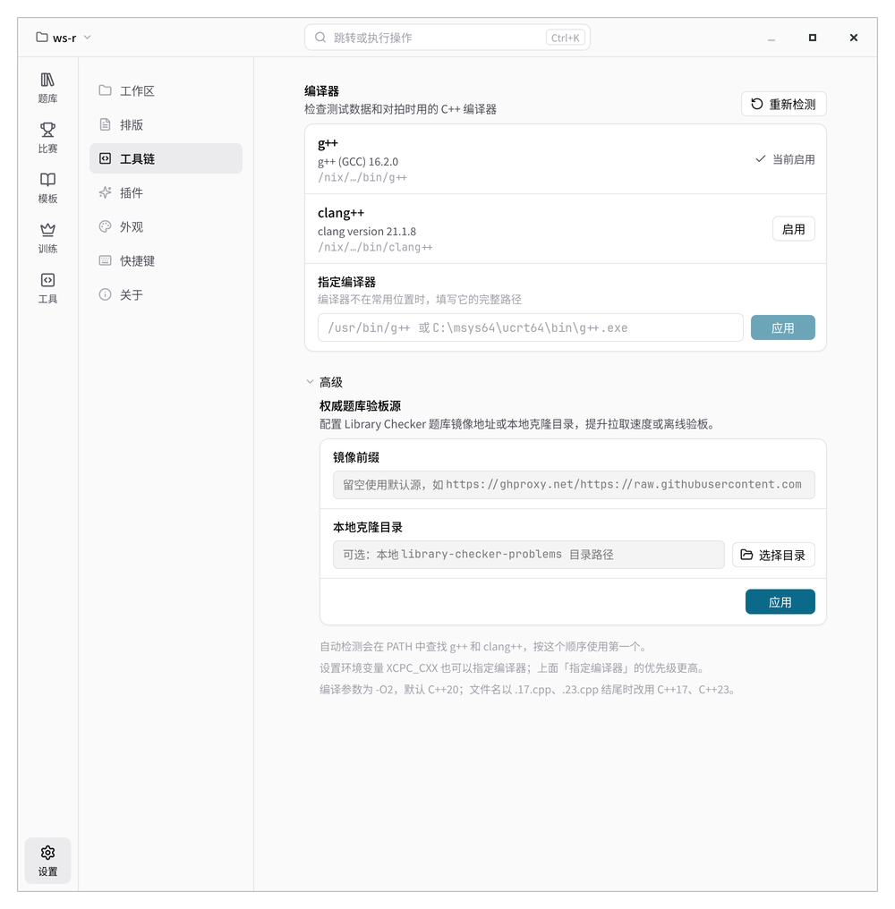

- 同一页里，编译器的「应用」在没有改动时是禁用的浅色按钮，而 Library Checker 的「应用」始终是可点的深色主按钮。
- 镜像前缀的占位符太长，被截断了。
- 卡片放在「高级」里又缩进了一层，外框和标题的左边缘跟上面的编译器卡片对不齐。

### I. 代码编辑器最后一行被切掉一半 · 打磨

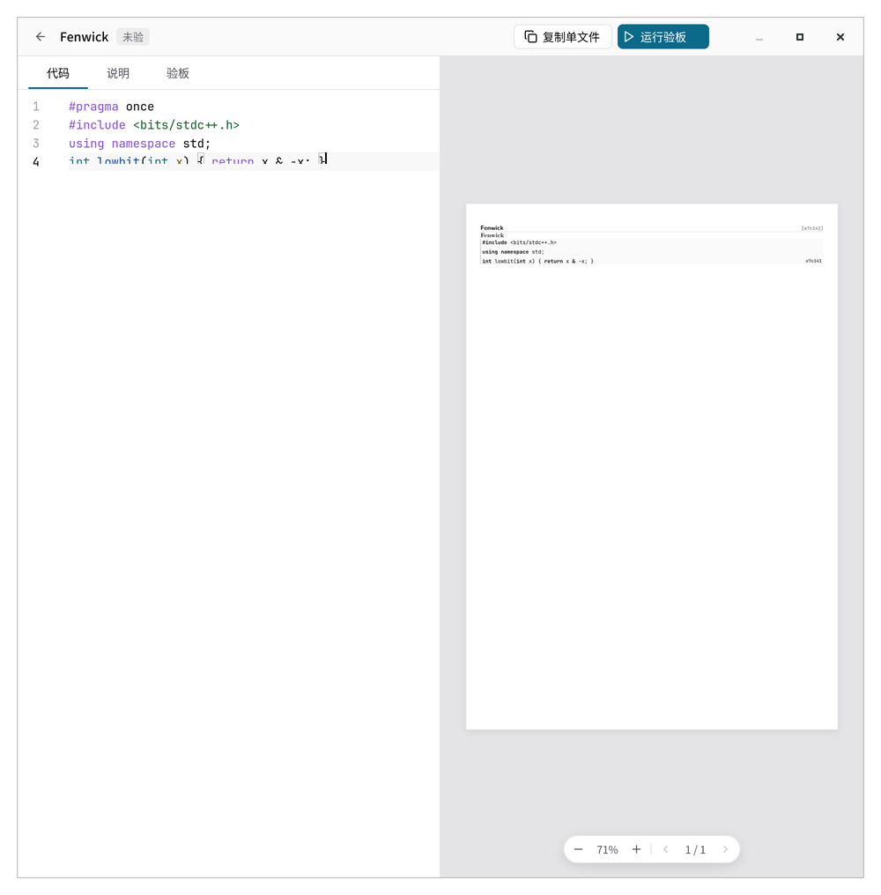

单条工作室的代码编辑器在 `scrollBeyondLastLine={false}` 的同时又设置了内容区 `pt-2`，最后一行的下半截会被裁掉；按回车新增一行之后，上一行才完整显示出来。展开弹窗的输入区也有同样的现象。题库的代码查看器用的是同一套参数，这是原来就有的问题。出版工作室的编辑器用的是 `scrollBeyondLastLine={120}`，没有这个问题。

### J. 切换条目时详情头的高度会变 · 打磨

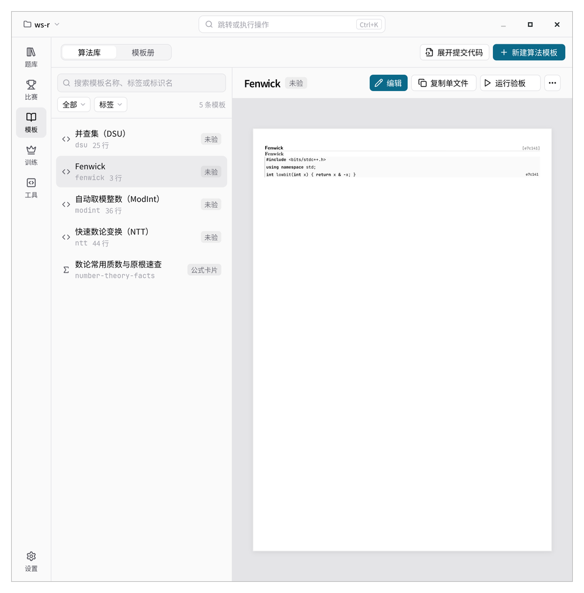

没有标签、复杂度和关系信息的条目（例如新建的 Fenwick），详情头只有一行，大约 52pt 高；ModInt 有 chip 行、依赖行和失败提示，详情头大约 180pt 高。下面的预览会跟着上下跳，在列表里用 `J/K` 连续切换时尤其明显。建议第二行固定占位，或者把失败提示移到预览区上方的浮层里。

### K. 其他 · 打磨

- **2.7 未修**：题库「代码」Tab 里的「沉淀为算法模板」按钮仍然贴着详情栏右边缘，几乎没有间距。

  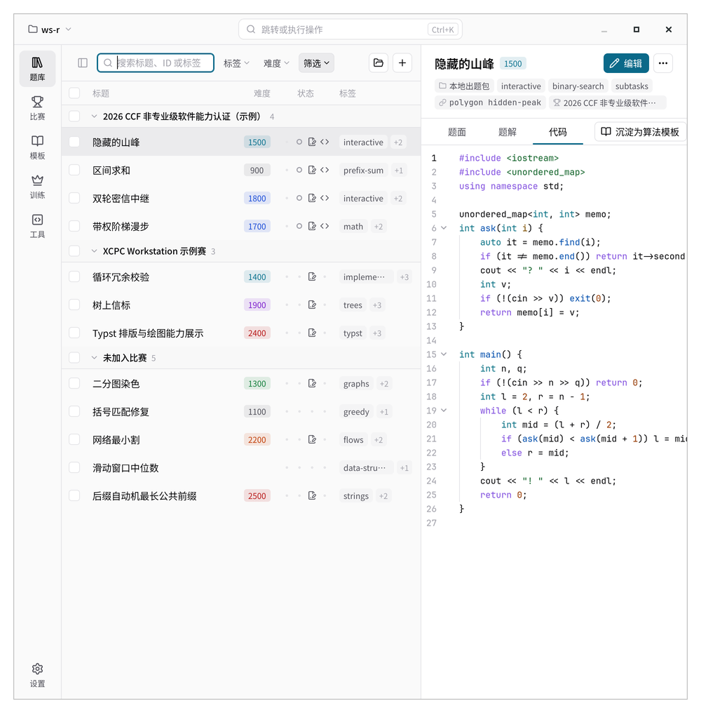

- 章节菜单的触发按钮用的是带边框的 `MoreTrigger`，条目菜单用的是无边框的 `ellipsis` 图标。同一张卡片里出现了两种 `⋯`，章节标题旁边这个显得偏重。
- 章节的 `Each` key 从 `` `${i}:${c.title}` `` 改成了 `c.title`，但界面允许新建同名章节（实测建了两个 `Misc`）。重复的 key 这次没有造成可见的错乱，但仍然有隐患。建议新建章节时拒绝重名，或者 key 改用稳定的 id。
- 「添加模板」菜单不会排除已经在其他章节里的条目，同一个板子可以被收进两章。
- 新建模板时，默认的 `notes.md` 是 `# 标题`，预览里标题会出现两遍（书眉标题下面又是一个同名的 H1）。
- 展开结果的开头连着 3 个空行（系统头文件和第一个内联文件之间）。

---

## 模板册 Typst 模板改版

`crates/xcpc-engine/templates/trd-compact.typ` 和 `trd-book.typ` 已按新的版式规范重写，规范见 `docs/statement-style.md` §5.1。`specs/phase-5-living-trd.md` §3.2 和 §4、`roadmap.md` 已同步修改。这一轮只改模板和文档，需要的代码改动列在下面的 T1–T4。

| 改前（trd-compact 第 1 页） | 改后（同一内容，另加一条 101 行的压力用例） |
|---|---|
| 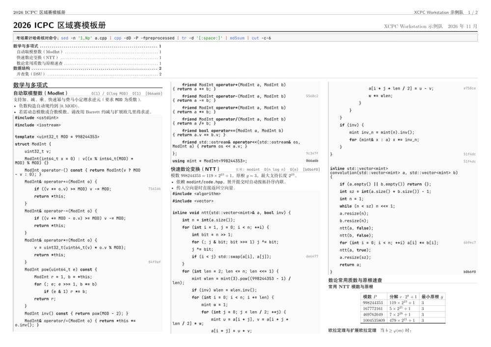 | 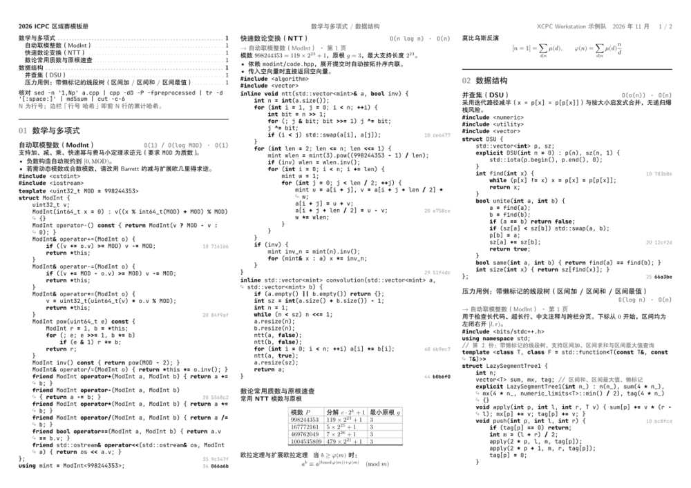 |

主要变化：

- **代码密度**：原来每行代码各包在一个 `grid` 里，行间距几乎翻倍。现在行高固定为代码字号的 1.2 倍，3 栏时每栏约 70 行。改前示例册要 2 页，改后加上 101 行的压力用例也只要 2 页。
- **边栏**：只在打哈希的行印「行号 哈希」，行号就是核对命令里的 `N`；其余行不再预留边栏宽度。累计哈希没变的重复标记（块尾之后的空行）不再印出。
- **长行**：续行悬挂缩进到「原缩进 + 2」，并在行首印 `↪`。
- **层级**：
  - 章标题改为「通栏细线 + 灰色两位章号 + 粗体章名」，条目标题只用粗体；去掉了条目下划线、代码灰底和左竖线。
  - 复杂度放在标题行右侧，标题太长时自动换到下一行。
  - 依赖印成「→ 自动取模整数（ModInt）· 第 1 页」，不再是 `依赖: modint`。
- **首页（compact）**：去掉了大标题横幅和重复的书名，目录和核对命令放在第一栏顶部。页眉中间显示本页的章名，右侧显示队名、日期和页码。
- **全部灰度**：核对命令不再带彩色高亮，代码里的中文注释从仿宋改成黑体。
- **trd-book**：连续排版，首页上部是书名区，下面紧接着目录和正文，不再有只用了四分之一的封面页。正文仍用衬线字体。

  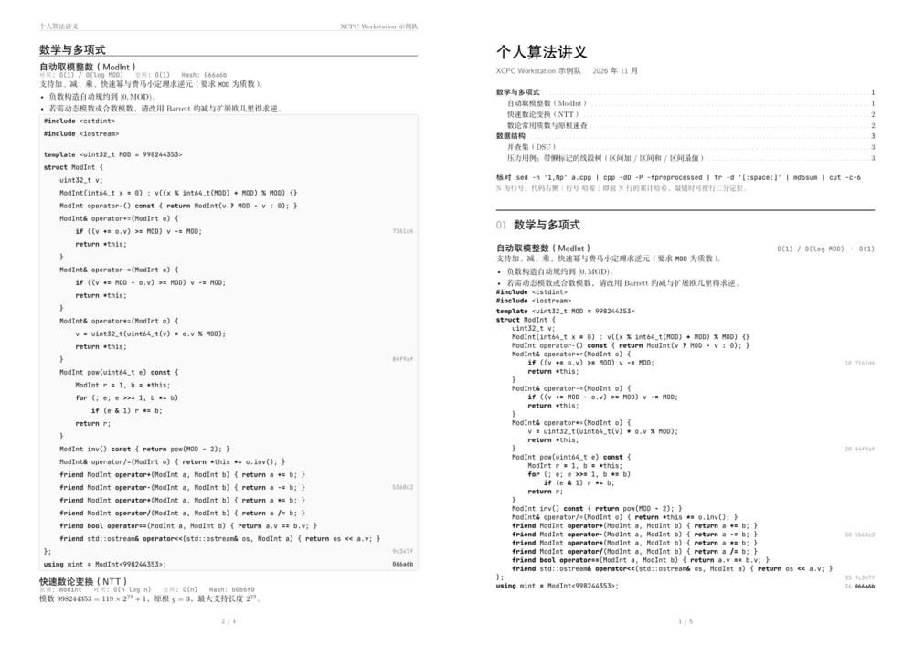

- **版式选项**：去掉了「页边距」「显示目录」和「显示核对命令」。核对命令改为跟随「哈希间隔」：大于 0 时印出，等于 0 时只印总哈希。两套模板现在都只保留栏数、字号、哈希间隔和剥离注释四项。
- **单条预览**（`single: true`）：页宽等于所在册的一栏，高度随内容，和印在册子里的折行完全一致；不再固定成竖版单栏（这是 1.11 的模板侧原因）。

  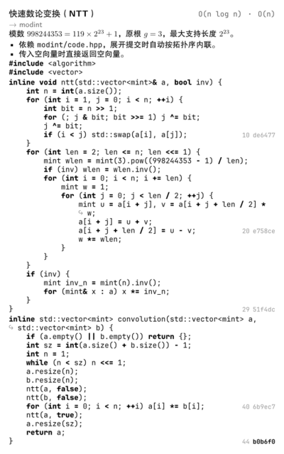

测试方式：用 `xcpc trd render` 渲染示例册，以及 2 栏、4 栏、哈希间隔为 0、trd-book 单栏和双栏这几个变体（各变体都加了一条压力用例：101 行代码，含超长行和中文注释，跨栏分页），逐页查看。单条预览用临时测试直接调用 `compile_snippet_preview` 渲染成 PNG 检查，测试文件用完已删除。

### 需要的代码改动

**T1. 更新模板 schema 测试（现在会失败）**

`crates/xcpc-engine/src/schema.rs:432`、`:433`、`:441` 断言了 `show-verify-cmd` 和 `show-toc` 字段，这两个字段已经从模板中去掉。`cargo test -p xcpc-engine` 里 `parses_trd_template_kind_and_preset_schemas` 失败，其余测试全部通过。改法：删掉这三条断言，改成断言 compact 和 book 都**没有** `margin` / `show-toc` / `show-verify-cmd`，并且都有 `font-size`。

**T2. 单条预览要带上所在册的版式选项和依赖标题**

- `publish::document_snippet_preview`（`crates/xcpc-convert/src/publish.rs` 约 1597 行）取的是 `ws.workspace_template_options()`，不是引用该条目的模板册的 `[template-options.<模板>]`。所以册子改成 2 栏或 6.5pt 之后，单条预览仍按默认的 3 栏、7.5pt 排。建议在 `PreviewRequest` 里带上模板册 ID，由 Core 取该册的模板和选项。前端 `resolveSnippetPreviewTemplate` 只需要返回册 ID，不必自己挑模板。
- 单条预览的 `doc` 里只有当前这一条，模板查不到依赖条目的标题，依赖行只能显示 `→ modint`。建议 `render_trd` 在 `doc` 顶层加一个 `snippet-titles: (slug: title, …)`，包含所有依赖条目（整本也可以用，模板现在是从全书条目里查的）。

**T3. 桌面端预览不刷新工作区模板（存疑）**

测试时在应用运行期间修改了 `templates/trd-compact.typ`：切换条目、按 Ctrl+R 之后，单条预览仍是启动时的模板版本，在模板里加的调试文字也没有出现。而同一份工作区用 CLI 和测试渲染都是新版本。可能是引擎的虚拟文件缓存没有监听 `templates/` 的变化，需要排查。这会影响用户自己定制模板册模板时的体验。

**T4. 哈希块去重放到 Core（可选）**

`prepare_printed_code` 会在块尾和每 N 行各生成一个标记，两个位置相邻时（块尾之后紧跟一个空行）会产生两个相同的哈希。模板现在会跳过重复的标记，但更合理的做法是 Core 直接不生成，这样第三方模板也不用各自处理。

---

## 校验

- `cargo fmt --all -- --check` 通过。
- `cargo test -p xcpc-domain -p xcpc-storage -p xcpc-judge -p xcpc-convert -p xcpc-mcp` 全部通过（复审时）。改完模板之后，`xcpc-engine` 的 `parses_trd_template_kind_and_preset_schemas` 失败（见 T1），其余测试仍全部通过。
- `nsh test`：215 个测试全部通过。`nsh check` 也通过，但它没有拦下新问题 C 的多余字段。
- 测试前备份了 `<dataDir>` 下的 `prefs.json`、`storage.json` 和 `theme.toml`，测试结束后已经还原，并用 `cmp` 逐字节确认过。

## 建议的修复顺序

1. A（元数据编辑入口）和 B（定稿对话框显示阻断错误）。
2. C（`danger` 改成 `destructive`，只改 4 处）、G（先决定规格怎么改）。
3. E（改成 TS 侧对齐编码并补测试）、D。
4. 其余打磨：I、J、F、H、K，以及 1.1、1.10、1.11、2.2、2.7、2.11 里遗留的部分。
