# Phase 5 UX 评审记录（5A / 5B / 5C：算法库与活模板册）

> 评审对象：`73f8b88df`（v0.4.0-beta.4）之上未提交的 Phase 5 工作副本（jj `tworkypu`）。截图在 `docs/review-phase5-ux/`。
> 环境：`xcpc init --example` 生成的示例工作区（modint → ntt 依赖链、dsu、number-theory-facts 公式卡片、示例模板册 `icpc-regional`），另建一个空工作区测空状态；`nsh dev`，用 linux-cua 实际操作。窗口默认约 960×980（逻辑像素，niri 2× 缩放），另测最大化（1560 宽）、浅色 / 深色和英文界面。基准对照：题库和出版工作室。
> 无编译器：另起一个宿主进程，从 PATH 去掉所有 g++ / clang++，工作区为空工作区加一条 dsu。
> 断网：用 `unshare -rn` 把宿主进程放进独立的网络命名空间（只开回环），`XCPC_CACHE_DIR` 指向空目录，Library Checker 无缓存。
> 严重度：**阻断**（走不通，或结果错误）/ **别扭**（能走但不顺）/ **打磨**（质感问题）。

## 总评

导航接入（6 项导航、`Ctrl+1..6`、速查表）、验板顺利路径、定稿和重新编辑的确认流程都能走通，深色主题也没有硬编码颜色。但「模板」空间整体还不能交给用户，问题集中在三类：

1. **看起来能用，其实是坏的**：两条路径会直接触发 Uncaught error（展开弹窗粘贴代码、新建无标签模板）；模板册工作室「信息 / 版式」的修改全部静默丢失；两个工作室的预览在会话内都不刷新；单条工作室离开时丢弃未保存的修改；删除章节不确认、立即写盘。
2. **出错路径没有闭环**：验板失败看不到原因；断网会把已通过的板子改判成「失败」；无编译器、缺失条目、标识名重复都直接把英文报错和文件路径搬上界面，有一处原因还说错了。
3. **缺少内容重心，呼吸感不足**：算法详情页看不到代码或公式本身，只有一排写着「无」的卡片；两层工具栏、分段控件贴顶；新代码字号大多是 11.5–12.5；大纲每行常驻三个图标；多处按钮在状态切换时移位。

---

## P0：阻断

### 0.1 空数组字段被省略，前端读 `.length` 直接崩溃 · 阻断

Rust 侧 `crates/xcpc-domain/src/snippet.rs` 有 23 个 `Vec` 字段带 `skip_serializing_if = "Vec::is_empty"`，而 `apps/desktop/src/ui/snippets/types.ts` 把它们声明为必填。已复现两处：

- **展开提交代码**：粘贴不含本地头文件的源码（例如只 `#include "ntt/code.hpp"`），返回结果里没有 `inlined_files`，`BundlerModal.tsx:259` 读 `.length` 报错。关掉报错后输出停在第一行，弹窗无法继续使用。

  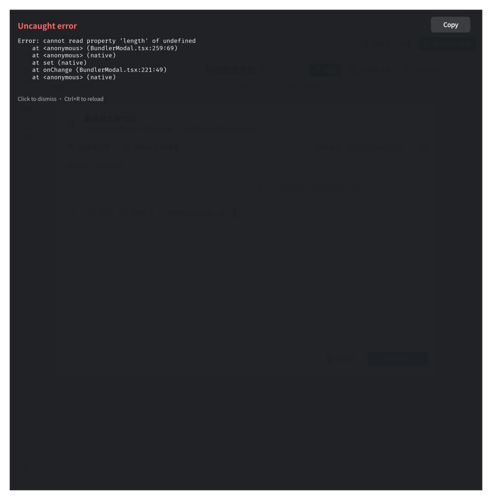

- **新建算法模板**：不填标签就创建，`meta.tags` 缺失，`SnippetsView.tsx:678` 报错；之后每次在列表里选中这个条目都会再崩一次，新建对话框也没有关闭，详情头还混着上一个条目的复杂度和标签。

  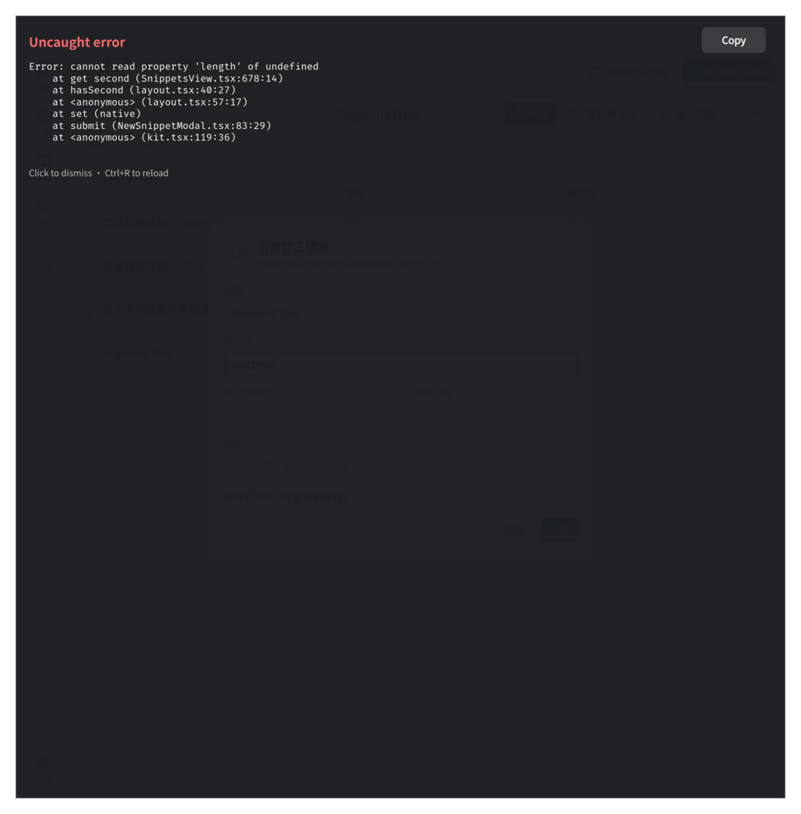

建议：IPC 载荷不省略空数组；或者 TS 类型改为可选，统一用 `?? []` 兜底。补两个前端测试：无标签条目、无本地头文件的展开。

### 0.2 模板册工作室「信息」「版式」的修改全部静默丢失 · 阻断

在「作者 / 队名」末尾加一个字符，按 Tab 失焦后 `trd.toml` 没有变化；在「版式」里点 `8pt` 字号，界面显示已选中，文件同样没写入。重新进入工作室后改动消失。

原因：`TrdMetaPatch` 里的 `Patch<T>`（`crates/xcpc-domain/src/lib.rs:968`）是 serde 默认的外部标签枚举，要求 `{"Set": …}`；`TrdStudio.tsx:181-215` 的 `saveMetaInfo` 和 `updateTemplateOption` 传的是裸值，`update_trd_meta` 反序列化失败，返回的 `res.ok === false` 又被直接忽略，没有任何提示。

建议：参照比赛 Inspector 的编码方式对齐 Patch，失败时就地报错；补一个往返测试。

### 0.3 两个工作室的预览在会话内都不刷新 · 阻断

- **模板册**：删掉「数据结构」章、改字号、导出之后，预览仍然是 2 页、3 个警告；可实际导出的 PDF 只有 1 页，里面没有 DSU。按 Ctrl+R 重新加载后才对得上（1/1、1 个警告）。

  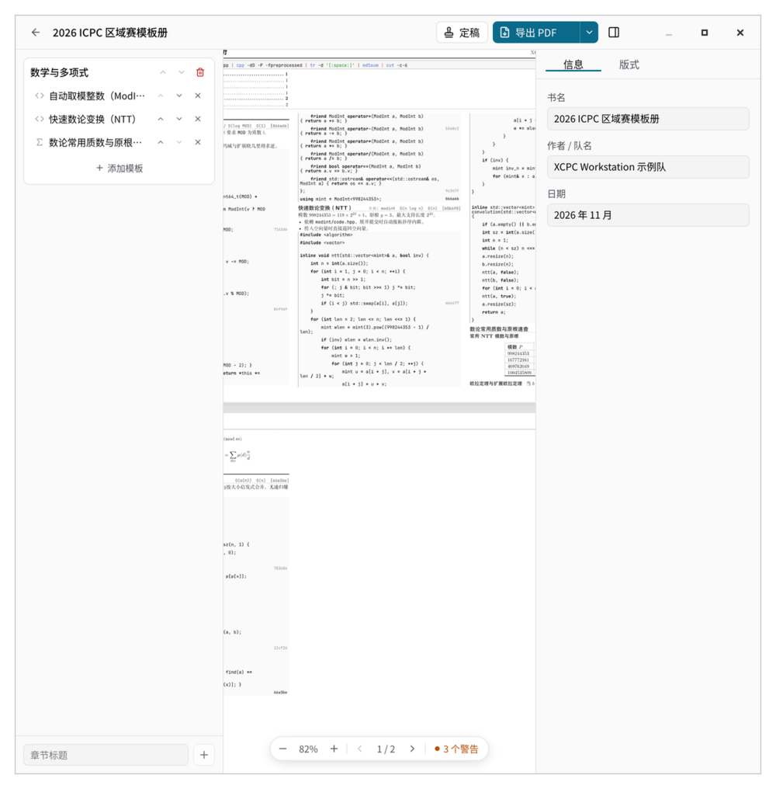

- **单条模板**：在 ntt 的代码里加一行，等 3 秒预览没变；保存后状态变成「已过期」，预览仍然没变。

原因（存疑）：`TrdStudio.tsx:283` 的 `previewRequest` 是常量，保存只 bump 了 `snippetsRevision`，PreviewCanvas 看不到 key 变化，也就不会重新编译。单条工作室在编辑态会带上 `text`（`SnippetStudio.tsx:163`），理论上 key 会变，实测却也没刷新，可能是 `compile_snippet_preview` 的缓存没有失效。需要打日志确认。

### 0.4 单条工作室离开时直接丢弃未保存的修改 · 阻断

在代码末尾输入 `// LIVE` 后点返回箭头，没有任何提示，修改直接丢失（`code.hpp` 里没有这一行）。这个工作室用的是手动「保存」，而出版工作室是自动保存，用户很难意识到需要先保存。建议改为自动保存（见规格建议 S-7）；如果保留手动保存，离开时必须拦截。

### 0.5 删除章节不确认、立即写盘、无法撤销 · 阻断

每个章节标题旁常驻一个红色垃圾桶，没有 tooltip，点一下整章就从 `trd.toml` 里删掉了（`TrdStudio.tsx:134` `removeChapter`）。违反 §9.1.4：删除只放在 `⋯` 菜单，红色文字，点击后弹确认。

---

## P1：可用性与规范

### 1.1 顶栏分段控件贴顶；页面结构出现两层工具栏 · 别扭

`Segmented` 带 `alignSelf: "flex-start"`（`kit.tsx:284`），放进横向的 `Toolbar` 后贴在上沿，和右侧「展开提交代码 / 新建」不在同一中线，最大化后更明显。另外，模板空间在整页宽的工具栏下面又加了一行搜索和筛选，和题库「列表栏顶部 52pt 工具行 + 详情头同中线」的同构结构（§9.1.3）不一致，平白多出约 50pt 高度。

| 模板空间 | 基准：题库 |
|---|---|
| 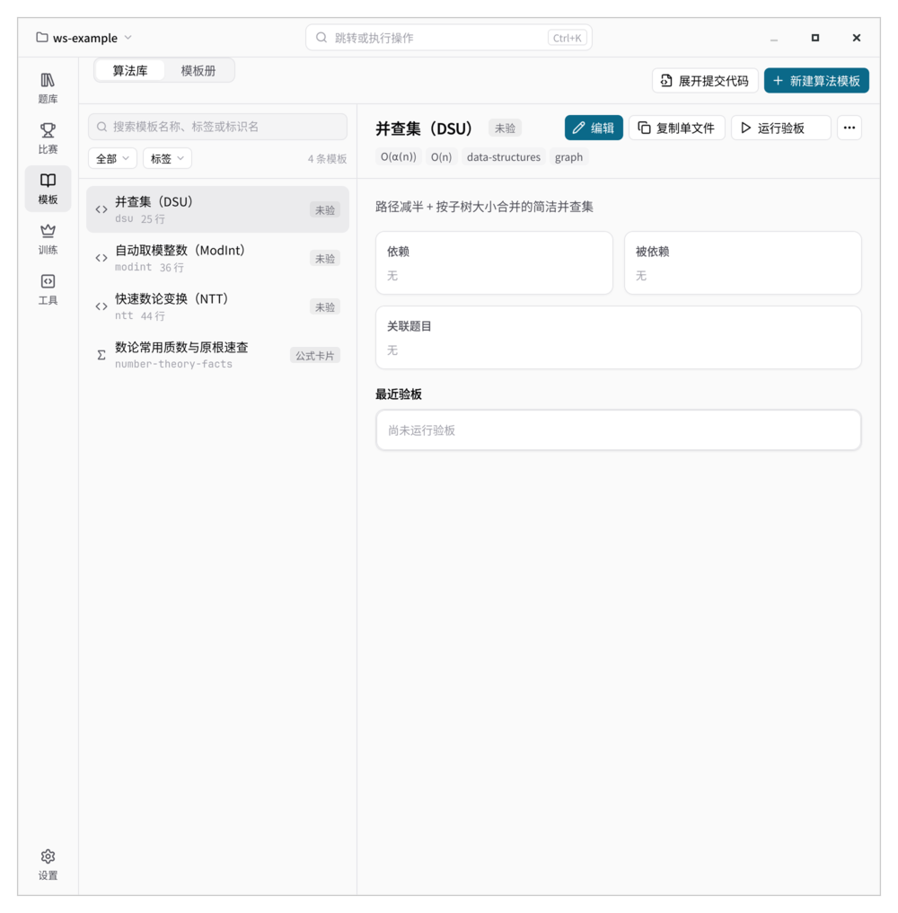 | 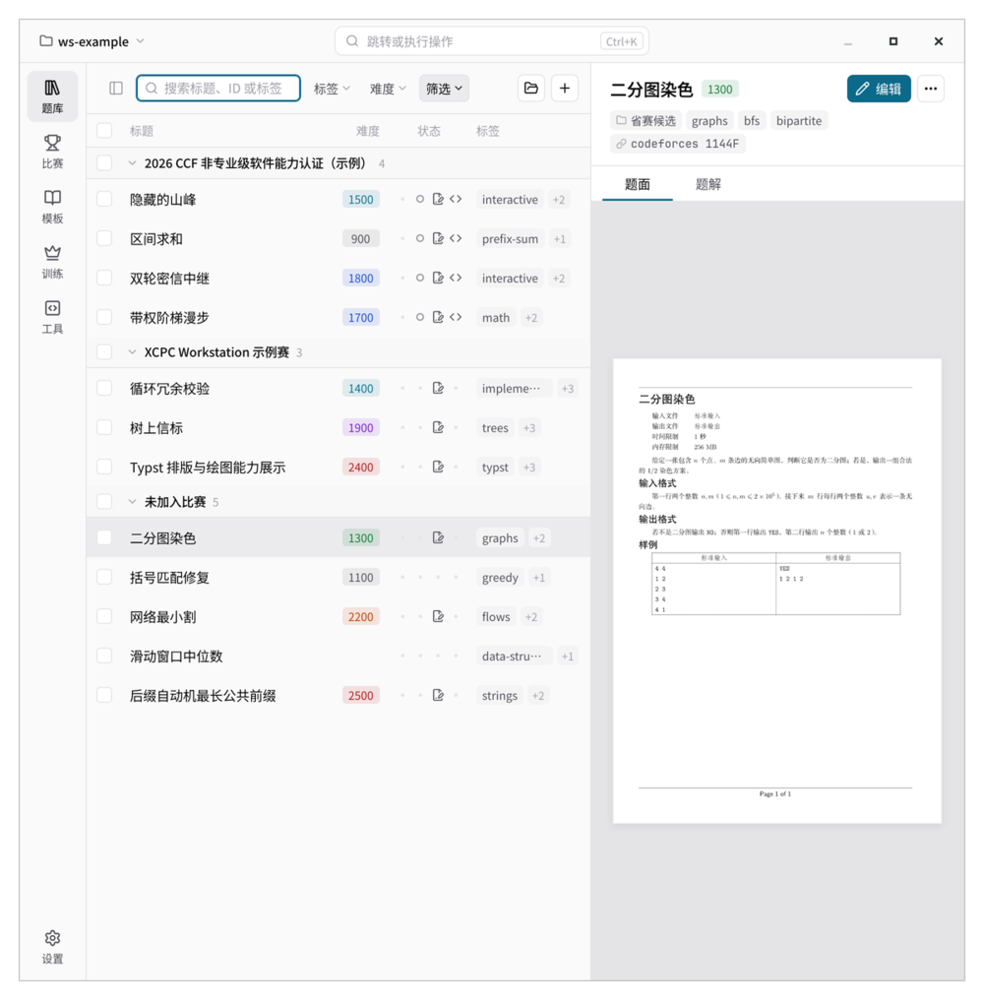 |

### 1.2 算法详情页看不到算法本身 · 别扭

详情区只有「依赖 / 被依赖 / 关联题目」三张卡片和「最近验板」，示例数据里大多数卡片都写着「无」。公式卡片的详情是三个「无」，公式内容一个字都看不到。题库详情的主体是题面预览，模板这边却没有任何内容可看，这是质感上最大的缺口：页面没有重心，宽屏下下半屏全空。

建议：详情主体放单条渲染预览（复用 PreviewCanvas）或只读代码；关系信息压成标题下的一行文字，为空就不显示。

| 公式卡片 | 最大化 |
|---|---|
| 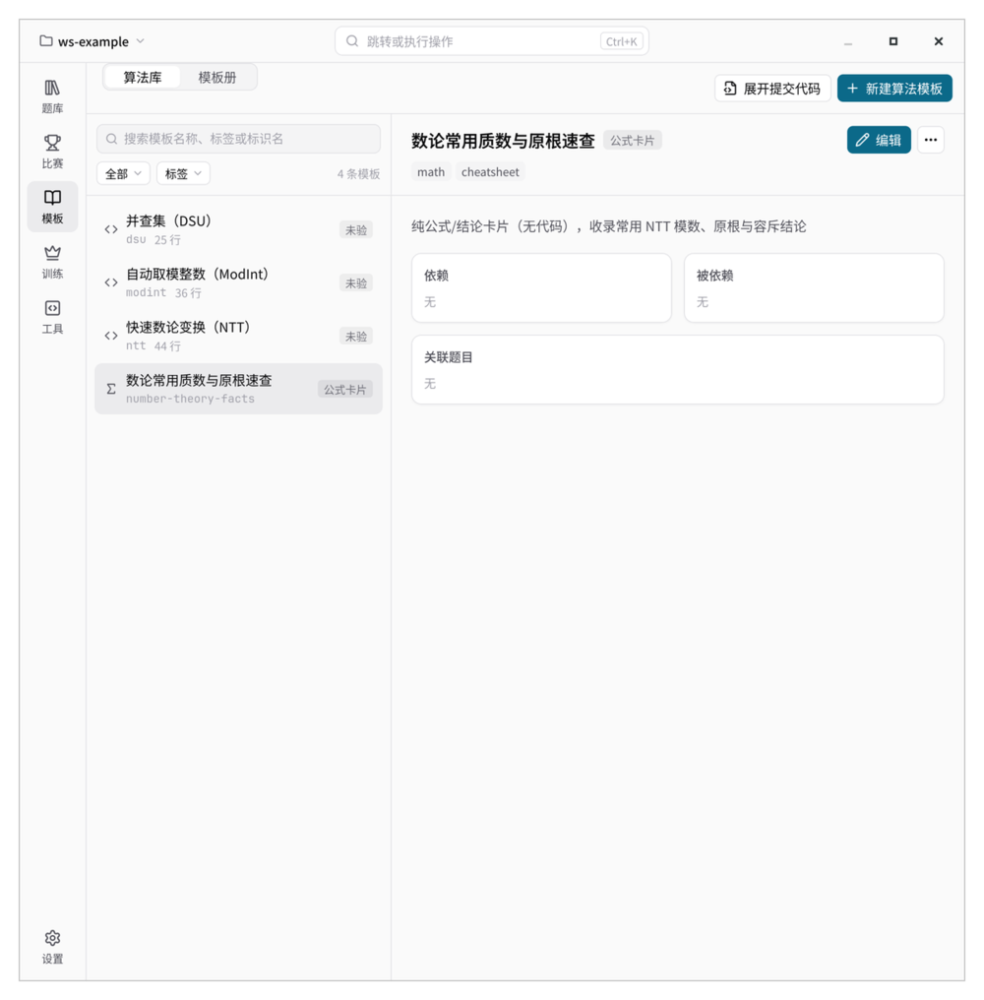 | 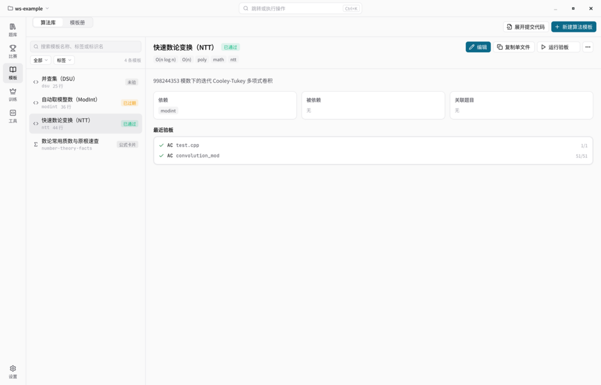 |

### 1.3 验板失败时看不到原因 · 别扭

把 modint 的乘法改坏后，界面只显示「RE test.cpp 0/1」，点这一行也没有反应。验板报告（`.xcpc/snippet-verify/modint.json`）里其实记录了 `test.cpp:7: int main(): Assertion '(a * b) / b == a' failed.`，只是没展示出来；而且这条消息前面带着一串哈希和绝对路径，展示前需要清理。Toast「验板发现问题（1 / 1）」里的「1 / 1」指什么也看不明白。

### 1.4 断网时，已通过的板子会被改判成「失败」 · 阻断（结果错误）

断网且无缓存时验证 ntt（此前为「已通过」），结果是「失败」，Library Checker 那一项显示「JE convolution_mod 0/0」，底层消息是 `library-checker problem 'convolution_mod' not found remotely (configure 'local_repo_path' or 'mirror_url')`。板子本身没有错，模板册预检却会因此报失败，消息还把「连不上」说成了「找不到」。

建议：网络或拉取失败时归为「无法验证」，保留上一次的结果；提示改成白话，例如「连不上 Library Checker，可以在设置里配置镜像或本地目录」，并附跳转入口。

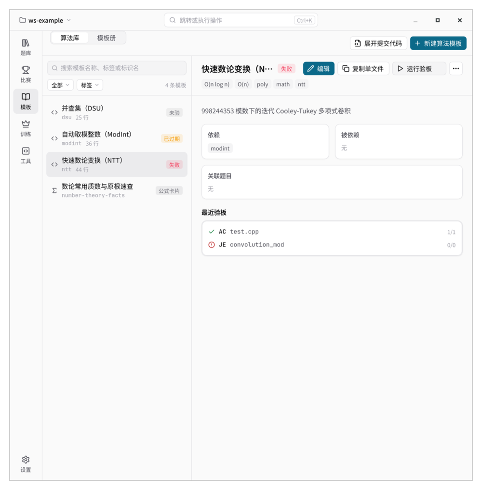

### 1.5 中文界面里直接露出英文报错、反引号和文件路径 · 别扭

- 预检警告（预览 HUD）和定稿对话框：``snippet `modint` has not been verified``，下一行是 `trds/icpc-regional/trd.toml:1`。
- 没有编译器时：Toast 显示 `no C++ compiler found (install g++ or clang++, or set XCPC_C…`，文字被截断，还提到了环境变量，也没有「前往工具链设置」的入口（Phase 3 评审 0.1 已经处理过同类问题，这里又出现了）。
- 引用了不存在的条目：预览区显示 ``snippet `ghost-snippet` does not exist in snippets/``。
- 新建时标识名重复（`ntt`）：报的是「文件「snippets/ntt/snippet.toml」已被外部修改，保存已取消。请先重新加载再保…」，原因说错了，而且文字溢出了对话框右边界。

| 无编译器 | 标识名重复 |
|---|---|
| 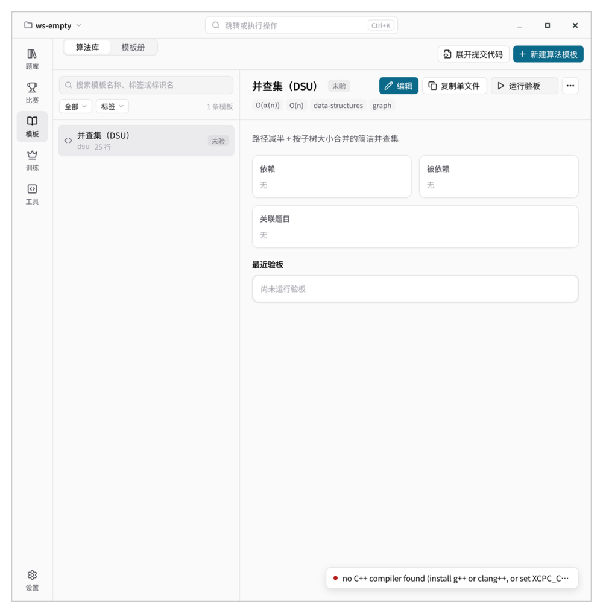 | 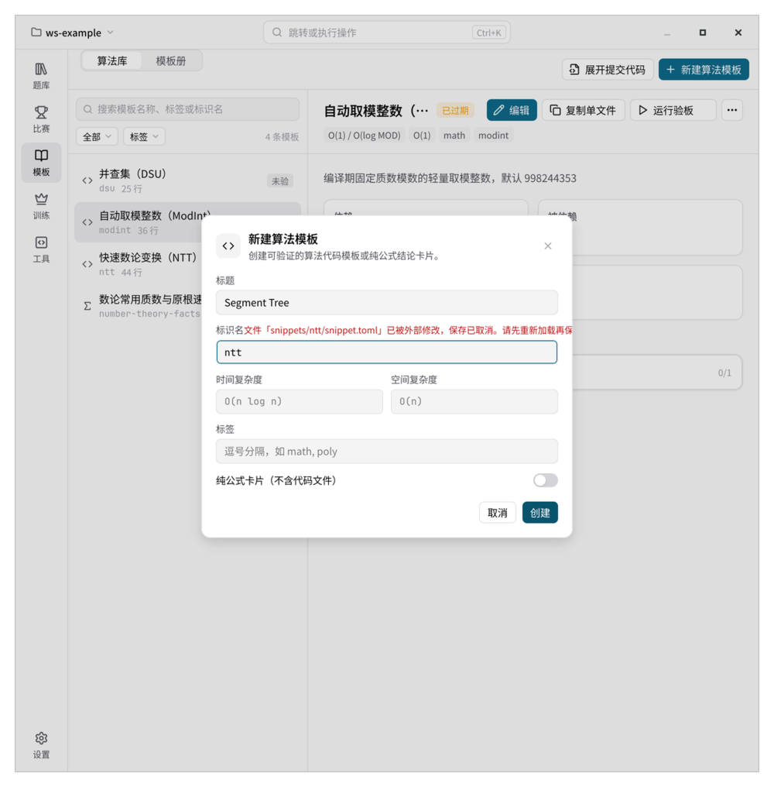 |

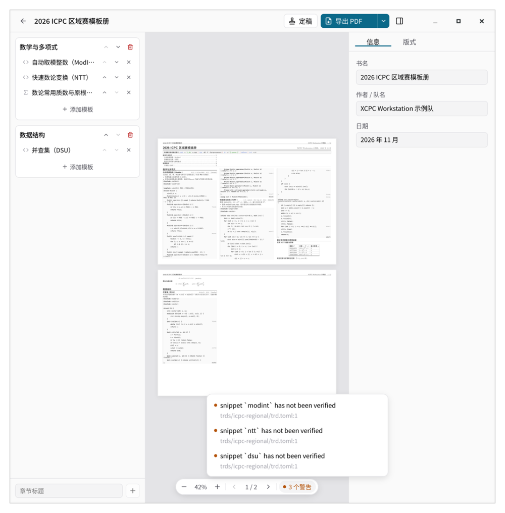

### 1.6 状态切换时按钮移位 · 别扭

违反「不能有 1px 布局抖动」和 §9.1 第 0 条：

- 「导出 PDF」变成「已导出」后按钮变窄，「定稿」右移约 18px（`09-trd-exported-shift.png`）。
- 「运行验板」变成「验板中…」时，算法详情头的「编辑 / 复制单文件」、单条工作室标题栏的按钮整体平移。
- 「保存」变成「已保存」时，左边的按钮跟着动。
- 在「算法库 / 模板册」之间切换时，列表栏宽度变化（约 466 和 443pt），右上角主按钮文案长度也不同（「新建算法模板 / 新建模板册」），导致「展开提交代码」位置跳动。

建议：状态按钮用固定宽度槽位；两个子视图的列表栏共用同一个宽度。

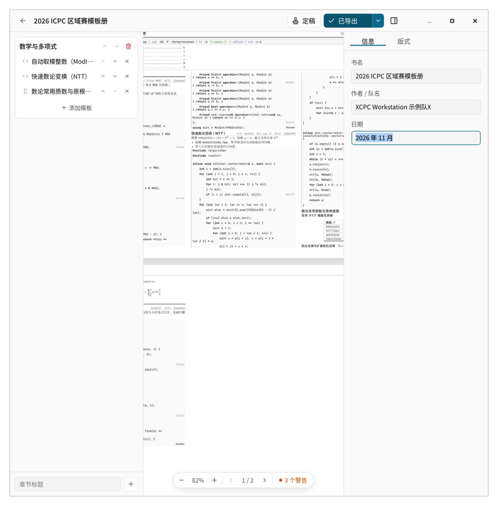

### 1.7 ⌘K 搜不到算法模板和模板册 · 别扭

输入 `ntt` 只能模糊匹配到题目「网络最小割」。`CommandPalette.tsx` 只加了动作（展开、新建、全部验板），没有为条目建立跳转索引。在模板空间打开 ⌘K 时，默认列出的仍是「导入 Polygon ZIP / 复制带样例的 Markdown / 加入比赛」这类题库动作，占位符也只写了「跳转到题目或比赛」。

### 1.8 一个缺失条目就让整本预览失败，缺失项也没有标出 · 别扭

在 `trd.toml` 里引用一个不存在的 `ghost-snippet` 后，预览区变成「排版出错，暂时没有页面」。大纲里它和正常条目一样带代码图标；模板册列表（「2 章 5 条」）和详情的 chip 也看不出问题。建议：缺失项在大纲里标红，渲染时跳过或放占位，不拖垮整本。

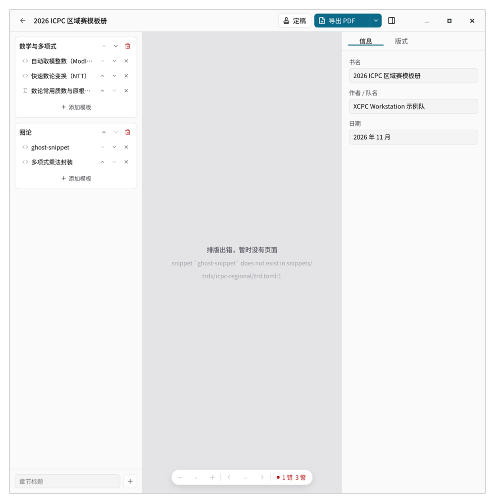

### 1.9 题解「沉淀为算法模板」会把整篇 Markdown 当成代码 · 别扭

`StudioView.tsx` 先用 `extractCodeBlockFromMarkdown(raw)` 找代码块，找不到时退回 `raw`，也就是整篇题解；找到时取的也是第一个代码块，而不是光标所在的那个。另外它往题解编辑器工具栏加了第 5 个图标，违反 §9.1.10（只保留 4 个高频插入图标）。建议：只在光标位于代码块内时提供，放进右键菜单或 `⋯` 菜单。

### 1.10 「说明」编辑器既不软换行，也没有 Markdown 样式 · 别扭

长行会被直接截断（「原根 $g = 3$」的后半截看不到）。同时它是纯等宽纯文本，和题面编辑器的样式源码（标记淡化、公式浅底，§9.1.10）不一致。

### 1.11 单条预览固定用竖版 trd-book，和实际模板册的版式不一致 · 别扭

`SnippetStudio.tsx:167` 写死了 `book: "trd-book"`。示例模板册用的是横版三栏的 trd-compact，单条预览却是竖版单栏，NTT 被分成两页，第二页几乎是空的。这样预览就看不出「印出来是什么样」。建议：用该条目所在模板册的模板（或工作区默认模板）渲染。

### 1.12 英文界面下分段控件溢出 · 打磨

`itemWidth={76}` 是写死的，「Algorithms / Handbooks」顶到了边，滑块盖不住文字。另外导航叫 `Snippets`，分段控件叫 `Algorithms`，叫法不统一。

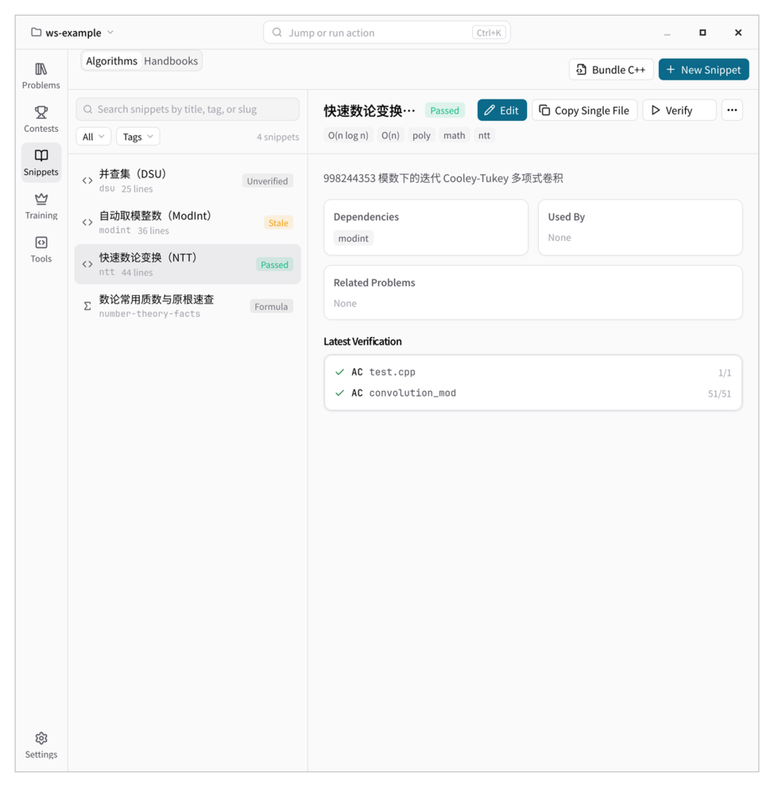

---

## P2：质感与一致性

### 2.1 字号整体偏小，挤掉了呼吸感 · 打磨

`ui/snippets/` 下的字号字面量，71 处是 12、12.5 或 11.5，13 以上只有 21 处；§5 规定常规正文与列表为 13–14。模板册大纲的条目是 12px、行高 28，章节标题是 12.5px，行密度明显比题库挤。

### 2.2 大纲每行常驻 ↑ ↓ × 三个按钮，条目标题因此被截断 · 打磨

即使在最大化窗口里，也只能看到「自动取模整数（ModI…」。规格要求的是拖拽排序，`studio/Outline.tsx` 和 `studio/reorder.ts` 里已经有比赛组卷的现成实现可以复用；移除操作放到悬停或 `⋯` 菜单即可。章节的 `Each` key 用的是 `` `${i}:${c.title}` ``，移动和重命名时会重建整个章节视图。

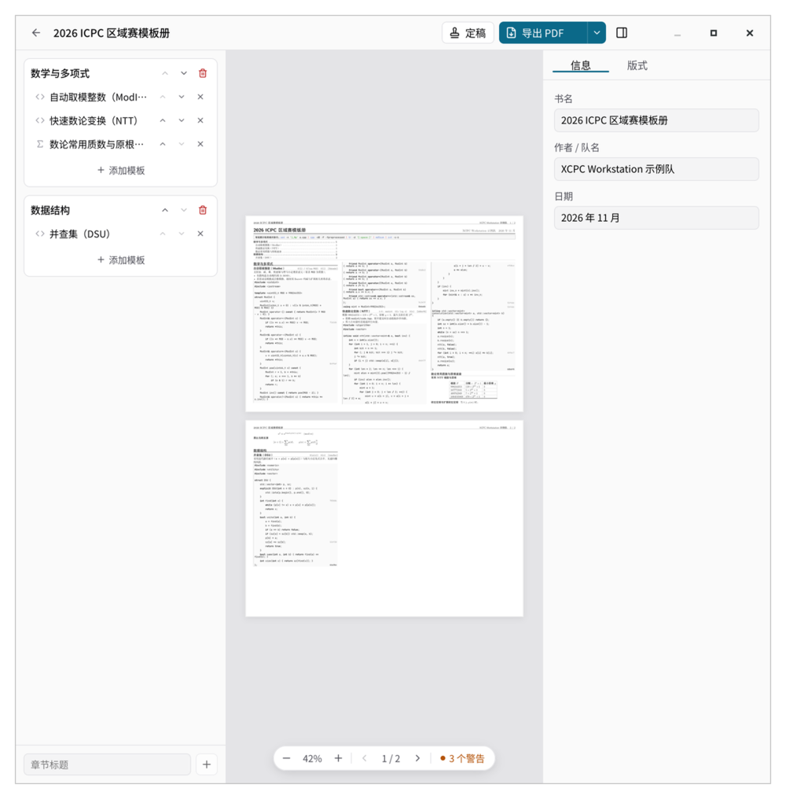

### 2.3 验板页内容重复 · 打磨

「验板项」和「最近验板」把同一组条目列了两遍；标题栏和「验板」Tab 里还各有一个「运行验板」。建议合并成一张列表，每项右侧直接显示结果。

### 2.4 展开弹窗的细节 · 打磨

- 弹窗标题「展开单文件代码」和入口按钮「展开提交代码」叫法不一致。
- 「自动包含工作区算法库」是一个点不了的 chip，属于噪音。
- 左右编辑器的行高分别是 20 和 18（`BundlerModal.tsx:219`、`:247`），第 1 行就对不齐。
- 输出区在空状态下只有一个行号「1」。

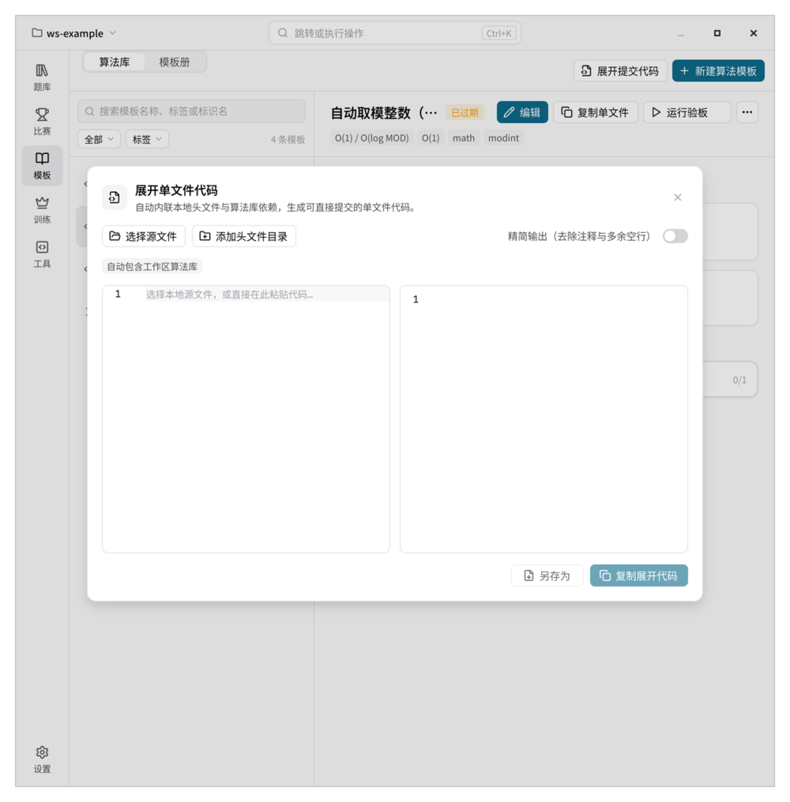

### 2.5 空状态的细节 · 打磨

说明文字最后的「册。」单独掉到了第二行；行动按钮没有标快捷键（§9.1.5）；同一屏里工具栏和空状态各有一个同名的「新建算法模板」主按钮。

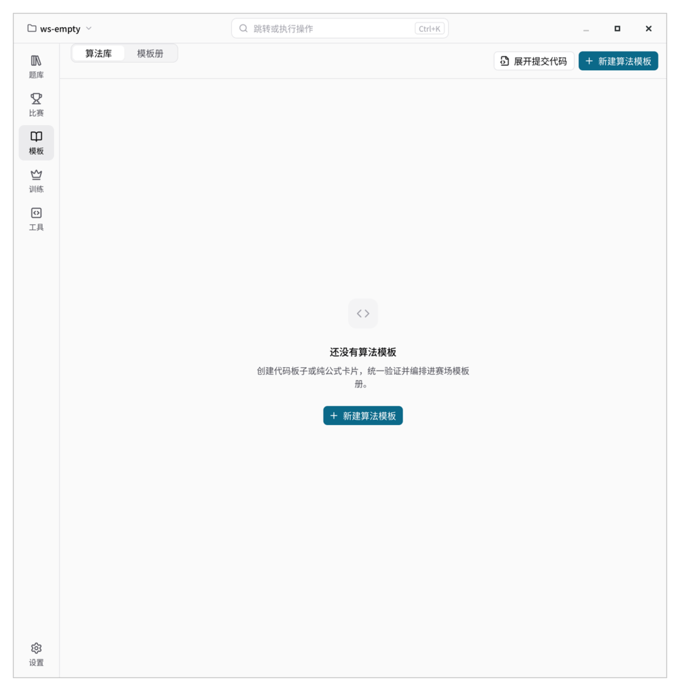

### 2.6 新建对话框 · 打磨

复杂度输入框的占位符「O(n log n)」颜色接近正文，看起来像已经填好了。从题库「沉淀为算法模板」进来时，标题会预填成题目名「隐藏的山峰」，标识名默认是 `snippet`，两者都需要用户手动改，而且对话框里看不到导入的代码。

### 2.7 「沉淀为算法模板」按钮贴着右边缘 · 打磨

在题库的「代码」Tab 里，这个按钮几乎贴着详情栏右边界；它只在「代码」Tab 下出现，切换 Tab 时会突然冒出来。

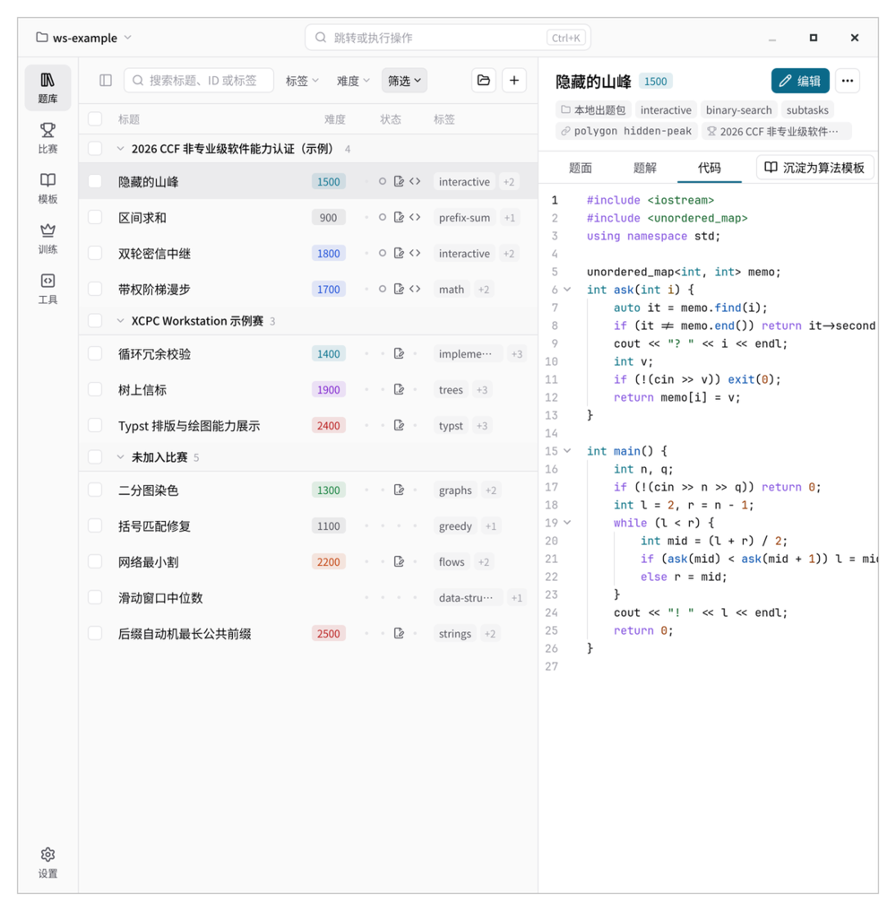

### 2.8 定稿后「信息」页看起来仍可编辑 · 打磨

日期框保留着焦点环和选中态，输入虽然会被忽略，但视觉上没有表现出只读。

### 2.9 模板册详情里条目显示的是标识名，不是标题 · 打磨

列表里显示的是 `number-theory-facts`，而大纲里显示的是中文标题，两处不一致。

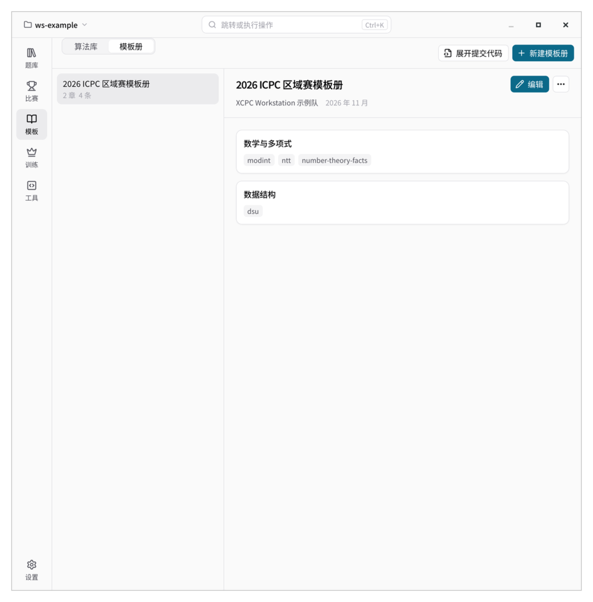

### 2.10 对话框和抽屉不一致 · 打磨

「定稿模板册」的说明写在标题下方，「重新编辑模板册」的说明放在头部之外的正文里（§9.1.6 要求头部是图标方块 + 标题 + 一句说明）。属性抽屉宽 290pt，§9.1.12 规定 320–340pt。

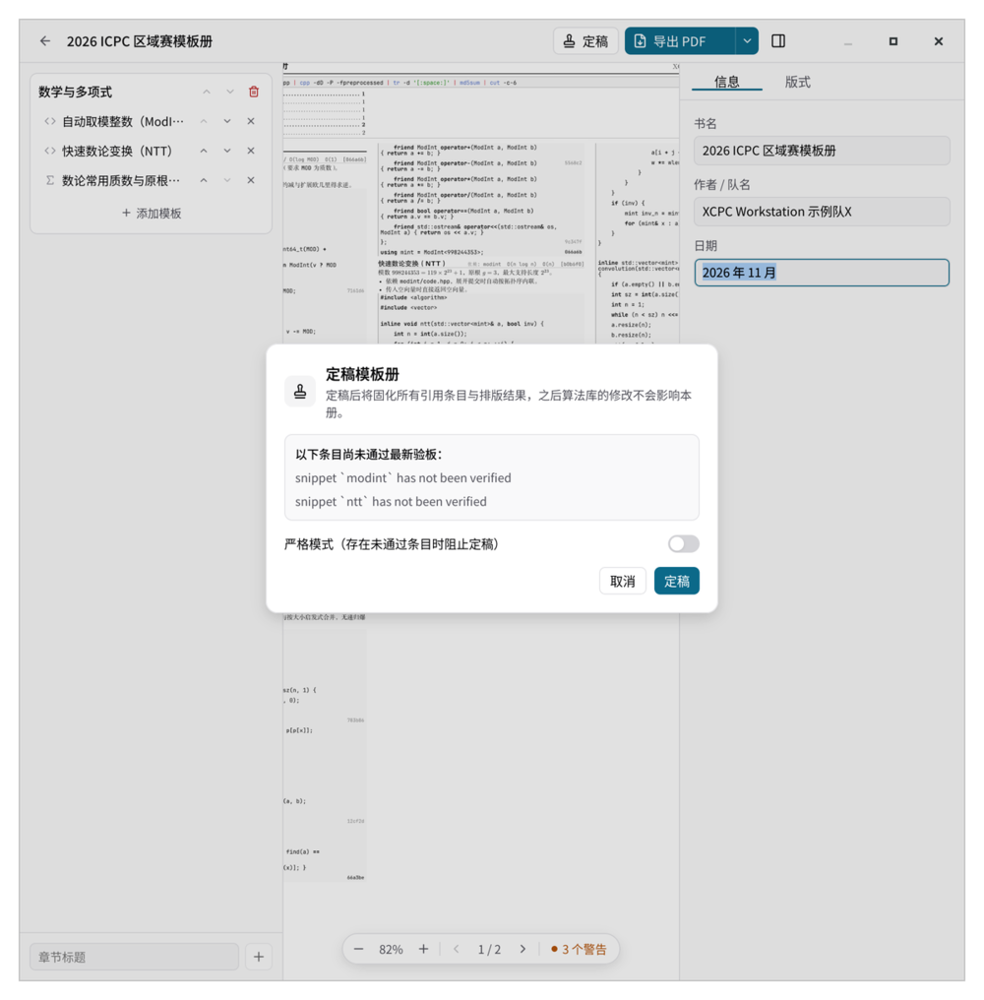

### 2.11 窄窗口下模板册预览默认缩放只有 42% · 打磨

横版 A4 缩在中间很小一块，四周大片灰底。建议默认适配宽度。最大化后的效果（`21-wide-trd-studio.png`）不错，累计哈希边栏和考场校验命令清楚可读。

### 2.12 文档没有同步 · 打磨

`docs/design-system.md` §2.1 和 §8.1、§9 里仍然写着 `Cmd+1..3/4` 和旧的导航槽位，没有加入「模板」空间。

---

## 建议改规格（做减法，待确认）

这些地方实现是照 `specs/phase-5-living-trd.md` 做的，但按「做减法」的原则可以去掉或收起来，请确认后再改规格。

| 编号 | 建议 | 理由 |
|---|---|---|
| S-1 | 去掉定稿对话框里的「严格模式」开关，只保留 CLI 的 `--strict` | 在对话框里放一个会阻止自己确认的开关，逻辑上有点绕 |
| S-2 | 「未验」不算警告，只有「失败」和「已过期」才提示 | 示例工作区一打开，模板册预览就是橙色的「3 个警告」 |
| S-3 | 「权威题库验板源」收进工具链的「高级」折叠里 | 镜像前缀和本地克隆目录是低频的技术配置，现在占了一整张卡片，还带单独的「保存」按钮（同页编译器用的是「应用」）（`19-settings-toolchain.png`） |
| S-4 | 状态筛选去掉「公式卡片」，只保留「全部 / 未验 / 已过期 / 失败 / 已通过」 | 公式卡片是类型不是状态，列表里的 Σ 图标已经能区分 |
| S-5 | 新建对话框只保留标题、标识名和「公式卡片」开关 | 复杂度和标签放到工作室里再填，创建这一步更轻 |
| S-6 | 详情页去掉「依赖 / 被依赖 / 关联题目」三张卡片，改成一行关系文本，为空不显示 | 把位置让给代码预览（配合 1.2） |
| S-7 | 单条工作室改为自动保存，去掉「保存」按钮 | 和出版工作室一致，0.4 自然消失 |

## 做得好的地方

- 六项导航、`Ctrl+1..6`、快捷键速查表和命令面板里的空间切换都已同步，顺序一致。
- 验板的顺利路径能跑通（自测 1/1、convolution_mod 51/51）；改代码保存后状态立即变成「已过期」，并能正确级联到下游。
- 定稿和重新编辑都会弹确认；定稿后大纲变成只读，标题旁出现锁标记。
- 深色主题下状态色、卡片和预览都清晰可读，没有出现硬编码的浅色（`17-dark-library.png`）。
- 空状态的结构符合 §9.1.5（图标方块、一句标题、一句说明、一个行动按钮）。

## 未覆盖

以下几项本次没有实测，需要另外补测：展开弹窗的「选择源文件 / 添加头文件目录」（需要原生文件对话框）、「另存为」、循环 include、「补齐缺失依赖」、实际点击「验证本条及下游依赖」、新建模板册对话框、归档区、算法库的状态 / 标签筛选菜单、`J/K` 键盘导航、`workspace.toml` 里 `snippets = false` 隐藏导航。流畅感方面，新视图没有拖拽和缩放手势，所以合成器约束不涉及；状态按钮抖动见 1.6；验板状态在 `SnippetsView`、`SnippetStudio`、`CommandPalette` 三处各写了一份 220ms 的 `setInterval` 轮询，逻辑重复。

## 建议的修复顺序

0. **数据与崩溃**：0.1 空数组序列化（一次修复覆盖所有同类字段，并补测试）、0.2 Patch 编码、0.3 预览刷新。
1. **防丢失**：0.4 离开拦截或自动保存（S-7）、0.5 删除章节进 `⋯` 菜单并确认。
2. **出错路径**：1.3 展示失败原因、1.4 断网归为「无法验证」、1.5 文案白话化与跳转入口、1.8 缺失条目标记。
3. **结构与质感**：1.1 工具栏同构、1.2 详情页以预览为主体、1.6 固定宽度槽位、2.1 字号回到 13–14、2.2 拖拽排序。
4. **其余打磨与规格做减法**：按 S-1 至 S-7 的确认结果执行。
