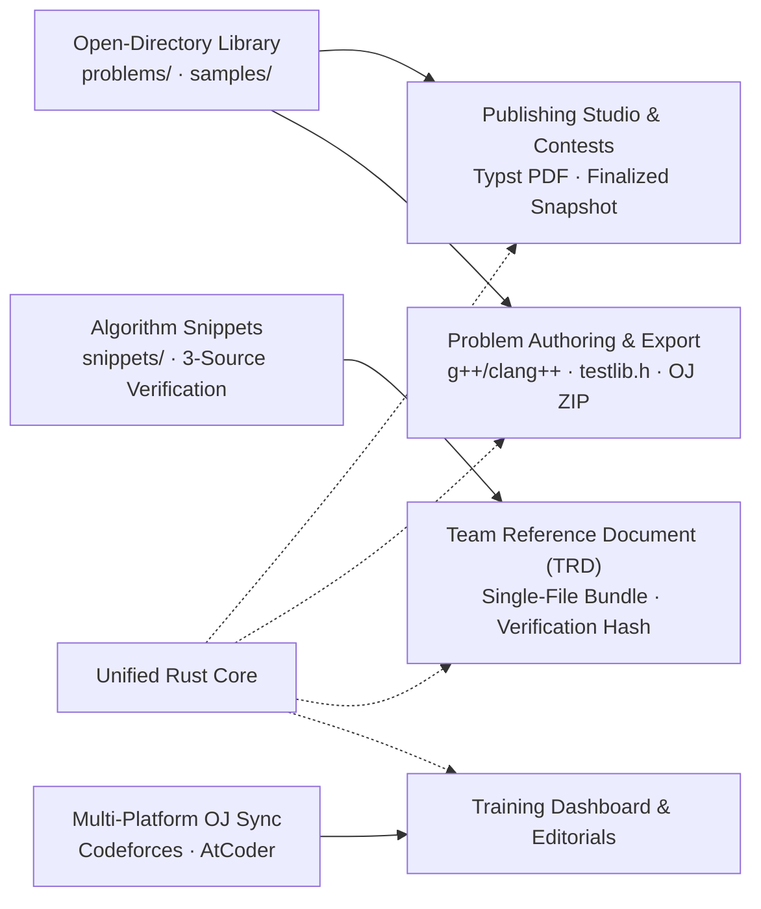

# Getting Started

**XCPC Workstation** is a local-first personal XCPC workstation built on a plain-text, open-directory problem library. It brings statement publishing, problem authoring & export, algorithm snippets and Team Reference Documents (TRD), a multi-platform training dashboard, and CLI / MCP automation together in a single local project.

## Why This Architecture

In traditional problem-setting and training workflows, statement typesetting depends on multi-gigabyte TeX Live installations, test-data generation and verification are scattered across ad-hoc scripts, contest composition relies on copying directories, and training records and editorials are split across multiple platforms. XCPC Workstation addresses these issues through three core architectural decisions:

| Design Decision | Approach | Practical Benefits |
| :--- | :--- | :--- |
| **Open Directory (Single Source of Truth)** | Problems, contests, templates, and training logs are all stored as Markdown and TOML files in ordinary folders; personal caches, sync databases, and appearance settings are completely isolated in the user data directory. | Naturally compatible with Git version control and collaborative problem setting, with no proprietary database lock-in; readable and editable in any text editor. |
| **Native Typst Engine** | Ships with an embedded Rust-native [Typst](https://typst.app/) typesetting engine, `comemo` incremental compilation, and tiled rasterization, requiring no external TeX distribution. | Ready out of the box with millisecond-level live preview; the default `olymp-classic` template matches classic `olymp.sty` typography, alongside built-in `cnoi-classic` and `minimal` presets. |
| **Unified Rust Core** | The desktop client (GUI), headless CLI (`xcpc`), and stdio MCP server (`xcpc mcp`) share the exact same Rust Core. | Identical typesetting output, validation rules, finalized read-only guards, and path sandboxing across all three interfaces; suited for interactive use, CI pipelines, and AI Agent workflows. |

## Core Workflows

XCPC Workstation is organized in layers from content foundation to publishing, authoring, training, and extensions:

1. **Library & Publishing**: Maintain statements, samples, images, and editorials under `problems/<slug>/`; compose contests via live references under `contests/<id>/`; compile single-problem PDFs, full contest statement booklets, and A4 editorial booklets in real time; and lock read-only snapshots upon finalization. See [Workspace & Open Directory](../publishing/workspace.md).
2. **Problem Authoring & Export**: Write validators, generators, checkers, and interactors locally with native `g++` / `clang++` and bundled `testlib.h`. Supports standard problems, interactive problems, multi-run communication, and OI subtasks. After passing strict verification, export DOMjudge / Hydro packages directly or import from Polygon ZIP archives. See [Problem Authoring & Export](../problem-build/index.md).
3. **Algorithm Snippets & Team Reference Document (TRD)**: Manage C++ algorithm templates, mathematical notes, and verification harnesses from a single source under `snippets/` and `trds/`. Supports `#include` dependency DAG resolution, single-file bundling (`xcpc bundle`), three-source automated verification, and print-grade `trd-compact` / `trd-book` typesetting. See [Algorithm Snippets & TRD](../templates-trd/index.md).
4. **Training Dashboard & Tool Plugins**: Incrementally sync Codeforces and AtCoder submissions and ratings, merging them with local `training/logs.jsonl` at runtime to derive training status without modifying library content files; run drawing and calculation tool plugins in an isolated sandbox. See [Training Dashboard](../training/index.md) and [Plugins & Development](../plugins/index.md).
5. **CLI & AI Agents**: Integrate into local scripts via `xcpc <subcommand> --json`, or connect AI Agents via `xcpc mcp` and official Skills for statement review, test-data authoring, verification, and snippet maintenance. See [CLI Reference](../cli-mcp/cli.md) and [MCP Server Integration](../cli-mcp/mcp.md).

## Use Cases

- **Personal Long-Term Library & Training Workstation**: Manage original problems, curated external OJ editorials, verified algorithm snippets, and personal training analytics.
- **Git-Based Collaborative Problem Setting**: Create a dedicated workspace repository for a university contest, regional contest, or training camp (optionally setting `training = false` in `workspace.toml` to hide the Training view), collaborating on authoring, verification, typesetting, and finalization through Git branches and Pull Requests.
- **Headless CI & Agent Automation**: Install only the `xcpc` CLI on servers or local terminals to run `xcpc check`, `xcpc build`, `xcpc package build --strict`, or `xcpc mcp`.

!!! note "Scope"
    XCPC Workstation is designed as a local-first tool. It does not include online user accounts or cloud real-time collaboration, does not export LaTeX source, and does not generate editorial slides. Multi-person problem setting is handled through the open-directory layout and Git.

## Next Steps

- [Download & Installation](./installation.md): Get the desktop client or standalone CLI package for your operating system.
- [Quickstart](./quickstart.md): Walk through the core desktop and CLI workflows in 5 minutes using the built-in example workspace.
- [Font Configuration](./fonts.md): Learn about bundled fonts, CJK fallback chains, and configuring Founder fonts to match the `olymp.sty` reference layout.
