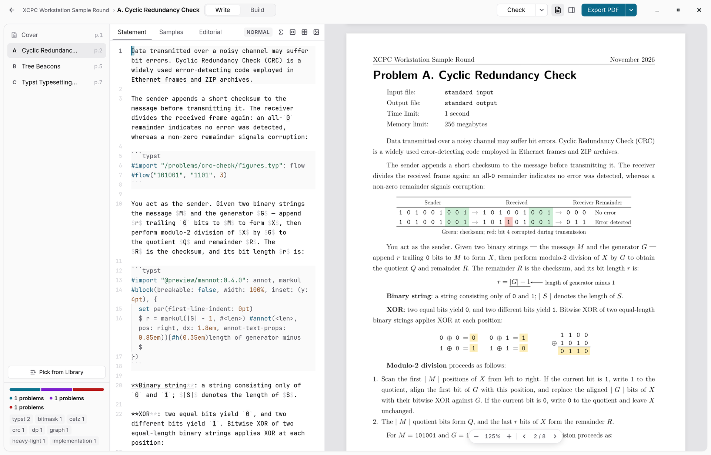

# XCPC Workstation

A local-first personal XCPC workstation built on an open-directory problem library — uniting Typst PDF publishing, problem authoring & strict verification, algorithm snippets & Team Reference Documents (TRD), a multi-platform training dashboard, a hybrid sandboxed plugin ecosystem, and native MCP / CLI support.

[Get Started](getting-started/index.md){ .md-button .md-button--primary }
[Installation](getting-started/installation.md){ .md-button }
[CLI & MCP Reference](cli-mcp/cli.md){ .md-button }
[GitHub Releases](https://github.com/lihaoze123/xcpc-workstation/releases){ .md-button }

{ .xcpc-hero-shot }

---

## Core Capabilities

  <a class="xcpc-card" href="publishing/workspace/">
    
Library & Publishing

    
Plain-text open-directory storage, live-reference contest assembly with frozen snapshots, and built-in <code>olymp-classic</code> / <code>cnoi-classic</code> / <code>minimal</code> declarative Typst templates with millisecond live preview and no TeX installation required.

  </a>
  <a class="xcpc-card" href="problem-build/">
    
Problem Authoring & Export

    
Native <code>g++</code> / <code>clang++</code> with bundled <code>testlib.h</code> covering traditional, interactive, multi-run communication, and OI subtask problems — with strict verification gates, stress testing, ASan checks, and Polygon / DOMjudge / Hydro package exchange.

  </a>
  <a class="xcpc-card" href="templates-trd/">
    
Algorithm Snippets & TRD

    
Open-directory management of code, notes, and verification scripts — with dependency DAGs, single-file C++ bundling (<code>xcpc bundle</code>), cumulative verification hashes, three-source verification, and <code>trd-compact</code> / <code>trd-book</code> templates.

  </a>
  <a class="xcpc-card" href="training/">
    
Training Dashboard

    
Built-in incremental sync for Codeforces and AtCoder, merging external submissions with local logs at runtime without polluting problem files — featuring a rolling 12-month heatmap, rating curves, difficulty breakthrough trends, and editorial aggregation.

  </a>
  <a class="xcpc-card" href="cli-mcp/cli/">
    
CLI & AI Agent

    
Desktop GUI, <code>xcpc</code> CLI, and <code>xcpc mcp</code> (stdio) share one Rust Core, supporting <code>--read-only</code> guards and three official Skills for end-to-end problem authoring, snippet curation, and plugin development.

  </a>
  <a class="xcpc-card" href="plugins/">
    
Plugins

    
Core QuickJS sandbox plus a three-layer isolated <code>&lt;WebView&gt;</code> sandbox with Core-enforced <code>pending_trust</code> gating, paired with <code>@xcpc-workstation/plugin-sdk</code> and a hot-reloading CLI workflow.

  </a>

---

## Community & Support

- **GitHub Repository**: [lihaoze123/xcpc-workstation](https://github.com/lihaoze123/xcpc-workstation)
- **Official Plugin Registry**: [lihaoze123/xcpc-plugins](https://github.com/lihaoze123/xcpc-plugins)
- **QQ User Group**: `1134941278`
- **Issue Tracker**: Open a [GitHub Issue](https://github.com/lihaoze123/xcpc-workstation/issues) — use **Settings → About → Copy Diagnostics** in the desktop app to attach environment details.
