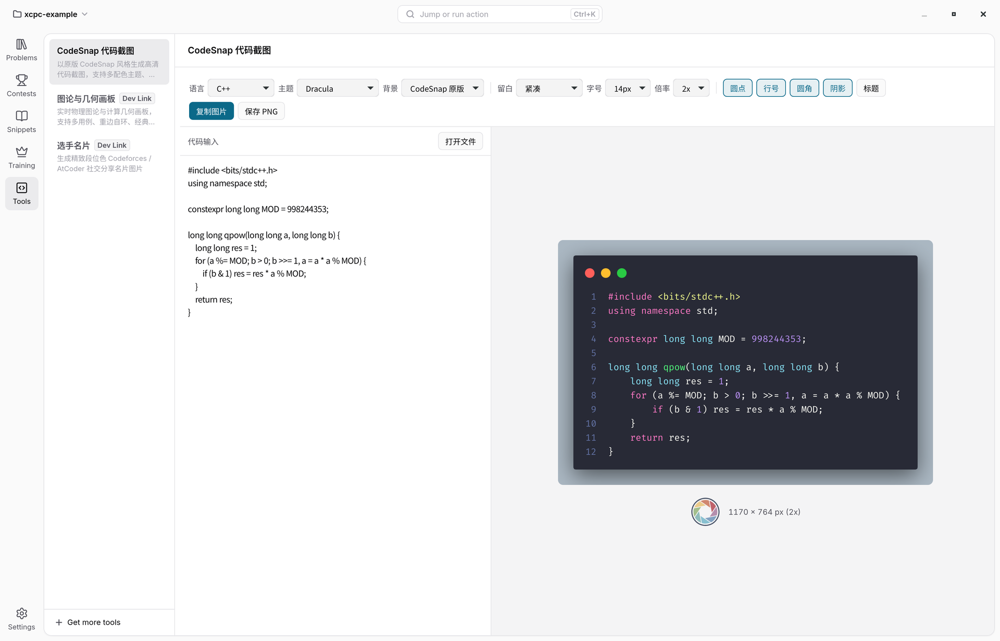

# Plugin Ecosystem Overview

XCPC Workstation uses a **hybrid sandbox plugin architecture**: core logic runs inside an embedded QuickJS sandbox in the Rust Core (shared by the desktop app, CLI, and MCP), while tools requiring rich interactive interfaces run inside a three-layer isolated pure-Web `<WebView>` sandbox in the desktop app.



---

## Four Plugin Modes

Whether authored as zero-build plain files or built with Vite, the host recognizes a single self-contained plugin directory layout (`manifest.toml` + optional `index.js` / `ui.html` / `templates/*.typ`). Based on declared capabilities, plugins fall into four primary modes:

| Mode | Key Declarations | Runtime Environment | Use Cases & Official Examples |
| :--- | :--- | :--- | :--- |
| **OJ Source Plugin** (`oj_source`) | `capabilities = ["oj_source"]` + `[permissions].domains` | Core QuickJS sandbox | Sync OJ accounts, submissions, rating history, and contest schedules. Built-in to the main repo: `codeforces`, `atcoder`. |
| **Headless Form Tool** (Headless `tool`) | `capabilities = ["tool"]` + `[[tools]]` (no `ui_entry`) | Core QuickJS sandbox | Input forms are automatically rendered by the desktop `HeadlessToolRunner` and can also be invoked via CLI (`xcpc tool`). Official examples: `complexity-mem`, `string-lab`. |
| **Pure-Web Custom UI Tool** (`<WebView>` `tool`) | `capabilities = ["tool"]` + `ui_entry = "ui.html"` | Isolated desktop `<WebView>` (optionally backed by `index.js`) | Interactive canvases (Canvas2D, SVG) or high-frequency UI tools bridging host capabilities and theme tokens via `window.xcpc`. Official examples: `graph-editor`, `math-bitwise`. |
| **Typesetting Template Plugin** (`template`) | `capabilities = ["template"]` + `[[templates]]` (optional `font_dirs`) | Read-only virtual mount `/plugins/<id>/...` | Distribute statement, editorial (`kind = "editorial"`), or Team Reference Document (TRD) Typst templates and bundled fonts with `plugin:<id>/<tpl>` live references, one-click eject to workspace, and offline frozen snapshots. |

In addition to these three primary modes, `manifest.toml` supports `commands` (Command Palette entries), `importer` (custom importers), `exporter` (custom exporters), and `credentials` (OS-managed credentials). See [`manifest.schema.json`](https://github.com/lihaoze123/xcpc-workstation/blob/main/packages/plugin-sdk/manifest.schema.json) and [`host.d.ts`](https://github.com/lihaoze123/xcpc-workstation/blob/main/packages/plugin-sdk/host.d.ts) in the repository for the complete schema.

---

## Built-in Plugins & Official Plugin Repository

To keep the main repository build free of Node.js dependencies, XCPC Workstation maintains a clear boundary between built-in plugins and external tools:

- **Built-in plugins**: Only two core `oj_source` plugins—`codeforces` and `atcoder`—are bundled in the main repository, enabling out-of-the-box data synchronization in the **Training** space. To customize a built-in plugin locally, run `xcpc plugin export <id>` to export it to `<dataDir>/plugins/<id>/` as a local override (uninstalling the override restores the built-in version).
- **Official plugin repository (`xcpc-plugins`)**: Official offline tools are maintained in a separate repository at [lihaoze123/xcpc-plugins](https://github.com/lihaoze123/xcpc-plugins). Both the desktop app and CLI subscribe to its index URL by default:
  ```text
  https://github.com/lihaoze123/xcpc-plugins/releases/download/official-latest/index.json
  ```
  To point to a self-hosted mirror, override the default official repository URL with the `XCPC_OFFICIAL_PLUGIN_REPO` environment variable.

Core tool plugins available in the official repository:

| Plugin ID | Mode | Summary |
| :--- | :--- | :--- |
| `graph-editor` | `<WebView>` tool | Graph and geometry canvas with 60 fps Canvas2D interaction, coordinate preservation when editing edge lists, and publication-grade image export. |
| `math-bitwise` | `<WebView>` tool | Number theory and bitwise workbench with instant bit toggling, modular arithmetic, and base conversion. |
| `codesnap` | `<WebView>` tool | High-DPI code screenshot tool with multiple color themes, gradient or transparent backgrounds, and one-click PNG copy. |
| `profile-card` | `<WebView>` tool | Competitive-programmer profile card generator with rank-colored Codeforces / AtCoder share cards. |
| `complexity-mem` | Headless form tool | Fast time-complexity and static array memory footprint estimator. |
| `string-lab` | Headless form tool | String algorithm inspector (prefix function, Z-function, hashing, SAM/SA, and related utilities). |

---

## Installing & Managing Plugins

### Desktop Management

- **One-click installation & full-canvas workspace**: Switch to the **Tools** space in the left sidebar (`Ctrl+5` by default). From the empty state you can install recommended official tools in one click, or use **Manage Plugins** at the bottom of the sidebar to browse and install or update tools from subscribed repositories. The left plugin list collapses into a slim rail, and pure-Web tools render full-height with their own toolbar and canvas without stacking a redundant host header bar.
- **Unified configuration & status**: Open **Settings → Plugins** to enable or disable installed plugins, review trust permissions, uninstall or restore built-in plugins, configure OJ accounts and OS-managed credentials, and manage third-party plugin repositories. Installing a plugin that declares sensitive permissions from a repository immediately opens a permission confirmation dialog so you can review and approve it on the spot.

### CLI Management (`xcpc plugin`)

`xcpc plugin` shares the exact same plugin manager and `<dataDir>/plugins/` directory as the desktop app:

```bash
# List installed built-in and external plugins
xcpc plugin list

# List subscribed repositories and browse installable catalogs (optional keyword filter)
xcpc plugin repo list
xcpc plugin repo catalog
xcpc plugin repo catalog graph

# Install by ID from a subscribed repository, or from a local directory / .zip archive
xcpc plugin install graph-editor
xcpc plugin install ./my-tool-0.1.0.zip
xcpc plugin install ./my-tool-dir

# Enable, disable, or uninstall a plugin
xcpc plugin enable graph-editor
xcpc plugin disable graph-editor
xcpc plugin uninstall graph-editor

# Add or remove a custom HTTPS plugin repository
xcpc plugin repo add https://example.org/xcpc-plugins/index.json --name "Team Plugins"
xcpc plugin repo remove https://example.org/xcpc-plugins/index.json
```

> If an external plugin declares network domains, credentials, or read-only workspace access, it enters the `pending_trust` state upon installation and cannot run until explicitly approved via the desktop confirmation dialog or `xcpc plugin trust <id>`. See [Security Boundaries & Trust Gate](./security.md).

---

## Running Headless Tools via CLI (`xcpc tool`)

Any enabled `tool` plugin that exposes headless logic can be invoked directly from the terminal with `xcpc tool`, with `--json` output for scripting or agent orchestration:

```bash
# List all enabled tools and their input schemas
xcpc tool list

# Run a tool with --input key=value (numbers and booleans are parsed as JSON)
xcpc tool run complexity-mem:estimate --input n=200000 --input log=true

# Or pass a full JSON object via --input-json (merged with --input, where --input takes precedence)
xcpc tool run my-calc:powmod --input-json '{"a":2,"b":10,"m":998244353}' --json
```

---

## Further Reading

- [Security Boundaries & Trust Gate](./security.md): Details on `pending_trust`, the QuickJS sandbox, three-layer WebView isolation, and path-escape protection.
- [Plugin Development Guide](./development.md): Build, hot-reload, test, package, and publish plugins with `@xcpc-workstation/plugin-sdk` and `xcpc plugin init`.
