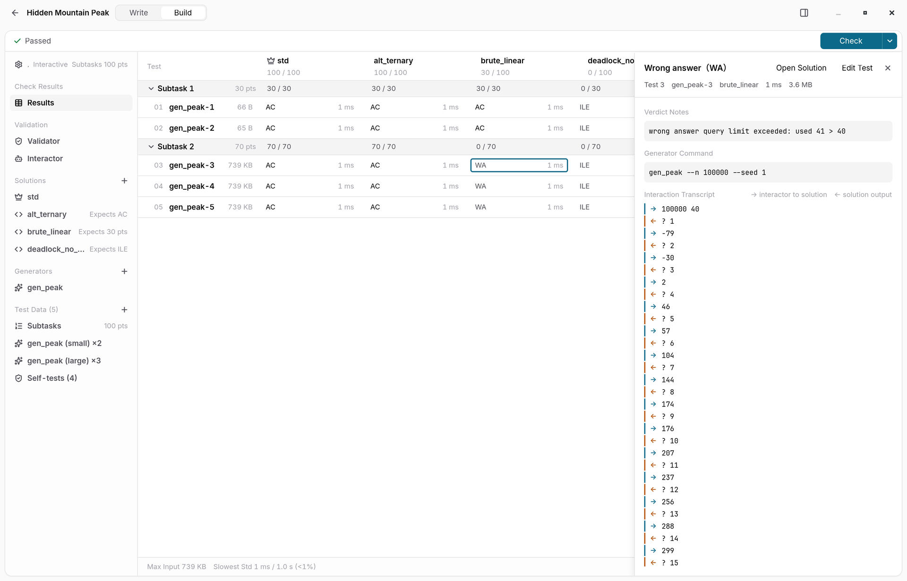

# Problem Authoring & Export

XCPC Workstation includes a complete problem authoring, data verification, and multi-platform export pipeline that operates directly on the open problem directory `problems/<slug>/` as its single source of truth. The same problem directory feeds the Typst typesetting engine for statement and editorial PDFs, while invoking the native C++ toolchain to compile reference solutions, validators, generators, and interactors—covering the full workflow from local iteration and strict verification to OJ package export.



## Core Design Principles

### Native C++ Toolchain and Built-in `testlib.h`

The build engine does not rely on external virtual machines or containers; it invokes the host's native `g++` or `clang++` directly:

- **Compiler resolution priority**: Explicit path (**Settings → Toolchain**) → `XCPC_CXX` environment variable → first `g++` / `clang++` detected on `PATH`.
- **Language standard inference**: Selected automatically from the source file suffix (always compiled with `-O2`):
  - `.cpp` / `.cc` / `.cxx`, `.20.cpp` / `.20.cc` → `-std=c++20` (default)
  - `.17.cpp` / `.17.cc` → `-std=c++17`
  - `.23.cpp` / `.23.cc` → `-std=c++23`
- **`testlib.h` resolution priority**:
  1. Problem directory `<problem_dir>/testlib.h`
  2. Workspace root `<workspace>/testlib.h`
  3. Embedded up-to-date `testlib.h` shipped with the binary (automatically materialized into the header cache directory for out-of-the-box use)
- **Cross-platform silent execution & resource limits**: Uses `rlimit`/`rusage` on Linux to track and enforce limits; on Windows, launches compiler and judge child processes silently (no console window flash), enforces real peak-memory measurement and MLE detection via Windows Job Objects, automatically passes `-DFOR_LINUX` when compiling `testlib.h` targets, and normalizes line endings (CRLF → LF) before comparison.

### Three-Tier Content-Hash Cache

Build artifacts are cached under `~/.cache/xcpc/` (overridable via `XCPC_CACHE_DIR`) and shared across workspaces. All writes use a same-directory temporary file followed by atomic rename to ensure concurrency safety:

| Cache Tier | Directory | Cached Artifact | Hash Key Components |
| :--- | :--- | :--- | :--- |
| Level 1 (Compile) | `bin/` | Compiled executables | Compiler metadata + flags + source content + `testlib.h` hash |
| Level 2 (Generate) | `gen/` | Generated test input `.in` files | Generator binary hash + expanded CLI arguments |
| Level 3 (Run) | `run/` | Solution execution and checker verdict JSON | Solution binary + input data + time/memory limits + checker + answer hash |

In addition, `sanitize/bin/` maintains a completely separate compilation cache for ASan/UBSan checks so sanitizer builds never mix with standard `-O2` artifacts.

### Debug Mode vs. Strict Verification Gates

The build pipeline operates in two modes: **Debug (development)** and **Strict Verification (`--strict`)**:

- **Debug mode (default)**: Supports filtering by `--tests` and `--solutions` to run a subset of tests or solutions for fast generator and code iteration. Non-blocking issues (such as missing self-tests or a reference solution exceeding half the time limit) are reported as warnings. Partial runs preserve the remaining cells from the last full matrix and automatically mark un-rerun cells as stale.
- **Strict verification (`--strict`)**: Disallows subset filtering and enforces a full execution of all test cases against all solutions. Every hard gate—compilation, validator and its self-tests, custom checker self-tests, OI subtask structure, validator pass on all tests, solution verdict/score expectations, and main solution slowest time ≤ 50% of the time limit—must pass before the persistent verification report is written to `build/problems/<slug>/verified_report.json`.

!!! info "Independent Verification Context for Contest Limit Overrides"
    When a contest entry overrides a problem's time or memory limit in `contest.toml`, pass `--contest <contest_id>` to run strict verification under that contest's effective limits. The report is stored separately as `verified_report.t<ms>-m<kib>.json` without affecting the problem library's own verification status.

### Separation of Static and Dynamic Operations

XCPC Workstation strictly separates **static inspection / publishing / export** from **dynamic compilation / execution**:

- **Zero execution in static commands**: `xcpc check`, `xcpc package inspect`, contest finalization (`freeze`), and OJ package export (`xcpc export`) **never** compile or execute any C++ code.
- **Content-hash freshness detection**: The engine computes a deterministic SHA-256 hash (`package_hash`) over `problem.toml`, validator, checker, interactor, `generators/`, `solutions/`, `samples/`, `tests/`, and any custom `testlib.h`, then compares it against `verified_report.json` to derive one of five statuses immediately:
  - `not_a_package`: Statement-only problem (no package files)
  - `verified_fresh`: Latest strict verification passed and matches the current file hash
  - `stale`: Previously passed strict verification, but package files have since changed
  - `unverified`: Has not passed strict verification yet (or only ran in Debug mode)
  - `failed`: Most recent build for the current file hash failed

## Common Entry Points

### Initialize Package Scaffolding

Generate standard package files for an existing problem directory without overwriting any existing files:

```bash
# Traditional problem scaffold (validator.cpp, generators/gen_random.cpp, solutions/std.cpp, and validator self-tests)
xcpc package init a-plus-b

# Interactive problem scaffold (generates interactor.cpp and interactive std.cpp)
xcpc package init guess-number --interactive

# Multi-run communication scaffold (writes runs = 2 under [package])
xcpc package init encode-decode --interactive --runs 2

# OI subtask scaffold (writes example [[subtask]] entries into problem.toml)
xcpc package init tree-dp --subtasks
```

### Static Inspection and Building

```bash
# Read-only inspection of package manifest, expanded test cases, freshness, and gate status
xcpc package inspect a-plus-b

# Debug build (supports filtering tests and solutions by index, name, or tag)
xcpc package build a-plus-b
xcpc package build a-plus-b --tests 1,2,edge --solutions std,brute

# Strict verification (accepts multiple problem IDs to run sequentially)
xcpc package build a-plus-b tree-dp --strict

# Strict verification under a specific contest's overridden limits
xcpc package build a-plus-b --strict --contest icpc-2026
```

!!! tip "Prerequisite for Export and Finalization"
    Before exporting packages to DOMjudge or Hydro, or finalizing a contest that includes problem packages, run `xcpc package build <id> --strict` so each problem reaches the `verified_fresh` state.

## Further Reading

- [Traditional Problems & Strict Verification](./traditional.md): Directory layout, built-in checkers, `validator.cpp` self-tests, bounded stress testing, ASan/UBSan checks, and external tester trial runs.
- [Interactive, Multi-Run & OI Subtasks](./interactive-and-oi.md): stdio interaction protocol, multi-run cumulative timing, dual-pipe proxy with ILE deadlock detection, `[[subtask]]` scoring, and `quitp` partial scores.
- [Package Import & Export](./import-export.md): Single-problem and full-contest Polygon import, minimal-set export for DOMjudge and Hydro, and verification hash gating.
