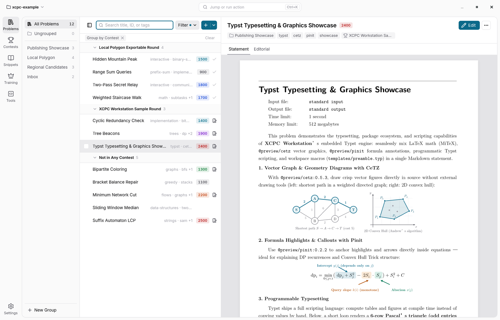

# Problem Library & Search

The problem library is the content foundation of XCPC Workstation: each problem is persisted independently under `problems/<slug>/` and does not belong exclusively to any single contest. You can organize groups, preview statements, and run batch operations in the desktop **Problems** view, or perform the same tasks from the CLI using `xcpc search`, `xcpc group`, and `xcpc problem`.



## Persistent Groups & Dynamic Views

The problem library provides two complementary ways to organize problems:

- **Persistent Groups (left group sidebar)**: Group definitions are declared in the `groups` array of `workspace.toml`. Each problem can belong to one persistent group (stored in `problem.toml`) or remain **Ungrouped**. The desktop app supports creating, renaming, and deleting groups (group order can be adjusted via `xcpc group reorder` or by editing `workspace.toml`). **Deleting a group never deletes its problems**; member problems are simply moved to **Ungrouped**.
- **Dynamic View Grouping**: Without modifying any files on disk, open the **Group by** selector in the filter bar to collapse or expand the problem list dynamically by **Group**, **Rating**, **Source**, **Contest**, or **Check Status**—useful when selecting problems for a contest or auditing unverified packages.

## Multi-Select & Batch Operations

Selecting multiple problems in the library list brings up the bottom batch action bar, supporting one-step operations across the selection:

- **Add to Contest**: Append selected problems in order to a chosen draft contest.
- **Move to Group / Remove from Group**: Reassign or clear persistent group membership in bulk.
- **Edit Tags… & Set Rating…**: Add/remove tags or assign/clear difficulty ratings across all selected problems.
- **Check / Quick Run**: Run full verification (**Check**) or fast debug runs (**Quick Run**) sequentially on selected problems that have packages.
- **Export**: Merge selected problems into a single ad-hoc **Merged PDF** booklet, or batch-export **DOMjudge ZIP** / **Hydro ZIP** packages.
- **Delete**: Automatically skips problems still referenced by **unfinalized contests** and reports which contests block deletion; problems referenced only by finalized contests can be safely deleted.

## External Source Metadata (`[[source]]`)

Each `problem.toml` may declare zero or more external sources (omitted for original problems) to record provenance and match against external OJ sync records at runtime:

```toml
title = "Two Sum"
rating = 800
tags = ["greedy", "implementation"]

[[source]]
platform = "codeforces"
id = "1999A"
url = "https://codeforces.com/problemset/problem/1999/A"

[[source]]
platform = "luogu"
id = "CF1999A"
```

Both the desktop app and CLI support creating a problem directly from an external OJ URL (automatically deduplicating against existing `[[source]]` entries):

```bash
xcpc problem from-url "https://codeforces.com/problemset/problem/1999/A"
```

## Command Palette (`Ctrl+K`)

Press ++ctrl+k++ (++cmd+k++ on macOS) anywhere in the desktop app to open the **Command Palette**:

- **Type keywords directly**: Searches across problems (ID and title), contests, algorithm snippets, Team Reference Documents (TRD), and common actions with grouped quotas; press Enter to jump straight to the target.
- **Prefix with `>`**: Switches to action-only search to run commands such as **New Problem**, **New Contest**, **Import Polygon ZIP**, **Appearance Settings**, or **Open Performance & Diagnostics Window**.

## CLI Library Operations

All search, grouping, and batch management capabilities are exposed as CLI subcommands (each supporting global `--json` output):

### Search Problems (`xcpc search`)

```bash
# Full-text keyword search (matches ID, title, tags, source, statement, and editorial)
xcpc search "segment tree"

# Combined filters: tags (repeatable, intersected) + rating range + source platform + group
xcpc search --tag dp --tag graphs --rating-min 1800 --rating-max 2400 --platform codeforces
xcpc search --group "Regional Candidates"
xcpc search --ungrouped
```

### Manage Persistent Groups (`xcpc group`)

```bash
# List all groups and ungrouped problem count
xcpc group list

# Create, rename, reorder, and delete groups
xcpc group create "Regional Candidates"
xcpc group rename "Regional Candidates" "ICPC Candidates"
xcpc group reorder "ICPC Candidates" "Daily Practice" "Fundamentals"
xcpc group delete "Fundamentals"
```

### Duplicate & Batch-Maintain Problems (`xcpc problem`)

```bash
# Recursively copy a problem directory into an independent new problem (no lineage tracked)
xcpc problem duplicate lantern-street lantern-street-hard --title "Lantern Street (Hard Version)"

# Batch assign or clear persistent group
xcpc problem group "ICPC Candidates" lantern-street matrix-walk
xcpc problem group --clear lantern-street

# Batch add/remove tags (comma-separated or repeated flags)
xcpc problem tag --add dp,constructive --remove draft lantern-street matrix-walk

# Batch set or clear rating
xcpc problem rating 2100 lantern-street matrix-walk
xcpc problem rating --clear draft-problem

# Batch delete problems (pass --yes to skip interactive confirmation)
xcpc problem delete draft-problem --yes
```

To inspect a problem's full metadata, content hash, and sample list:

```bash
xcpc show problem lantern-street
```
