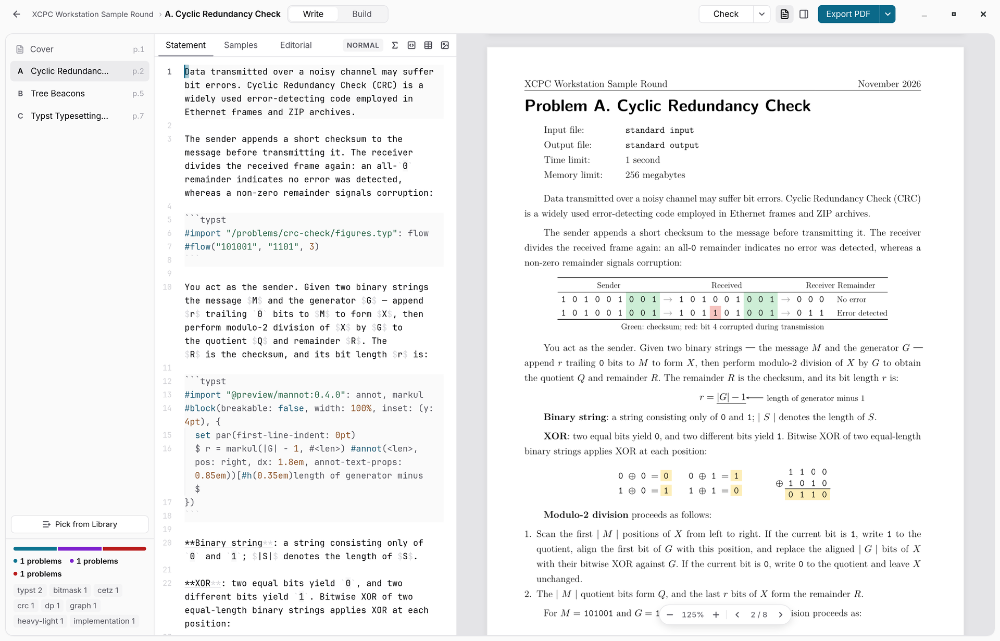

# Publishing Studio

The Publishing Studio is the core writing and typesetting environment of XCPC Workstation: the left sidebar shows the problem outline and contest overview, the center pane hosts the Markdown / LaTeX / Typst editor, and the right pane renders a tiled, incremental live preview powered by the native Typst engine. Both single-problem editing and full-contest editing share this same studio interface.



## Statement Syntax & Section Recognition

A problem statement uses a single Markdown file (`statement.md`, or bilingual `statement.zh.md` / `statement.en.md`) as its single source of truth, supporting GFM tables and lists, LaTeX math expressions, and raw Typst blocks.

### Automatic Section Recognition via Level-2 Headings

Content before the first level-2 heading (`##`) is automatically treated as the **Problem Description**. Subsequent `##` headings are matched against Chinese and English keywords (trailing colons stripped, English case-insensitive) and mapped to the template's standard section styles:

| Standard Section | Recognized `##` Heading Keywords |
| :--- | :--- |
| Description (heading hidden) | `题目描述`, `Description` (the heading itself is omitted; body text is output directly) |
| Input Format | `输入`, `输入格式`, `Input` |
| Output Format | `输出`, `输出格式`, `Output` |
| Interaction Protocol | `交互`, `交互协议`, `交互方式`, `Interaction` |
| Sample Table Anchor | `样例`, `Examples` (explicitly sets where the sample table is inserted) |
| Sample Explanation | `样例解释`, `样例说明`, `Explanation` |
| Note / Hint | `提示`, `说明`, `备注`, `Note`, `Notes`, `Hint` |
| Constraints | `约束`, `数据范围`, `Constraints` |
| Scoring | `评分`, `Scoring` |
| Background | `背景`, `题目背景`, `Background` |
| Specification | `题目要求`, `Specification` |
| Illustration | `图表说明`, `Illustration` |
| Subtasks | `子任务`, `Subtasks` |

Any `##` heading not listed above is typeset as a standard custom section; level-3 and deeper headings render as bold paragraphs.

### Math Expressions & Raw Typst Blocks

- **LaTeX Math**: Write inline math with `$...$` and display math with `$$...$$`. The embedded MiTeX engine converts them to Typst math in real time. In Chinese mode, `\le` and `\ge` automatically render as slanted `⩽` and `⩾`, and `\left...\right` converts to adaptive Typst delimiters.
- **Raw Typst Blocks**: When you need vector drawings (such as the bundled offline `cetz` package), custom layouts, or annotations (`pinit` / `mannot`), insert a fenced ```` ```typst ```` code block in Markdown. The conversion pipeline passes it directly to the Typst engine.

### Images & Width Control

Images must reside inside the current problem directory (storing them under `assets/` is recommended for use with the **Assets** gallery; paths escaping the problem directory, absolute paths, and external URLs are disallowed). Append `{width=NN%}` (range `10%`–`100%`, decimals supported) after standard image syntax to center the image at a percentage of the text area width:

```markdown
{width=60%}
```

Images without a `{width=...}` attribute are typeset inline.

## Slash Commands (`/`) & Floating Math Preview

### Slash Command Menu (`/`)

Type `/` at the start of a line or after whitespace to open the slash command popover below the caret, with filtering by English keywords, Chinese keywords, or pinyin initials:

- **Basic (6-item row)**: **Heading 2**, **Heading 3**, **Bulleted List**, **Numbered List**, **Blockquote**, **Inline Math** (`$...$`).
- **Common**: **Display Math** (`$$...$$`), **Insert Image** (opens **Assets**), **Markdown Table**, **C++ Code Block**.
- **Statement & Advanced**: **Piecewise Function** (`\begin{cases}`), **Matrix** (`\begin{bmatrix}`), **Subtask Scoring Table**, **Note Section**, **Interaction Section**, **Raw Typst Block** (```` ```typst ````).

Templates that insert prose (tables, subtasks, notes, interaction sections) automatically match the current problem's publishing language (Chinese or English).

### Floating Math Preview

When the caret moves inside an inline (`$...$`) or display (`$$...$$`) math expression, a compact floating preview card appears above the editor so you can verify syntax and rendered output without shifting focus to the full-page PDF preview.

## Samples & Assets

### Split Sample Editor & `samples/`

Samples are stored **only in the problem's `samples/` directory** (`01.in` / `01.ans`, `02.in` / `02.ans`, …) rather than embedded in statement Markdown, and are automatically rendered as sample tables during typesetting:

- Switch to the **Samples** tab in the studio to edit each sample's input and output side by side, add or delete pairs, and drag to reorder them.
- By default, the sample table is inserted after the Input / Output / Interaction sections and before the next section. To place it elsewhere, add a `## Examples` (or `## 样例`) heading as an anchor; any text beneath that heading appears immediately after the sample table.
- When using [Problem Authoring & Export](../problem-build/index.md), files in `samples/` are automatically included as the leading test cases during validation and verification.

### Assets Gallery

Open **Assets** from the editor toolbar or the `/image` slash command to manage images under `problems/<slug>/assets/`: import local images, inspect thumbnails or full-size lightbox previews with pixel dimensions and file sizes, jump to referencing lines in the statement or editorial, safely rename files (automatically updating Markdown references), batch-clean unused files, insert Markdown references at the caret, or apply width presets (`50%` / `75%` / `100%`) to referenced images.

## Focus Mode, Practical Vim Subset & Bilingual Writing

- **Focus Mode**: Collapse both the left outline and right preview with one click to leave a centered editing column (760px max width) with typewriter-centered scrolling. Outside **Focus Mode**, you can also toggle the right preview pane independently.
- **Practical Vim Mode**: Enable built-in **Vim Mode** under **Settings → Appearance → Editor Typography**. Supports `Normal`, `Insert`, `Visual`, and `Visual-Line` modes, covering core motions (`hjkl`, `w/b/e`, `0/$`, `gg/G`), editing (`i/a/I/A/o/O`, `x`, `dd/yy/p/P`, `u`, `Ctrl+r`), visual operators (`v/V` with `d/y/c`), and inner text objects (`ci`/`di`/`yi` with `w`, `$`, `(`, `)`, `"`, `'`, `` ` ``), while preserving `Ctrl+*` / `Alt+*` application shortcuts (`Ctrl+r` performs redo in Normal mode).
- **Bilingual Writing**: A single problem directory can hold both `statement.zh.md` and `statement.en.md` (or a single `statement.md`) while sharing one set of `samples/`, limits, and `assets/`. Switch contest language in **Properties → Info** (or the `language` field in `contest.toml`), or pass `--language` when building a single problem via CLI; the engine selects the corresponding statement file and adapts template headings and limit labels automatically.

## Live Diagnostics & Preflight Checks

As you edit, the studio continuously runs `xcpc-lint` preflight checks and Typst compilation in the background. Results are summarized in the floating HUD capsule at the bottom of the preview pane (silent when clean; displays a badge only when issues are detected):

- **Structural & Asset Preflight (`xcpc-lint`)**: Detects missing referenced problems or images (including external URLs or escaping paths), missing template files, unpaired or non-sequential sample numbering (not starting from `01`), missing Input/Output sections (or missing Interaction section for interactive problems, or missing Subtasks section when `[[subtask]]` is declared), and missing `editorial.md` when exporting editorials or finalizing a contest.
- **Compilation & Layout Overflow Checks**: Detects LaTeX math conversion errors, Typst template or raw-block errors/warnings, and overflow warnings when prose, formulas, graphics, or images exceed the page margins.

Click any diagnostic entry to jump directly to the corresponding Markdown line or preview page.
