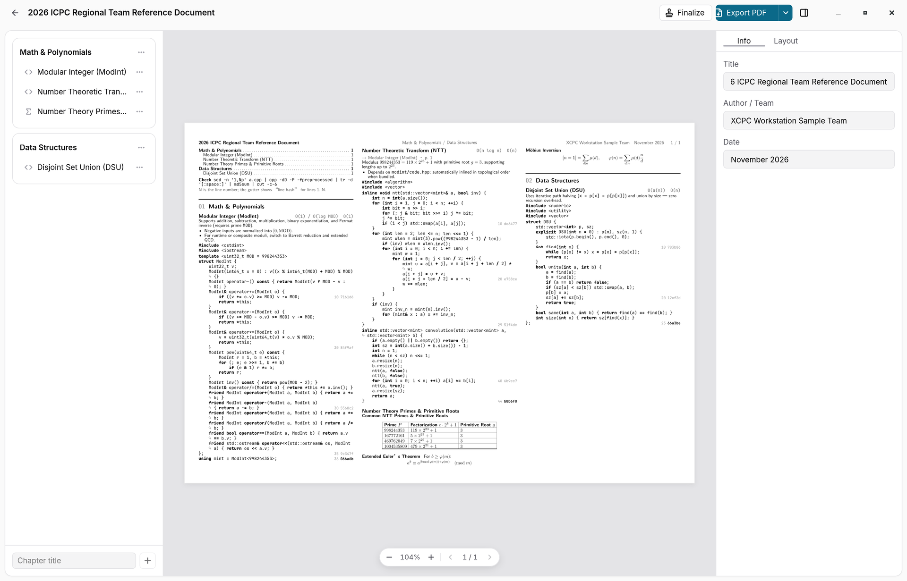

# Algorithm Snippets & Team Reference Document (TRD)

XCPC Workstation brings your algorithm snippet library and Team Reference Document (TRD) into the same open-directory workspace: algorithm source files are real C++ headers that can be directly `#include`-compiled and automatically verified, while also serving as the single source of truth for TRD typesetting—eliminating manual copy-paste and code/handbook drift before contests.



## Open-Directory Layout

Algorithm snippets and Team Reference Documents live under `snippets/` and `trds/` at the workspace root. Everything is plain text for straightforward Git / jj version control and team collaboration:

```text
<workspace>/
├── workspace.toml                  # Set snippets = false to disable the snippets module (enabled by default)
├── snippets/                       # Algorithm snippet library (one directory per snippet)
│   ├── modint/
│   │   ├── snippet.toml            # Title, tags, complexity, [[verify]] declarations
│   │   ├── code.hpp                # C++ template header (omit for formula-only cards)
│   │   ├── notes.md                # Algorithm notes, derivations, and caveats
│   │   └── test.cpp                # Self-contained unit test
│   ├── ntt/
│   │   ├── snippet.toml
│   │   ├── code.hpp                # Declares dependency via #include "modint/code.hpp"
│   │   ├── test.cpp
│   │   └── verify_conv.cpp         # Library Checker or workspace problem adapter
│   └── number-theory-facts/        # Formula-only reference card (no code.hpp)
│       ├── snippet.toml
│       └── notes.md
├── trds/                           # Team Reference Documents (live references to snippets/)
│   └── icpc-regional/
│       ├── trd.toml                # Metadata, template selection, [[chapter]] layout
│       └── snapshot/               # Read-only snapshot and archived PDF created on finalize
└── .xcpc/
    └── snippet-verify/             # Runtime verification cache (never pollutes snippet source files)
        ├── modint.json
        └── ntt.json
```

!!! info "Separation of Status and Content"
    Like problem training status, snippet verification results (`passed` / `stale` / `failed` / `unverified`) are **never** written into `snippet.toml`. They are stored in `.xcpc/snippet-verify/<slug>.json` and derived on the fly from the content hash of the snippet and all of its upstream dependencies.

## Desktop Snippets Space Workflow

The desktop app provides a dedicated **Snippets** space in the top bar (containing **Snippets** and **Handbooks** tabs, with a detail sidebar showing dependencies, reverse references, and verification status), splitting daily maintenance and pre-contest composition into two focused studios:

- **Snippet Studio (`SnippetStudio`)**:
  - Edit `code.hpp` and `notes.md` side by side, inspect verification results in the **Verify** tab, and manage metadata and `[[verify]]` declarations in the right-hand properties drawer.
  - Built-in millisecond Typst single-snippet preview displays the exact printed layout alongside KACTL++ cumulative line checksums.
  - Trigger single-snippet verification (**Verify**), cascading regression (**Verify & Downstream**), or single-file C++ expansion (**Copy Single File**) in one click.
- **TRD Studio (`TrdStudio`)**:
  - Compose `[[chapter]]` structure and snippet ordering using live references, switch between `trd-compact` (landscape multi-column) and `trd-book` (portrait study handbook), and tune column count, font size, hash interval, and comment stripping in the **Layout** tab.
  - Run pre-print checks (missing dependencies, dependency cycles, unverified or stale snippets) and click **Finalize** to lock the exact sources and PDF into `snapshot/`.

!!! tip "Try the Built-in Example"
    Initializing a workspace with `xcpc init --example` creates a ready-to-use snippet library containing `modint`, `ntt` (depending on `modint`), `dsu`, and the formula-only card `number-theory-facts`, together with an example Team Reference Document `icpc-regional`.

## Further Reading

- [Algorithm Snippets & Single-File Bundler](./snippets.md): `snippet.toml` schema, formula cards, dependency DAG, `xcpc bundle` single-file expander, and KACTL++ cumulative checksums.
- [Three-Source Automatic Verification](./verification.md): `self` unit tests, workspace `problem` verification, `library_checker` online/offline verification, cascading regressions, and status transitions.
- [Team Reference Document (TRD)](./trd.md): `trd.toml` chapter composition, `trd-compact` and `trd-book` templates, pre-print checks, and reversible finalization.
