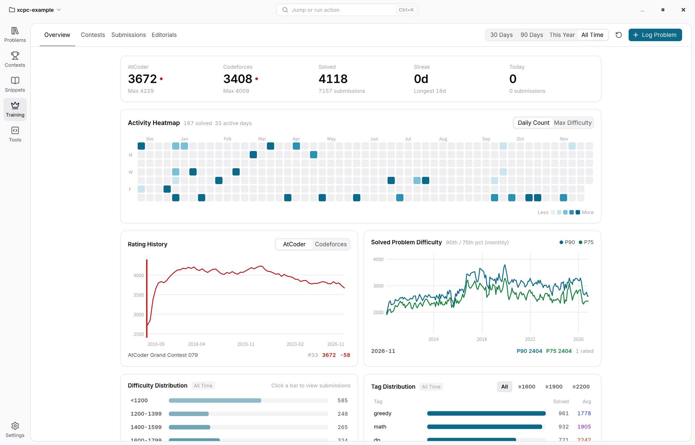

# Dashboard Views & Manual Logging

Switching to the **Training** space in the desktop app presents four sub-views in the top toolbar — **Overview**, **Contests**, **Submissions**, and **Editorials** — alongside quick **Sync** and **Log Problem** actions. All core metrics and logging workflows are also exposed via the `xcpc training` CLI and MCP tools.



---

## Four Sub-Views

### 1. Overview

The top of the Overview page provides a global time-window selector (**30 Days `30d`**, **90 Days `90d`**, **This Year `year`**, **All Time `all`**), followed by four data sections:

- **KPI Band**:
  - Current rating for each configured OJ platform (with tier color indicator and max rating; unrated platforms display solved and submission counts);
  - **Total Solved** and total submissions within the selected window;
  - **Streak** (consecutive active days) and longest historical streak;
  - **Today** solved count and submission count.
- **Rolling 12-Month Dual-Mode Activity Heatmap**:
  - Displays a rolling 52–53 week activity grid ending today (spanning across calendar years automatically);
  - Switches between **Daily Count** (unique AC problems per day) and **Max Difficulty** (highest unified rating solved that day); hover or click any cell to inspect daily details.
- **Rating History & Difficulty Trend**:
  - **Rating History**: Plots per-platform contest rating trajectories with rank and rating delta per contest;
  - **Difficulty Trend (P75 / P90)**: Tracks weekly/monthly P75 and P90 difficulty percentiles of solved problems (with smoothed trend lines) to measure growth in your upper solving ceiling without being skewed by high-volume easy problems.
- **Difficulty Distribution & Tag Distribution (Click to Drill Down)**:
  - Left: bar chart of solved problems bucketed by unified rating range;
  - Right: solved count and average rating by algorithm tag, with a minimum rating threshold filter (**All** / `≥ 1600` / `≥ 1900` / `≥ 2200`);
  - **Clicking any difficulty bar or tag row** navigates directly to the **Submissions** view with the corresponding filters pre-applied.

### 2. Contests

Aggregates schedules synced from all enabled `oj_source` plugins and groups them by local time into **Today**, **This Week**, and **Later** (enabling the **Show finished** toggle appends a **Finished** group):

- Running contests show live remaining time; upcoming contests display a countdown and start time;
- A platform filter bar appears automatically when multiple platforms have contests;
- Clicking any row opens the contest page in your default browser.

### 3. Submissions & One-Click Library Ingestion

Searches external submissions from `oj_sync.db` together with local records across three display modes and multi-dimensional filters:

- **Three modes**:
  - **Submissions (Raw)**: Lists all individual submissions in reverse chronological order;
  - **By Problem**: Aggregates by `(platform, problem_key)`, showing the latest verdict, total attempt count, and solve status;
  - **Unsolved only**: Automatically deduplicates by problem and filters to attempted problems without an AC, ideal for targeted upsolving.
- **Filter dimensions**: Free-text search (problem key, title, or contest ID), platform filter, verdict (`AC`, `WA`, `TLE`, plus expandable `MLE`, `RE`, `CE`), preset difficulty ranges (`<1200`, `1200–1599`, `1600–1999`, `2000–2399`, `2400+`), and tag filters carried over from Overview drill-downs.
- **One-click Add to Library**: Hover any external problem not yet in your workspace and click **Add to Library**. Core deduplicates by `[[source]]`, populates the title, unified rating, and tags from `oj_sync.db`, and offers a direct link in the confirmation toast to jump to the **Editorial** tab in Studio. Problems already in the workspace display an **Open** action directly.

### 4. Editorials

Displays a split-pane browser of every problem in the current workspace that has a non-empty `editorial.md`, designed for pre-contest review and topic revision:

- **Left list**: Filter by keyword (problem ID, title, tags, or editorial excerpt), algorithm tag, and difficulty range;
- **Right preview**: Renders a live Typst preview of the selected editorial (`book = "editorial"`), with an edit button to open `editorial.md` directly in Studio.

---

## Manual Logging & `training/logs.jsonl`

For platforms without automated sync (such as campus OJs, Luogu, offline mock contests, or paper derivations), or when manually annotating upsolve status (such as marking an external AC as `upsolved` or adding a library problem to `todo`), use the **Log Problem** dialog in the top-right corner or the CLI to append records to `<workspace>/training/logs.jsonl`.

The desktop **Log Problem** dialog supports three input workflows:

1. **Link an existing library problem**: Search workspace problems by keyword and record a status update;
2. **Paste an external problem URL**: Enabled plugins parse the platform and problem key offline and enrich metadata from `oj_sync.db`;
3. **Create a standalone entry**: Enter a title, optional difficulty rating, tags, date, and note without creating a problem directory first. Choosing **Save & Write Editorial** automatically creates or links the problem in the library and opens the editorial editor.

---

## `xcpc training` CLI Reference

`xcpc training` provides 6 subcommands. All subcommands support the global `--json` flag for structured machine-readable output.

### `xcpc training status` — Update a Workspace Problem's Training Status

Appends a status change record for an existing workspace problem to `training/logs.jsonl` and prints the resulting derived status after merging with external sync data.

```bash
# Mark library problems as upsolved / todo / attempted / ac
xcpc training status cf-1999a upsolved
xcpc training status tree-dp todo

# Clear the manual override (revert to external sync status or none)
xcpc training status cf-1999a clear
```

Valid status values: `todo`, `attempted`, `ac`, `upsolved`, `clear`.

### `xcpc training log` — Record a Manual Training Entry

Logs a status update for a workspace problem or a standalone external/offline practice entry. Pass `--create-in-library` to simultaneously create or link the problem in the workspace library.

```bash
# Log a standalone external or offline practice entry
xcpc training log \
  --title "P3805 manacher" \
  --platform luogu \
  --rating 1800 \
  --tags string,manacher \
  --status ac \
  --note "Watch sentinel boundary characters"

# Log via external URL and add to the workspace library
xcpc training log \
  --url "https://codeforces.com/problemset/problem/1999/A" \
  --status upsolved \
  --create-in-library

# Log an existing workspace problem with a backdated RFC 3339 timestamp
xcpc training log --problem cf-1999a --status ac --at "2026-11-20T14:30:00Z"
```

Common options:

| Option | Description |
| :--- | :--- |
| `--problem <ID>` | Associate with an existing workspace problem ID (omit for standalone entries) |
| `--title <TITLE>` | Problem title (required for standalone entries unless resolvable from `--url` or `--problem`) |
| `--status <STATUS>` | Training status: `ac` (default), `upsolved`, `attempted`, `todo`, `clear` |
| `--rating <INT>` | Unified difficulty rating |
| `--tags <T1,T2>` | Comma-separated list of tags |
| `--platform <NAME>` | Platform identifier (e.g., `codeforces`, `luogu`, `local`) |
| `--url <URL>` | External problem URL (parsed offline when recognized by an enabled plugin) |
| `--at <RFC3339>` | Record timestamp (defaults to current UTC time) |
| `--note <TEXT>` | Short note or takeaway |
| `--create-in-library` | Also create or link the problem in the workspace library |

### `xcpc training dashboard` — Query Dashboard Metrics

Outputs per-platform account summaries, KPIs, streak stats, heatmap data, rating curves, difficulty trend (P75/P90), difficulty buckets, and tag distribution.

```bash
# Default all-time window
xcpc training dashboard

# Inspect the last 90 days with tag stats filtered to rating >= 1900 (JSON output)
xcpc training dashboard --window 90d --min-rating 1900 --json

# Specify the calendar year for heatmap aggregation
xcpc training dashboard --year 2026
```

- `--window <30d|90d|year|all>`: Aggregation window (default `all`).
- `--year <YYYY>`: Calendar year for the heatmap (defaults to the current year).
- `--min-rating <INT>`: Minimum unified rating threshold for tag distribution.

### `xcpc training contests` — Query Contest Schedule

```bash
# View upcoming and running contests across all enabled platforms
xcpc training contests

# View AtCoder contests only, including finished ones
xcpc training contests --platform atcoder --all
```

### `xcpc training submissions` — Search Submissions

```bash
# Deduplicate by problem and list unsolved Codeforces problems rated 1600–2100
xcpc training submissions \
  --by-problem \
  --unsolved \
  --platform codeforces \
  --min-rating 1600 \
  --max-rating 2100

# Filter by tag, verdict, and keyword with pagination
xcpc training submissions --tag dp --verdict AC --search "tree" --limit 50 --offset 0 --json
```

Common options: `--by-problem`, `--unsolved`, `--platform <ID>`, `--verdict <V>`, `--min-rating <INT>`, `--max-rating <INT>`, `--tag <TAG>`, `--search <TEXT>`, `--limit <N>` (default `100`), `--offset <N>` (default `0`).

### `xcpc training editorials` — Search Workspace Editorials

Lists all problems in the current workspace that contain a non-empty `editorial.md` along with excerpts:

```bash
# Search editorials tagged dp with rating >= 1800
xcpc training editorials --tag dp --min-rating 1800

# Search by keyword (matches problem ID, title, tags, and editorial excerpt)
xcpc training editorials --search "convex hull trick" --max-rating 2400 --json
```
