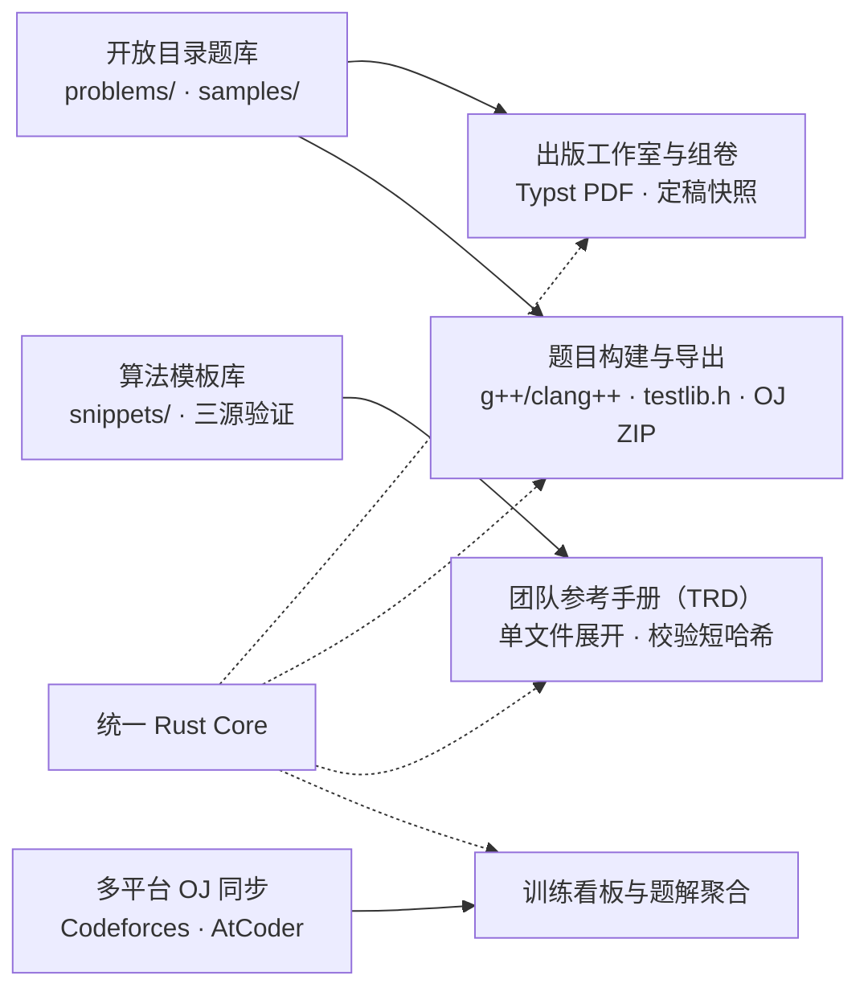

# 快速开始

**XCPC Workstation** 是一款本地优先的个人 XCPC 工作站，以纯文本开放目录题库为底座，将题面出版、题目构建与导出、算法模板与团队参考手册（TRD）、多平台训练看板以及 CLI / MCP 自动化收拢在同一个本地工程中。

## 为什么采用这套架构

在传统出题与训练流程中，题面排版依赖数 GB 的 TeX Live 环境、数据构建与验证散落在手工脚本中、比赛组卷靠复制粘贴目录、训练记录与题解分散在不同平台。XCPC Workstation 围绕三项核心架构决策解决这些问题：

| 设计决策 | 具体做法 | 带来的实际收益 |
| :--- | :--- | :--- |
| **开放目录（单一事实源）** | 题目、比赛、模板与训练日志全部以 Markdown + TOML 存储在普通文件夹中；个人缓存、同步数据库与外观配置完全隔离在用户数据目录。 | 天然兼容 Git 版本控制与多人协同命题，无私有数据库锁定，任意文本编辑器均可直接读写。 |
| **原生 Typst 引擎** | 应用内置 Rust 原生 [Typst](https://typst.app/) 排版引擎、`comemo` 增量编译与分块光栅化，无需安装外部 TeX 发行版。 | 开箱即用、毫秒级实时预览，默认 `olymp-classic` 模板与经典 `olymp.sty` 中文版式保持一致，同时提供 `cnoi-classic` 与 `minimal` 模板。 |
| **统一 Rust Core** | 桌面客户端（GUI）、无头命令行（`xcpc`）与标准输入输出 MCP 服务（`xcpc mcp`）共用同一套 Rust Core。 | 排版结果、校验规则、冻结只读守卫与路径沙箱在三端完全一致；适合人工交互、CI 脚本与 AI Agent 协同。 |

## 核心工作流

XCPC Workstation 的功能按「内容底座 → 出版与构建 → 训练与扩展」分层展开：

1. **题库与出版**：以 `problems/<slug>/` 维护题面、样例、配图与题解；在比赛目录 `contests/<id>/` 中通过活引用组卷，实时编译单题、整本试题册与 A4 题解册 PDF，定稿后固化只读快照。详见 [工作区与开放目录](../publishing/workspace.md)。
2. **题目构建与导出**：在本地使用原生 `g++` / `clang++` 与内置 `testlib.h` 编写 Validator、Generator、Checker 与 Interactor，支持传统题、交互题、多轮通信与 OI 子任务，完成严格验收后直接导出 DOMjudge / Hydro 数据包，或从 Polygon ZIP 导入。详见 [题目构建与导出](../problem-build/index.md)。
3. **算法模板与团队参考手册（TRD）**：在 `snippets/` 与 `trds/` 中同源管理 C++ 算法模板、数学说明与验证脚本，支持 `#include` 依赖 DAG 解析、单文件展开（`xcpc bundle`）、三源自动验证以及印刷级 `trd-compact` / `trd-book` 排版。详见 [算法模板与参考手册](../templates-trd/index.md)。
4. **训练看板与工具插件**：增量同步 Codeforces / AtCoder 提交与 Rating，并与本地 `training/logs.jsonl` 合并派生训练状态（不污染题库内容文件）；在独立沙箱中运行画板与计算工具插件。详见 [训练看板](../training/index.md) 与 [插件生态与开发](../plugins/index.md)。
5. **CLI 与 AI Agent**：通过 `xcpc <subcommand> --json` 接入本地脚本，或通过 `xcpc mcp` 与官方 Skill 让 AI Agent 参与审题、造数、验证与模板维护。详见 [命令行手册（CLI）](../cli-mcp/cli.md) 与 [MCP 服务接入](../cli-mcp/mcp.md)。

## 适用场景

- **个人长期题库与训练工作站**：管理个人原创题、外部 OJ 精选复盘题解、算法模板库与训练数据看板。
- **赛事命题组基于 Git 的多人协同**：为某场校赛、省赛或集训单独建立一个工作区仓库（可在 `workspace.toml` 中设置 `training = false` 隐藏训练视图），命题、验题、排版与定稿全部通过 Git 分支与 Pull Request 协作完成。
- **无头 CI 与 Agent 自动化环境**：在服务器或本地终端仅安装 `xcpc` CLI，执行 `xcpc check`、`xcpc build`、`xcpc package build --strict` 或启动 `xcpc mcp`。

!!! note "范围说明"
    XCPC Workstation 定位为本地优先工具，不内置在线账号体系与云端实时协作服务，不导出 LaTeX 源码，也不生成题解幻灯片。多人协同命题统一依托开放目录与 Git 完成。

## 下一步

- [下载与安装](./installation.md)：获取适合你操作系统的桌面客户端或纯 CLI 安装包。
- [快速上手](./quickstart.md)：在 5 分钟内通过内置示例工作区走通桌面端与 CLI 核心流程。
- [字体配置](./fonts.md)：了解内置字体、系统中文回退链以及与 `olymp.sty` 基准一致的方正字体配置。
