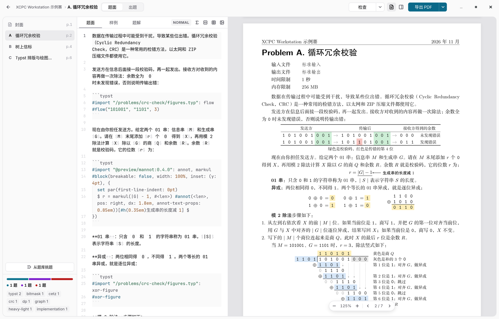

# XCPC Workstation

本地优先的个人 XCPC 工作站。以开放目录题库为底座，集成 Typst 题面出版、题目构建与严格验收、算法模板与团队参考手册（TRD）、多平台训练看板、混合沙箱插件生态与原生 MCP / CLI 支持。

[快速开始](getting-started/index.md){ .md-button .md-button--primary }
[下载与安装](getting-started/installation.md){ .md-button }
[CLI 与 MCP 手册](cli-mcp/cli.md){ .md-button }
[GitHub Releases](https://github.com/lihaoze123/xcpc-workstation/releases){ .md-button }

{ .xcpc-hero-shot }

---

## 核心能力导览

  <a class="xcpc-card" href="publishing/workspace/">
    
题库与出版

    
开放目录纯文本存储、活引用组卷与定稿快照、内置 <code>olymp-classic</code> / <code>cnoi-classic</code> / <code>minimal</code> 声明式 Typst 模板，零 TeX 环境毫秒级实时预览。

  </a>
  <a class="xcpc-card" href="problem-build/">
    
题目构建与导出

    
基于原生 <code>g++</code> / <code>clang++</code> 与内置 <code>testlib.h</code>，覆盖传统题、交互题、多轮通信与 OI 子任务，支持严格验收门禁、对拍、ASan 体检及 Polygon / DOMjudge / Hydro 数据包流转。

  </a>
  <a class="xcpc-card" href="templates-trd/">
    
算法模板与参考手册

    
开放目录管理代码、说明与验证脚本；支持依赖 DAG、单文件展开（<code>xcpc bundle</code>）、逐行累计校验短哈希、三源自动验证与 <code>trd-compact</code> / <code>trd-book</code> 印刷级排版。

  </a>
  <a class="xcpc-card" href="training/">
    
训练看板

    
内置 Codeforces / AtCoder 增量同步，运行时合并外部提交与本地日志（不污染题库文件），提供滚动 12 月热力图、Rating 走势、难度突破趋势与题解聚合。

  </a>
  <a class="xcpc-card" href="cli-mcp/cli/">
    
CLI 与 AI Agent

    
桌面端、<code>xcpc</code> CLI 与 <code>xcpc mcp</code>（stdio）共用同一套 Rust Core，支持 <code>--read-only</code> 守卫与三大官方 Skill，端到端辅助出题、维护模板与插件开发。

  </a>
  <a class="xcpc-card" href="plugins/">
    
插件生态与开发

    
Core 层 QuickJS 沙箱 + 桌面端三层隔离 <code>&lt;WebView&gt;</code> 沙箱，强制 <code>pending_trust</code> 信任门控，提供 <code>@xcpc-workstation/plugin-sdk</code> 与热重载 CLI 工具链。

  </a>

---

## 社区与支持

- **GitHub 仓库**：[lihaoze123/xcpc-workstation](https://github.com/lihaoze123/xcpc-workstation)
- **官方插件仓库**：[lihaoze123/xcpc-plugins](https://github.com/lihaoze123/xcpc-plugins)
- **QQ 用户交流群**：`1134941278`（欢迎反馈排版细节、出题体验、模板定制与使用建议）
- **问题反馈**：提交 [GitHub Issue](https://github.com/lihaoze123/xcpc-workstation/issues)，可在桌面端 **「设置 → 关于 → 复制诊断信息」** 一键附带环境信息。
