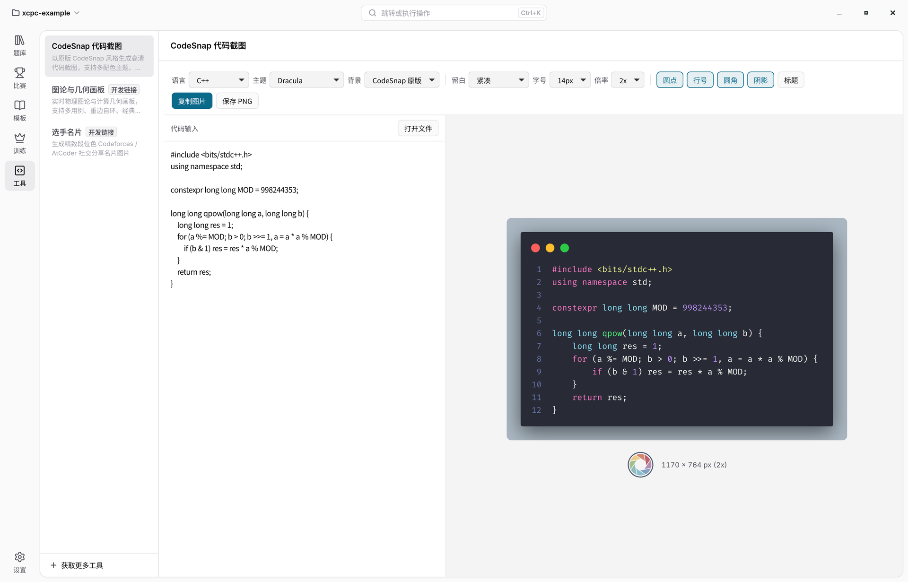

# 插件生态概览

XCPC Workstation 采用**混合沙箱插件架构**：核心逻辑运行于 Rust Core 内嵌的 QuickJS 沙箱（桌面端、CLI 与 MCP 共用），需要复杂交互界面的工具则运行于桌面端三层隔离的纯 Web `<WebView>` 沙箱中。



---

## 四种插件模式

无论使用免构建手写文件还是 Vite 工程化构建，宿主只识别统一的自包含插件目录结构（`manifest.toml` + 可选 `index.js` / `ui.html` / `templates/*.typ`）。基于能力声明，插件分为四种主要模式：

| 模式 | 关键声明 | 运行环境 | 适用场景与官方示例 |
| :--- | :--- | :--- | :--- |
| **OJ 数据源插件** (`oj_source`) | `capabilities = ["oj_source"]` + `[permissions].domains` | Core QuickJS 沙箱 | 同步 OJ 账号、提交记录、Rating 历史与比赛列表。主仓库内置 `codeforces`、`atcoder`。 |
| **无头表单工具** (Headless `tool`) | `capabilities = ["tool"]` + `[[tools]]`（无 `ui_entry`） | Core QuickJS 沙箱 | 输入表单由桌面端 `HeadlessToolRunner` 自动渲染，同时支持 CLI（`xcpc tool`）调用。官方示例：`complexity-mem`、`string-lab`。 |
| **纯 Web 自定义界面工具** (`<WebView>` `tool`) | `capabilities = ["tool"]` + `ui_entry = "ui.html"` | 桌面端隔离 `<WebView>`（可搭配 `index.js` 后端） | 需要 Canvas2D、SVG 或高频交互的工具界面，通过 `window.xcpc` 桥接宿主能力与主题变量。官方示例：`graph-editor`、`math-bitwise`。 |
| **排版模板插件** (`template`) | `capabilities = ["template"]` + `[[templates]]`（可选 `font_dirs`） | 引擎只读虚拟挂载 `/plugins/<id>/...` | 分发题面、题解（`kind = "editorial"`）或团队参考手册（TRD）Typst 排版模板与配套字体，支持 `plugin:<id>/<tpl>` 活引用、一键复制到工作区与冻结快照归档。 |

除上述三种主形态外，`manifest.toml` 还支持 `commands`（命令面板入口）、`importer`（自定义导入器）、`exporter`（自定义导出器）与 `credentials`（系统凭据托管）扩展点。完整字段定义见仓库内的 [`manifest.schema.json`](https://github.com/lihaoze123/xcpc-workstation/blob/main/packages/plugin-sdk/manifest.schema.json) 与 [`host.d.ts`](https://github.com/lihaoze123/xcpc-workstation/blob/main/packages/plugin-sdk/host.d.ts)。

---

## 内置插件与官方插件仓库

为保持主仓库构建零 Node 依赖，XCPC Workstation 对内置插件与外置工具做了清晰边界划分：

- **主仓库内置插件**：仅内置 `codeforces` 与 `atcoder` 两个核心 `oj_source` 插件，开箱即可用于「训练」空间的数据同步。如需本地定制内置插件，可执行 `xcpc plugin export <id>` 将其导出到 `<dataDir>/plugins/<id>/` 覆写（卸载后自动恢复内置版本）。
- **官方插件仓库（`xcpc-plugins`）**：官方离线工具维护在独立仓库 [lihaoze123/xcpc-plugins](https://github.com/lihaoze123/xcpc-plugins)，桌面端与 CLI 默认预置订阅其索引地址：
  ```text
  https://github.com/lihaoze123/xcpc-plugins/releases/download/official-latest/index.json
  ```
  如需指向自建镜像，可通过环境变量 `XCPC_OFFICIAL_PLUGIN_REPO` 覆盖默认官方仓库地址。

官方仓库预置的核心工具插件包括：

| 插件 ID | 形态 | 能力简介 |
| :--- | :--- | :--- |
| `graph-editor` | `<WebView>` 工具 | 图论与几何画板，支持 60fps Canvas2D 交互、改边表保留节点坐标与出版级出图。 |
| `math-bitwise` | `<WebView>` 工具 | 数论与位运算工作台，支持毫秒级位格翻转、模运算与进制转换。 |
| `codesnap` | `<WebView>` 工具 | 高清代码截图工具，支持多配色主题、渐变/透明背景与一键复制 PNG。 |
| `profile-card` | `<WebView>` 工具 | 选手名片生成器，按段位色生成 Codeforces / AtCoder 分享卡片。 |
| `complexity-mem` | 无头表单工具 | 算法时间复杂度与静态数组内存占用快速估算。 |
| `string-lab` | 无头表单工具 | 字符串算法调试器（前缀函数、Z 函数、哈希、SAM/SA 等辅助分析）。 |

---

## 安装与管理插件

### 桌面端管理

- **一键安装与全画布工作区**：切换至左侧导航的「工具」空间（默认 `Ctrl+5`），空态可直接一键安装官方推荐工具，左侧栏底部「获取更多工具」可打开插件仓库浏览器进行安装或更新。左侧插件列表支持折叠为细轨，纯 Web 工具直接全高展示自身工具栏与画布，不叠放冗余宿主标题栏。
- **统一配置与状态**：前往 **「设置 → 插件」**，可管理已安装插件的启用/禁用、信任授权、卸载/恢复内置版本、OJ 账号与系统凭据，以及第三方插件仓库订阅；在插件仓库安装声明了敏感权限的插件时，桌面端会直接弹出权限确认框以便及时授权。

### CLI 管理（`xcpc plugin`）

`xcpc plugin` 与桌面端共用同一套插件管理器与 `<dataDir>/plugins/` 目录：

```bash
# 查看已安装的内置插件与外部插件
xcpc plugin list

# 查看订阅仓库列表与可安装目录（支持按关键词搜索）
xcpc plugin repo list
xcpc plugin repo catalog
xcpc plugin repo catalog graph

# 从订阅仓库按 ID 安装，或从本地目录 / .zip 包安装
xcpc plugin install graph-editor
xcpc plugin install ./my-tool-0.1.0.zip
xcpc plugin install ./my-tool-dir

# 启用、禁用与卸载插件
xcpc plugin enable graph-editor
xcpc plugin disable graph-editor
xcpc plugin uninstall graph-editor

# 添加或移除自定义 HTTPS 插件仓库
xcpc plugin repo add https://example.org/xcpc-plugins/index.json --name "Team Plugins"
xcpc plugin repo remove https://example.org/xcpc-plugins/index.json
```

> 若安装的外部插件声明了外网域名、凭据或工作区只读权限，安装后默认处于 `pending_trust` 状态，需在桌面端弹窗确认或执行 `xcpc plugin trust <id>` 后方可运行。详见 [安全边界与信任门控](./security.md)。

---

## 通过 CLI 运行无头工具（`xcpc tool`）

所有已启用且提供无头逻辑的 `tool` 插件均可通过 `xcpc tool` 直接在终端调用，支持 `--json` 输出以便脚本或 Agent 编排：

```bash
# 列出全部已启用的工具及其输入 Schema
xcpc tool list

# 使用 --input key=value 运行工具（数字与布尔值按 JSON 解析）
xcpc tool run complexity-mem:estimate --input n=200000 --input log=true

# 或使用 --input-json 传入完整 JSON 对象（与 --input 合并，后者优先级更高）
xcpc tool run my-calc:powmod --input-json '{"a":2,"b":10,"m":998244353}' --json
```

---

## 延伸阅读

- [安全边界与信任门控](./security.md)：了解 `pending_trust` 信任门、QuickJS 沙箱、三层 WebView 隔离与防逃逸校验。
- [插件开发指南](./development.md)：使用 `@xcpc-workstation/plugin-sdk`、`xcpc plugin init` 与热重载工作流开发并发布自己的插件。
