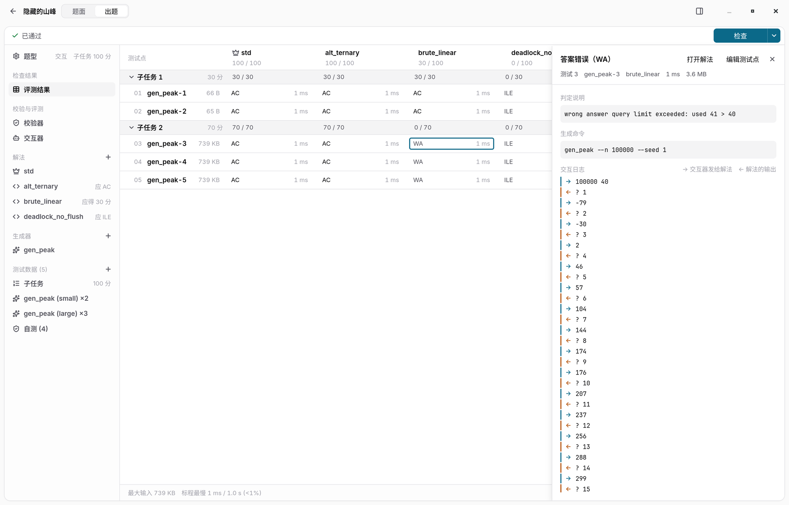

# 题目构建与导出

XCPC Workstation 内置完整的题目构建、数据校验与多平台导出管线，直接复用题库开放目录 `problems/<slug>/` 作为单一事实源。同一份题目目录既可以由 Typst 排版引擎输出题面与题解 PDF，也可以通过原生 C++ 工具链编译标程、校验器、生成器与交互器，完成从开发调试到严格验收、再到 OJ 数据包导出的全流程闭环。



## 核心设计原则

### 原生 C++ 工具链与内置 `testlib.h`

构建引擎不依赖外部虚拟机或容器，直接调用宿主机原生 `g++` 或 `clang++` 进行编译：

- **编译器选择优先级**：显式指定路径（桌面端「设置 → 工具链」）→ 环境变量 `XCPC_CXX` → `PATH` 中按序探测到的 `g++` / `clang++`。
- **语言标准推断**：通过源码文件后缀自动选择标准（固定附加 `-O2` 优化标志）：
  - `.cpp` / `.cc` / `.cxx`、`.20.cpp` / `.20.cc` → `-std=c++20`（默认）
  - `.17.cpp` / `.17.cc` → `-std=c++17`
  - `.23.cpp` / `.23.cc` → `-std=c++23`
- **`testlib.h` 解析优先级**：
  1. 题目目录 `<problem_dir>/testlib.h`
  2. 工作区根目录 `<workspace>/testlib.h`
  3. 随程序内嵌的最新 `testlib.h`（自动物化到缓存头文件目录，开箱即用）

### 三级内容哈希缓存

构建产物缓存在 `~/.cache/xcpc/`（可通过环境变量 `XCPC_CACHE_DIR` 覆盖），跨工作区共享，所有写入均采用「同目录临时文件 + 原子重命名」保证并发安全：

| 缓存层级 | 缓存目录 | 缓存内容 | 哈希键组成 |
| :--- | :--- | :--- | :--- |
| Level 1（编译） | `bin/` | 编译后的可执行文件 | 编译器信息 + 编译标志 + 源码内容 + `testlib.h` 哈希 |
| Level 2（生成） | `gen/` | 生成器产出的测试输入 `.in` | 生成器二进制哈希 + 展开后的命令行参数 |
| Level 3（运行） | `run/` | 解法执行与 Checker 判定 JSON | 解法二进制 + 输入数据 + 时空限制 + Checker + 答案哈希 |

此外，`sanitize/bin/` 为 ASan/UBSan 体检保留完全独立的编译缓存目录，绝不与正常 `-O2` 产物混用。

### 开发态调试 vs 严格验收门禁

构建流程分为**开发态（Debug）**与**严格验收（`--strict`）**两种模式：

- **开发态（默认）**：支持通过 `--tests` 与 `--solutions` 仅运行局部测试点或指定解法，快速迭代生成器与代码；部分非阻断项（如尚未补齐自测用例、标程耗时超过时限一半）以警告呈现，且局部运行不会擦除上次全量矩阵的其余单元格（未重跑的单元格自动标记为过期）。
- **严格验收（`--strict`）**：禁止子集过滤，强制全量执行「所有测试点 × 所有解法」，所有硬门禁（编译、校验器与自测、自定义评测器自测、OI 子任务结构、全部测试点通过校验器、全部解法符合预期、标程最慢用时不超过时限 50%）必须全部通过，才会写入持久化验收报告 `build/problems/<slug>/verified_report.json`。

!!! info "比赛覆写限制的独立验收上下文"
    若比赛条目在 `contest.toml` 中覆写了题目的时间或内存限制，传入 `--contest <contest_id>` 可在该比赛的有效限制下独立执行严格验收，验收报告单独存为 `verified_report.t<ms>-m<kib>.json`，不会污染题库本身的验收状态。

### 「动静分离」原则

XCPC Workstation 严格区分**静态检查/出版/导出**与**动态编译/执行**：

- **静态操作零执行**：`xcpc check`、`xcpc package inspect`、比赛定稿（`freeze`）以及 OJ 数据包导出（`xcpc export`）**绝不**编译或执行任何 C++ 代码。
- **基于内容哈希的新鲜度判定**：系统对 `problem.toml`、校验器、评测器、交互器、`generators/`、`solutions/`、`samples/`、`tests/` 及自定义 `testlib.h` 计算确定性 SHA-256 哈希（`package_hash`），并与 `verified_report.json` 比对，即时得出五种状态：
  - `not_a_package`：纯题面条目（无构建包内容）
  - `verified_fresh`：最新严格验收通过，且与当前文件哈希完全一致
  - `stale`：曾通过严格验收，但此后包内文件发生变更
  - `unverified`：尚未通过严格验收（或仅运行过开发态调试）
  - `failed`：当前文件哈希对应的最近一次构建失败

## 常用构建入口

### 初始化题目构建脚手架

为已有题目目录生成标准构建结构（不覆盖任何已存在的文件）：

```bash
# 传统题脚手架（validator.cpp、generators/gen_random.cpp、solutions/std.cpp 及校验器自测）
xcpc package init a-plus-b

# 交互题脚手架（生成 interactor.cpp 与交互版 std.cpp）
xcpc package init guess-number --interactive

# 多轮通信题脚手架（在 [package] 中写入 runs = 2）
xcpc package init encode-decode --interactive --runs 2

# OI 子任务脚手架（在 problem.toml 中写入 [[subtask]] 示例）
xcpc package init tree-dp --subtasks
```

### 静态检查与构建

```bash
# 只读检查包文件清单、展开后的测试点、新鲜度与验收门禁状态
xcpc package inspect a-plus-b

# 开发态构建（支持按索引、名称或标签筛选局部测试点与解法）
xcpc package build a-plus-b
xcpc package build a-plus-b --tests 1,2,edge --solutions std,brute

# 严格验收（支持一次传入多个题目 ID 顺序执行）
xcpc package build a-plus-b tree-dp --strict

# 在指定比赛的覆写限制下执行严格验收
xcpc package build a-plus-b --strict --contest icpc-2026
```

!!! tip "导出与定稿前置条件"
    在向 DOMjudge 或 Hydro 导出数据包，或对包含构建包的比赛执行定稿前，建议先运行 `xcpc package build <id> --strict` 使题目处于 `verified_fresh` 状态。

## 深入阅读

- [传统题与严格验收](./traditional.md)：目录结构、内置 Checker 家族、`validator.cpp` 自测、有界对拍、ASan/UBSan 体检与外部验题人试跑。
- [交互、通信与 OI 子任务](./interactive-and-oi.md)：stdio 交互协议、多轮通信累计计时、双管道代理与 ILE 死锁检测、`[[subtask]]` 计分与 `quitp` 部分分。
- [数据包导入与导出](./import-export.md)：Polygon 单题/整场导入、DOMjudge 与 Hydro 最小集合导出及验收哈希校验。
