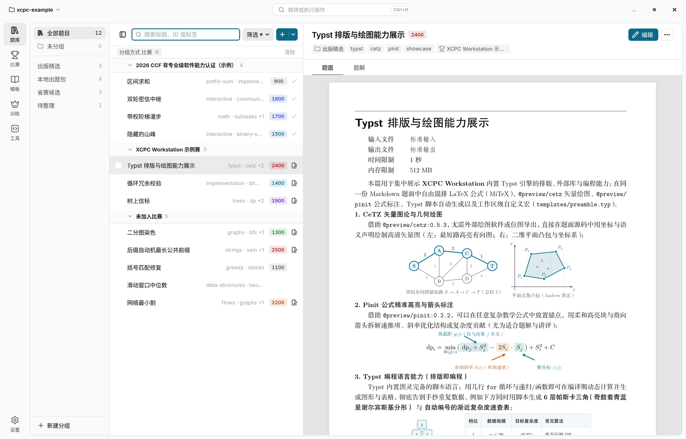

# 题库组织与检索

题库是 XCPC Workstation 的内容底座：每道题独立持久化于 `problems/<slug>/`，不依附于任何一场比赛。你可以在桌面端「题库」视图中进行分组整理、即时预览与批量操作，也可以通过 `xcpc search`、`xcpc group` 与 `xcpc problem` 在命令行完成相同工作。



## 持久化分组与动态视图

题库中心提供两种互补的组织维度：

- **持久化分组（左侧分组栏）**：分组清单声明在 `workspace.toml` 的 `groups` 字段中，每道题可归属一个持久化分组（写入 `problem.toml`），也可以保持未分组状态。桌面端支持新建、重命名与删除分组（分组顺序可通过 CLI `xcpc group reorder` 或直接编辑 `workspace.toml` 调整）；**删除分组不会删除题目本身**，原成员题目会自动转为未分组。
- **动态视图分组**：在不改动文件的前提下，可在列表顶部筛选面板的「分组方式」中按「分组」「难度」「来源」「比赛」「检查状态」等维度临时折叠/展开题目列表，适合快速盘点某场比赛的选材或筛选待验收题目。

## 多选与批量操作

在题库列表中勾选多道题目后，底部会浮出批量操作栏，支持一次性完成以下动作：

- **加入比赛**：将所选题目按序追加到指定未冻结比赛。
- **归入分组 / 移出分组**：批量调整持久化分组归属。
- **批量标签与难度**：统一添加/移除标签或设置难度分值。
- **批量构建与验收**：对所选带题目包的题目依次执行严格验收或调试构建。
- **批量导出**：一键将多道题目合并导出为临时 PDF 册子，或批量导出为 DOMjudge / Hydro 数据包。
- **批量删除**：自动跳过被**未冻结比赛**引用的题目并列出受阻原因；仅被已冻结比赛引用的题目允许安全删除。

## 外部来源标注（`[[source]]`）

每道题的 `problem.toml` 支持声明零个或多个外部来源（原创题可不写），用于记录搬运/出处，并在运行时与外部 OJ 同步记录匹配：

```toml
title = "Two Sum"
rating = 800
tags = ["greedy", "implementation"]

[[source]]
platform = "codeforces"
id = "1999A"
url = "https://codeforces.com/problemset/problem/1999/A"

[[source]]
platform = "luogu"
id = "CF1999A"
```

桌面端与 CLI 还支持直接通过外部 OJ 链接创建题目（自动按 `[[source]]` 去重，避免重复建题）：

```bash
xcpc problem from-url "https://codeforces.com/problemset/problem/1999/A"
```

## 全局命令面板（`Ctrl+K`）

在桌面端任意界面按下 ++ctrl+k++（macOS 为 ++cmd+k++）即可呼出全局命令面板：

- **直接输入关键词**：按分组配额同时检索题目（ID 与标题）、比赛、算法模板、团队参考手册（TRD）与常用动作，回车直达目标。
- **输入 `>` 前缀**：切换为纯动作检索模式，快速执行新建题目、新建比赛、导入 Polygon ZIP、打开外观设置、打开性能与诊断窗口等命令。

## 命令行题库操作

所有题库检索、分组与批量管理能力均开放为 CLI 子命令（均支持全局 `--json` 输出）：

### 检索题目（`xcpc search`）

```bash
# 全文关键词检索（匹配 ID、标题、标签、来源、题面与题解正文）
xcpc search "线段树"

# 组合筛选：标签（可重复，取交集）+ 难度区间 + 来源平台 + 分组
xcpc search --tag dp --tag graphs --rating-min 1800 --rating-max 2400 --platform codeforces
xcpc search --group "省赛候选"
xcpc search --ungrouped
```

### 管理持久化分组（`xcpc group`）

```bash
# 列出全部分组及未分组题目数量
xcpc group list

# 创建、重命名、重排与删除分组
xcpc group create "区域赛备选"
xcpc group rename "区域赛备选" "ICPC 备选"
xcpc group reorder "ICPC 备选" "日常训练" "基础练习"
xcpc group delete "基础练习"
```

### 题目复制与批量维护（`xcpc problem`）

```bash
# 递归复制整道题目录为独立新题（不追踪血缘关系，便于在比赛中定制独立变体）
xcpc problem duplicate lantern-street lantern-street-hard --title "灯笼街（困难版）"

# 批量归组 / 清除分组
xcpc problem group "ICPC 备选" lantern-street matrix-walk
xcpc problem group --clear lantern-street

# 批量增删标签（支持逗号分隔或重复传参）
xcpc problem tag --add dp,constructive --remove draft lantern-street matrix-walk

# 批量设置或清除难度评分
xcpc problem rating 2100 lantern-street matrix-walk
xcpc problem rating --clear draft-problem

# 批量删除题目（加 --yes 跳过交互确认）
xcpc problem delete draft-problem --yes
```

查看某道题的完整元数据、内容哈希与样例列表，可执行：

```bash
xcpc show problem lantern-street
```
