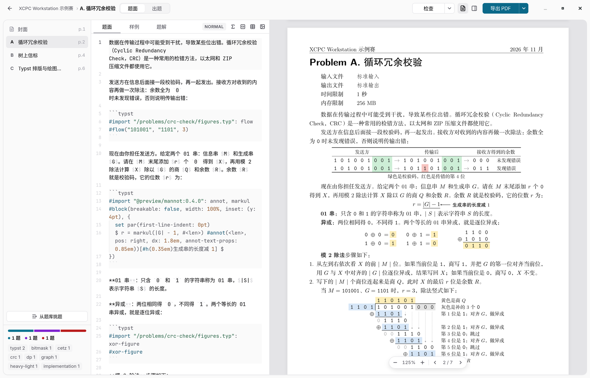

# 出版工作室

出版工作室是 XCPC Workstation 的核心写作与排版环境：左侧为题目大纲与比赛概览，中间为 Markdown / LaTeX / Typst 编辑器，右侧为原生 Typst 引擎驱动的分块增量实时预览。单题编辑与整场比赛编辑共用同一套工作室界面。



## 题面语法与章节识别

题面以单个 Markdown 文件（`statement.md`，或双语 `statement.zh.md` / `statement.en.md`）作为单一事实源，支持 GFM 表格与列表、LaTeX 数学公式以及原生 Typst 原始块。

### 按二级标题自动识别章节

第一个二级标题（`##`）之前的内容自动作为**题目描述**；之后的二级标题按中英文关键词自动映射为模板对应的标准章节样式（去掉末尾冒号，英文不区分大小写）：

| 标准章节 | 识别的二级标题写法 |
| :--- | :--- |
| 题目描述（无标题） | `题目描述`、`Description`（标题本身会被隐藏，直接输出正文） |
| 输入格式 | `输入`、`输入格式`、`Input` |
| 输出格式 | `输出`、`输出格式`、`Output` |
| 交互协议 | `交互`、`交互协议`、`交互方式`、`Interaction` |
| 样例位置锚点 | `样例`、`Examples`（用于手动指定样例表插入位置） |
| 样例解释 | `样例解释`、`样例说明`、`Explanation` |
| 提示 / 备注 | `提示`、`说明`、`备注`、`Note`、`Notes`、`Hint` |
| 数据范围 / 约束 | `约束`、`数据范围`、`Constraints` |
| 评分标准 | `评分`、`Scoring` |
| 题目背景 | `背景`、`题目背景`、`Background` |
| 题目要求 | `题目要求`、`Specification` |
| 图表说明 | `图表说明`、`Illustration` |
| 子任务 | `子任务`、`Subtasks` |

未在列表中的二级标题按普通小节原样排版；三级及更深标题输出为加粗段落。

### 数学公式与原生 Typst 块

- **LaTeX 数学公式**：使用 `$...$` 编写行内公式、使用 `$$...$$` 编写行间公式，由内置 MiTeX 引擎实时转换为 Typst 数学排版。中文模式下 `\le` / `\ge` 会自动渲染为斜底等号 `⩽` / `⩾`；`\left...\right` 会转换为 Typst 的自适应伸缩括号。
- **原生 Typst 原始块**：当需要绘制矢量图（如内置离线包的 `cetz`）、复杂排版或标注（`pinit` / `mannot`）时，可直接在 Markdown 中插入 ```` ```typst ```` 代码块，转换管线会将其原样透传给 Typst 引擎渲染。

### 配图与宽度控制

配图必须位于当前题目目录内（推荐统一存放在 `assets/` 目录下以配合素材库管理；禁止越出题目目录、使用绝对路径或外链 URL），支持在图片语法后附加 `{width=NN%}`（范围 `10%`–`100%`，支持小数）以按版心宽度居中排版：

```markdown
{width=60%}
```

不带 `{width=...}` 属性时按行内图片排版。

## `/` 斜杠命令与悬浮公式预览

### `/` 斜杠命令菜单

在行首或空白字符后输入 `/` 即可在光标下方呼出斜杠命令浮层，支持中英文关键词与拼音首字母前缀过滤：

- **基础区（单行 6 项）**：`H2` 二级标题、`H3` 三级标题、无序列表、有序列表、引用块、行内公式（`$...$`）。
- **常用区**：行间公式块（`$$...$$`）、插入图片（联动素材库）、Markdown 表格、C++ 代码块。
- **题面与进阶区**：分段函数（`\begin{cases}`）、矩阵（`\begin{bmatrix}`）、OI 子任务评分表、`## 提示` 章节、`## 交互方式` 章节、```` ```typst ```` 原始块。

插入自然语言模板（表格、子任务、提示、交互）时，菜单会自动匹配当前题目的出版语言（中文或英文）。

### 悬浮公式预览

将光标移入行内 `$...$` 或行间 `$$...$$` 数学公式内时，编辑器上方会即时浮现迷你公式预览卡片，无需视线频繁在编辑器与整页 PDF 预览之间来回跳转，即可确认公式语法与渲染效果。

## 样例管理与素材库

### 样例分栏与 `samples/` 管理

样例**只保存在题目的 `samples/` 目录中**（`01.in` / `01.ans`、`02.in` / `02.ans`……），不写进题面 Markdown 正文，出版时由模板自动渲染为样例表：

- 在工作室切换至样例面板，可通过左右分栏直接编辑每组样例的输入与输出，支持新增、删除与拖拽调整顺序。
- 样例表默认插在「输入 / 输出 / 交互」之后、下一个其他章节之前；如需调整位置，在题面中写一个 `## 样例`（或 `## Examples`）标题即可将该处作为插入点，标题下方的文字将紧接在样例表之后。
- 如果同时使用 [题目构建与导出](../problem-build/index.md)，`samples/` 中的样例会自动作为前序测试点纳入验证与校验。

### 轻量素材库

点击编辑器工具栏或通过 `/image` 斜杠命令可打开题目素材库，集中管理 `problems/<slug>/assets/` 下的配图文件：支持从本机导入图片、网格缩略图与灯箱大图预览、查看像素尺寸与文件大小、定位题面/题解中的引用行、安全重命名（同步更新 Markdown 引用）、批量清理未引用素材，以及一键插入 Markdown 引用或为已引用图片快捷切换宽度预设（`50%` / `75%` / `100%`）。

## 专注模式、实用子集 Vim 与双语写作

- **专注写作模式**：可一键收起左侧大纲与右侧实时预览，仅保留居中排版（最大宽度 760px）的纯编辑区并启用打字机居中滚动，减少长篇题面与题解写作时的视觉干扰；非专注模式下也可单独折叠右侧预览面板。
- **实用子集 Vim 模式**：在 **「设置 → 外观 → 编辑器排版」** 中可开启内置 Vim 模式，支持 `Normal` / `Insert` / `Visual` / `Visual-Line` 四种模式，覆盖常用移动（`hjkl`、`w/b/e`、`0/$`、`gg/G`）、编辑（`i/a/I/A/o/O`、`x`、`dd/yy/p/P`、`u`、`Ctrl+r`）、可视操作（`v/V` 配合 `d/y/c`）以及内部文本对象（`ci`/`di`/`yi` 配合 `w`、`$`、`(`、`)`、`"`、`'`、`` ` ``），同时保留 `Ctrl+*` / `Alt+*` 应用快捷键不受影响（Normal 模式下 `Ctrl+r` 用于重做）。
- **双语写作**：同一道题可在目录中并存 `statement.zh.md` 与 `statement.en.md`（或仅使用单文件 `statement.md`），共用同一套 `samples/`、时限内存与 `assets/`。在比赛中通过右侧属性面板（或 `contest.toml` 的 `language` 字段）切换比赛语言，或在 CLI 构建单题时指定 `--language`，系统会自动读取对应语言文件并切换模板关键词与限值文案。

## 实时排版诊断与印刷前预检

编辑过程中，工作室会在后台实时运行 `xcpc-lint` 预检与 Typst 编译检查，结果汇总显示在预览区底部的悬浮 HUD 胶囊中（无问题时保持静默，仅在发现异常时显示徽章）：

- **结构与资源预检（`xcpc-lint`）**：检测引用缺失的题目或配图（含外部 URL 或越界路径）、缺失模板文件、未配对或不从 `01` 连续编号的样例文件、缺少输入/输出章节（交互题缺少交互章节、声明 `[[subtask]]` 却缺少子任务章节）、以及导出题解或定稿比赛时缺失 `editorial.md` 等结构性缺陷。
- **编译与版面溢出预检**：检测 LaTeX 公式转换错误、Typst 模板或原生块编译错误/警告，以及正文、公式、图形或图片超出页面版心左右及底部边界的溢出警告。

点击诊断列表中的任意一项，可直接定位到对应的 Markdown 源文件行号或预览页码。
