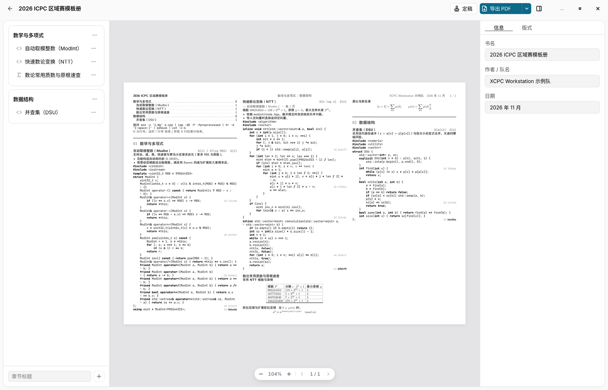

# 算法模板与参考手册

XCPC Workstation 将算法模板库与团队参考手册（TRD，Team Reference Document）纳入同一套开放目录工作区：算法源码既是可直接 `#include` 编译与自动验证的真实 C++ 头文件，也是团队参考手册排版的唯一事实源，彻底消除「赛前手工复制粘贴、改了代码忘改手册」的维护割裂。



## 开放目录布局

算法模板与团队参考手册分别存放在工作区根目录的 `snippets/` 与 `trds/` 下，全部为纯文本文件，便于 Git / jj 版本控制与多人协作：

```text
<workspace>/
├── workspace.toml                  # 可通过 snippets = false 关闭模板模块（默认开启）
├── snippets/                       # 算法模板库（每个条目一个独立目录）
│   ├── modint/
│   │   ├── snippet.toml            # 标题、标签、复杂度、[[verify]] 声明
│   │   ├── code.hpp                # C++ 模板头文件（纯公式卡片可省略）
│   │   ├── notes.md                # 算法说明、公式推导与注意事项
│   │   └── test.cpp                # 自包含单元测试脚本
│   ├── ntt/
│   │   ├── snippet.toml
│   │   ├── code.hpp                # 通过 #include "modint/code.hpp" 声明依赖
│   │   ├── test.cpp
│   │   └── verify_conv.cpp         # Library Checker 或题库适配器
│   └── number-theory-facts/        # 纯公式与结论卡片（无 code.hpp）
│       ├── snippet.toml
│       └── notes.md
├── trds/                           # 团队参考手册（活引用 snippets/）
│   └── icpc-regional/
│       ├── trd.toml                # 手册元数据、模板选择、[[chapter]] 编排
│       └── snapshot/               # 定稿冻结后生成的只读快照与归档 PDF
└── .xcpc/
    └── snippet-verify/             # 运行时验证缓存（不污染模板源文件）
        ├── modint.json
        └── ntt.json
```

!!! info "状态与内容分离"
    与题库训练状态类似，算法模板的验证结果与状态（`passed` / `stale` / `failed` / `unverified`）**不会**写入 `snippet.toml`，而是存放在 `.xcpc/snippet-verify/<slug>.json` 中，并在运行时结合当前文件与全部上游依赖的内容哈希实时派生。

## 桌面端「模板」空间工作流

桌面端在顶栏提供独立的 **「模板」** 工作空间（含「算法库」与「模板册」视图，可在详情侧栏查看条目的依赖关系、反向引用与验证状态），并将日常维护与赛前编排划分为两个专注的工作台：

- **模板工作台（SnippetStudio）**：
  - 统一编辑 `code.hpp` 与 `notes.md`，在「验板」标签页查看验证结果，并可通过右侧信息抽屉维护元数据与 `[[verify]]` 验证声明。
  - 右侧内置毫秒级 Typst 单条目预览，所见即所得地查看排版效果与 KACTL++ 逐行累计校验短哈希。
  - 一键触发单条目验证、级联回归验证，或展开为可直接提交 OJ 的单文件 C++ 代码并复制到剪贴板。
- **手册工作台（TrdStudio）**：
  - 以活引用方式编排 `[[chapter]]` 章节与条目顺序，随时切换 `trd-compact`（横版紧凑多栏）或 `trd-book`（竖版讲义复习册）模板并调整栏数、字号、哈希间隔与注释剥离等选项。
  - 提供印刷前预检（缺失依赖、依赖环、未验证/过期条目）与一键定稿冻结功能，将确定版本的源码与 PDF 锁定至 `snapshot/`。

!!! tip "快速体验内置示例"
    使用 `xcpc init --example` 初始化示例工作区时，会自动创建包含 `modint`、`ntt`（依赖 `modint`）、`dsu` 与纯公式卡片 `number-theory-facts` 的算法模板库，以及一份示例团队参考手册 `icpc-regional`。

## 深入阅读

- [算法模板与单文件展开](./snippets.md)：`snippet.toml` 规范、纯公式卡片、依赖 DAG、`xcpc bundle` 单文件展开器与 KACTL++ 累计短哈希原理。
- [三源自动验证](./verification.md)：`self` 自测、工作区 `problem` 题库验证与 `library_checker` 在线/离线验证，以及级联回归与状态流转。
- [团队参考手册（TRD）](./trd.md)：`trd.toml` 章节编排、`trd-compact` 与 `trd-book` 排版模板、印刷预检与可逆定稿冻结。
