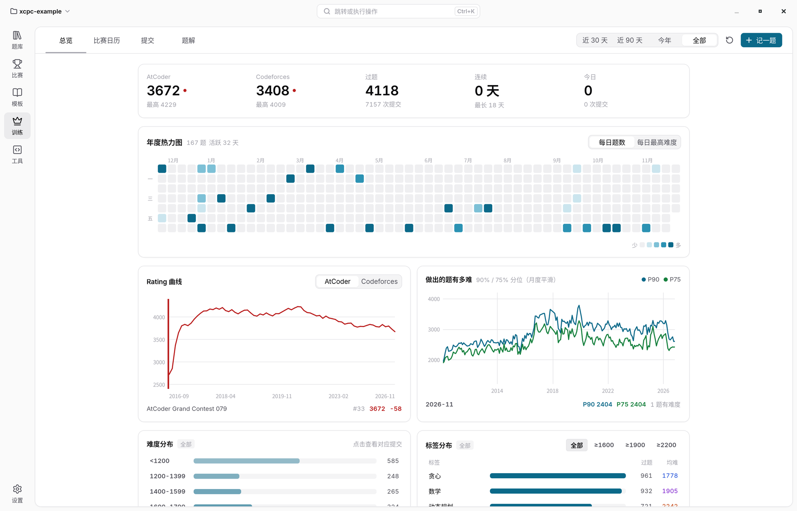

# 数据视图与手动记录

在桌面端切换至「训练」空间后，顶部工具栏提供**总览**、**比赛日历**、**提交**、**题解**四个子视图，以及「同步」与「记一题」快捷操作；所有核心指标与记录能力也均通过 `xcpc training` CLI 和 MCP 工具完整暴露。



---

## 四大子视图

### 1. 总览（Overview）

总览页顶部提供全局时间窗切换（**近 30 天 `30d`**、**近 90 天 `90d`**、**今年 `year`**、**全部 `all`**），下方由四组数据卡片构成：

- **统一指标带（KPI Band）**：
  - 各已配置 OJ 平台的当前 Rating（附带分段色点与历史最高 Rating，无 Rating 平台显示过题数与提交数）；
  - 当前时间窗内的**过题数（Solved）**与提交总数；
  - **连续打卡天数（Streak）**与历史最长连续天数；
  - **今日过题数（Today）**与今日提交数。
- **滚动 12 月双模式热力图**：
  - 固定展示截至今日的近 52–53 周活跃网格（自动跨年拼接）；
  - 支持在**「每日题数」**（每日去重 AC 题数）与**「每日最高难度」**（当日通过题目的最高统一 Rating）两种着色模式之间切换；悬停或点击任意日期可查看当日详情。
- **Rating 走势与难度突破曲线**：
  - **Rating 走势图**：按平台绘制历次比赛后的 Rating 变化曲线，展示单场排名与增减幅度；
  - **难度突破趋势（P75 / P90）**：按周/月统计通过题目的有效难度分位数（P75 与 P90，结合平滑曲线呈现），用于衡量实际解题上限的提升，避免被大量低难度水题拉低均值。
- **难度分桶与标签分布（支持下钻）**：
  - 左侧按统一 Rating 区间展示过题分桶柱状图；
  - 右侧按算法标签统计过题数与平均难度，支持设置最低难度阈值（全部 / `≥ 1600` / `≥ 1900` / `≥ 2200`）；
  - **点击任意难度柱或标签行**，都会直接携带对应筛选条件下钻跳转至「提交」视图。

### 2. 比赛日历（Contests）

聚合所有已启用 `oj_source` 插件同步到的赛程，按本地时间自动分组为**今天**、**本周**、**以后**（开启「显示已结束」开关后追加**已结束**分组）：

- 进行中的比赛实时显示剩余时间，未开始比赛显示倒计时与开赛时间；
- 存在多个平台时自动显示平台筛选条；
- 点击整行可直接在系统默认浏览器中打开对应比赛页面。

### 3. 提交检索与一键收入题库（Submissions）

集中检索 `oj_sync.db` 中的外部提交与本地记录，支持三种查看模式与多维组合筛选：

- **三种模式**：
  - **按提交（Raw）**：按提交时间倒序查看全部提交明细；
  - **按题目去重（By Problem）**：按 `(platform, problem_key)` 聚合，显示最新状态、总尝试次数与是否已通过；
  - **仅未过题（Unsolved Only）**：自动按题去重并筛选出尝试过但尚未 AC 的题目，便于集中补题。
- **筛选维度**：自由文本搜索（题号、标题、比赛 ID）、平台筛选、评测结果（`AC`、`WA`、`TLE` 及展开项 `MLE`、`RE`、`CE`）、难度预设区间（`<1200`、`1200–1599`、`1600–1999`、`2000–2399`、`2400+`）以及从总览页下钻带入的标签筛选。
- **一键收入题库**：悬停任意未入库的外部题目即可点击收入当前工作区题库。Core 会按 `[[source]]` 自动去重，从 `oj_sync.db` 补全标题、统一 Rating 与标签，并支持在提示条中一键跳转到出版工作室的「题解」标签页开始记录思路；已在题库中的题目会直接显示「已在题库」与「打开」入口。

### 4. 题解聚合（Editorials）

左右分栏展示当前工作区所有包含非空 `editorial.md` 的题目，方便赛前复盘与专题复习：

- **左侧列表**：支持按关键词（题目 ID、标题、标签、题解摘要）、算法标签和难度区间筛选；
- **右侧预览**：选中条目后即时渲染该题目的 Typst 题解预览（`book = "editorial"`），点击编辑按钮可直接跳转至出版工作室修改 `editorial.md`。

---

## 手动记录与 `training/logs.jsonl`

对于非同步平台（如校内 OJ、洛谷、线下模拟赛、纸面推导）或需要手动标注补题状态（如将外部 AC 标记为 `upsolved`、将题库题目加入 `todo`）的场景，可以通过桌面端右上角**「记一题」**弹窗或 CLI 追加记录到工作区的 `training/logs.jsonl` 中。

在桌面端「记一题」弹窗中，支持三种录入方式：

1. **关联已有题库题目**：输入关键词实时检索当前工作区题目并打卡状态；
2. **粘贴外部题目链接**：自动调用已启用插件离线解析平台与题号，并从 `oj_sync.db` 补全元信息；
3. **自由填写独立记录**：直接填写标题、可选难度 Rating、标签、日期与简短备注，无需先在题库建题；若选择**「保存并写题解」**，会自动在题库中创建或关联题目并打开题解编辑器。

---

## `xcpc training` 命令行用法

`xcpc training` 提供 6 个子命令，均支持全局 `--json` 参数输出结构化 JSON，便于脚本统计或外部集成。

### `xcpc training status` — 修改工作区题目的训练状态

为当前工作区已有题目追加一条状态变更记录到 `training/logs.jsonl`，并输出合并外部同步后的最新派生状态。

```bash
# 标记题库中的题目为已补题 / 待做 / 已尝试 / 通过
xcpc training status cf-1999a upsolved
xcpc training status tree-dp todo

# 清除该题目的手动状态覆盖（恢复为纯外部同步状态或 none）
xcpc training status cf-1999a clear
```

可选状态值：`todo`、`attempted`、`ac`、`upsolved`、`clear`。

### `xcpc training log` — 记录手动训练条目

支持为工作区题目打卡，或记录一条独立的外站/线下训练条目；支持 `--create-in-library` 同步收入题库。

```bash
# 记录一条独立的外站/线下刷题条目
xcpc training log \
  --title "P3805 manacher" \
  --platform luogu \
  --rating 1800 \
  --tags string,manacher \
  --status ac \
  --note "注意边界哨兵字符"

# 通过外站链接记录并同步收入当前工作区题库
xcpc training log \
  --url "https://codeforces.com/problemset/problem/1999/A" \
  --status upsolved \
  --create-in-library

# 为工作区已有题目指定历史时间打卡（RFC 3339）
xcpc training log --problem cf-1999a --status ac --at "2026-11-20T14:30:00Z"
```

常用选项：

| 选项 | 说明 |
| :--- | :--- |
| `--problem <ID>` | 关联工作区已有题目 ID（独立记录时省略） |
| `--title <TITLE>` | 题目标题（独立记录必填，除非可从 `--url` 或 `--problem` 解析） |
| `--status <STATUS>` | 训练状态：`ac`（默认）、`upsolved`、`attempted`、`todo`、`clear` |
| `--rating <INT>` | 统一难度 Rating |
| `--tags <T1,T2>` | 逗号分隔的标签列表 |
| `--platform <NAME>` | 平台标识（如 `codeforces`、`luogu`、`local`） |
| `--url <URL>` | 外部题目链接（已启用插件可识别时自动离线解析） |
| `--at <RFC3339>` | 记录时间戳（默认当前 UTC 时间） |
| `--note <TEXT>` | 简短备注 |
| `--create-in-library` | 同时在工作区题库中创建或关联对应题目 |

### `xcpc training dashboard` — 查看训练看板指标

输出各平台账号概况、KPI、连续打卡、热力图数据、Rating 曲线、难度突破趋势（P75/P90）、难度分桶与标签分布。

```bash
# 默认查看全量时间窗
xcpc training dashboard

# 查看近 90 天指标，并仅统计 Rating >= 1900 的标签分布（JSON 输出）
xcpc training dashboard --window 90d --min-rating 1900 --json

# 指定热力图统计年份
xcpc training dashboard --year 2026
```

- `--window <30d|90d|year|all>`：统计时间窗（默认 `all`）。
- `--year <YYYY>`：热力图自然年（默认当年）。
- `--min-rating <INT>`：标签分布的最低统一 Rating 过滤阈值。

### `xcpc training contests` — 查询比赛日历

```bash
# 查看近期与进行中的全部平台比赛
xcpc training contests

# 仅查看 AtCoder 比赛并包含已结束赛程
xcpc training contests --platform atcoder --all
```

### `xcpc training submissions` — 检索提交记录

```bash
# 按题去重，仅列出未通过的 Codeforces 1600–2100 分题目
xcpc training submissions \
  --by-problem \
  --unsolved \
  --platform codeforces \
  --min-rating 1600 \
  --max-rating 2100

# 按标签、结果与关键词检索，支持分页
xcpc training submissions --tag dp --verdict AC --search "tree" --limit 50 --offset 0 --json
```

常用选项：`--by-problem`、`--unsolved`、`--platform <ID>`、`--verdict <V>`、`--min-rating <INT>`、`--max-rating <INT>`、`--tag <TAG>`、`--search <TEXT>`、`--limit <N>`（默认 `100`）、`--offset <N>`（默认 `0`）。

### `xcpc training editorials` — 检索工作区题解

列出当前工作区中所有包含非空 `editorial.md` 的题目及其摘要：

```bash
# 检索带有 dp 标签且难度 >= 1800 的题解
xcpc training editorials --tag dp --min-rating 1800

# 按关键词检索（匹配题目 ID、标题、标签与题解摘要）
xcpc training editorials --search "斜率优化" --max-rating 2400 --json
```
